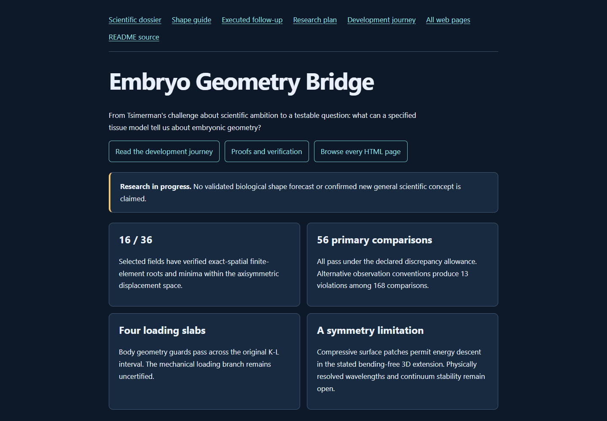
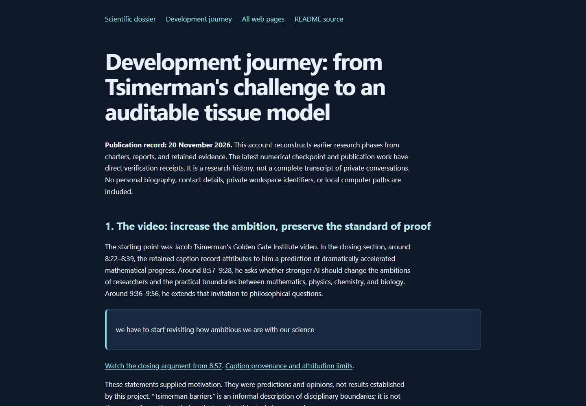

# Embryo Geometry Bridge

**A study of what tissue mechanics can—and cannot—predict about embryonic shape. The research remains incomplete. No confirmed new general scientific concept or validated biological shape forecast is claimed.**

[Open the live scientific dossier](https://az9713.github.io/embryo-geometry-bridge/docs/index.html) · [Latest illustrated proof checkpoint](https://az9713.github.io/embryo-geometry-bridge/controlled_furrowing/runs/transfer_ambiguity_nonlinear_probe_v1/certification_design/exact_targets_v1/remaining32_bridge_v1/remaining28_preparation_v1/waves/wave_03/checkpoint_v1/REPORT.html)

Tsimerman's remarks about the boundaries between scientific disciplines motivated this research program. The current controlled-furrowing study asks whether small-region measurements determine larger-region shape in a specified finite-height epithelial model. Connecting chemistry, mechanics and geometry requires defensible inputs and observable predictions; numerical precision alone does not establish that connection.

## Shape description and next research step

[**What the results mean for embryonic shape, their originality, and the strongest next theorem**](https://az9713.github.io/embryo-geometry-bridge/docs/RESULTS-AND-NEXT-THEOREM.html): the new law changes force balance, but no fold-depth change has been established. Fine folds can change area without a comparable position change. The next target is a certified coarse-observable bound, or an admissible counterexample, with calibration rechecked under the new mechanics. Includes a bounded primary-source audit and a conditional energy-exclusion proof; no confirmed new general concept is claimed.

**Executed follow-up:** [results and retained verification](https://az9713.github.io/embryo-geometry-bridge/controlled_furrowing/research_directions/relaxed_slab_execution_v1/REPORT.html) and [the full finite-slab proof](https://az9713.github.io/embryo-geometry-bridge/controlled_furrowing/research_directions/relaxed_slab_execution_v1/THEOREM.html) complete the first three scoped steps. Pillow 13 passes saved-pixel and runtime checks. Two K/L **small-patch calibration fields** are not stationary under the candidate relaxed surface density. A constructive affine-periodic slab result proves global injectivity, positive determinant and a cube-root recovery upper bound. This does not determine a new equilibrium shape, prove the rate optimal, establish the full cylinder limit or validate embryonic predictions. [Active runtime](RUNTIME.md) · [release provenance](docs/EXECUTION-UPDATE-20261121.md).

[The illustrated shape guide](https://az9713.github.io/embryo-geometry-bridge/docs/SHAPE-DESCRIPTION.html) explains how deformation maps produce folds, areas and curvatures. Its explicit circular and asymmetric teaching maps have the same annular height contrast, showing why a single observable does not determine the full shape. The figures are analytic illustrations, not experimental fits or force-balanced model predictions. The guide also states which symmetries, topologies, contact events and cellular processes the current formulation excludes. [Guide evidence](docs/SHAPE-DESCRIPTION-RECEIPT.json).

[The research plan](https://az9713.github.io/embryo-geometry-bridge/controlled_furrowing/research_directions/regularization_shape_v1/PLAN.html) prioritizes rigorous fixed-height bulk-boundary relaxation and a quantitative bound on a coarse fold observable. Its historical proposal now links the executed steps and corrects the former large-region label for the K/L scan. **The full curved-cylinder theorem and useful observable-growth bound remain unproved; originality is unconfirmed.** Classical tension-field relaxation, bending regularization and prediction-focused inference are prior art. [Bounded originality audit](controlled_furrowing/research_directions/regularization_shape_v1/LITERATURE-AUDIT.json) · [Plan evidence and scope](controlled_furrowing/research_directions/regularization_shape_v1/EVIDENCE.json).

Future scientific shape documents must explain their representation or prominently refer to the guide. See [project documentation instructions](AGENTS.md). [Publication provenance and replay limits](docs/PUBLICATION-UPDATE-20261121.md).

<!-- live-pages:start -->
[**Executed results and verification**](https://az9713.github.io/embryo-geometry-bridge/controlled_furrowing/research_directions/relaxed_slab_execution_v1/REPORT.html) · [**Full finite-slab proof**](https://az9713.github.io/embryo-geometry-bridge/controlled_furrowing/research_directions/relaxed_slab_execution_v1/THEOREM.html)

[**Shape guide, concrete examples and limitations**](https://az9713.github.io/embryo-geometry-bridge/docs/SHAPE-DESCRIPTION.html) · [**Research plan and scope correction**](https://az9713.github.io/embryo-geometry-bridge/controlled_furrowing/research_directions/regularization_shape_v1/PLAN.html)

[**Development journey: beginning with Tsimerman's video**](https://az9713.github.io/embryo-geometry-bridge/docs/DEVELOPMENT-JOURNEY.html) · [**Every HTML page**](https://az9713.github.io/embryo-geometry-bridge/docs/ALL-PAGES.html)

GitHub displays clickable image previews here. Follow them to the fully rendered GitHub Pages documents.

Direct webpage links to all 128 HTML files

- [ACTIVATED-MESH-STUDY](https://az9713.github.io/embryo-geometry-bridge/controlled_furrowing/docs/ACTIVATED-MESH-STUDY.html)
- [ACTIVATED-QUADRATURE](https://az9713.github.io/embryo-geometry-bridge/controlled_furrowing/docs/ACTIVATED-QUADRATURE.html)
- [ACTUAL-M-CELL-EXCLUSION](https://az9713.github.io/embryo-geometry-bridge/controlled_furrowing/docs/ACTUAL-M-CELL-EXCLUSION.html)
- [ALGEBRAIC-ROOT-CERTIFICATION-PATH](https://az9713.github.io/embryo-geometry-bridge/controlled_furrowing/docs/ALGEBRAIC-ROOT-CERTIFICATION-PATH.html)
- [ALGEBRAIC-ROOT-INDEPENDENT-REVIEW](https://az9713.github.io/embryo-geometry-bridge/controlled_furrowing/docs/ALGEBRAIC-ROOT-INDEPENDENT-REVIEW.html)
- [ALGEBRAIC-ROOT-OBSERVER-ERROR](https://az9713.github.io/embryo-geometry-bridge/controlled_furrowing/docs/ALGEBRAIC-ROOT-OBSERVER-ERROR.html)
- [ANNULUS-OBSERVER](https://az9713.github.io/embryo-geometry-bridge/controlled_furrowing/docs/ANNULUS-OBSERVER.html)
- [AXISYMMETRIC-MODEL](https://az9713.github.io/embryo-geometry-bridge/controlled_furrowing/docs/AXISYMMETRIC-MODEL.html)
- [BASELINE-TENSION](https://az9713.github.io/embryo-geometry-bridge/controlled_furrowing/docs/BASELINE-TENSION.html)
- [BOUNDED-AFFINE-MINIMAX-REVIEW](https://az9713.github.io/embryo-geometry-bridge/controlled_furrowing/docs/BOUNDED-AFFINE-MINIMAX-REVIEW.html)
- [BOUNDED-AFFINE-MINIMAX](https://az9713.github.io/embryo-geometry-bridge/controlled_furrowing/docs/BOUNDED-AFFINE-MINIMAX.html)
- [CALIBRATION-EXCEPTION-REVIEW](https://az9713.github.io/embryo-geometry-bridge/controlled_furrowing/docs/CALIBRATION-EXCEPTION-REVIEW.html)
- [CALIBRATION-UNCERTAINTY](https://az9713.github.io/embryo-geometry-bridge/controlled_furrowing/docs/CALIBRATION-UNCERTAINTY.html)
- [COHORT-BOUND-DIAGNOSTICS](https://az9713.github.io/embryo-geometry-bridge/controlled_furrowing/docs/COHORT-BOUND-DIAGNOSTICS.html)
- [COHORT-ENERGY-STABILITY](https://az9713.github.io/embryo-geometry-bridge/controlled_furrowing/docs/COHORT-ENERGY-STABILITY.html)
- [COHORT-INFERENCE-CHECKPOINT](https://az9713.github.io/embryo-geometry-bridge/controlled_furrowing/docs/COHORT-INFERENCE-CHECKPOINT.html)
- [COHORT-INTEGRATION-L](https://az9713.github.io/embryo-geometry-bridge/controlled_furrowing/docs/COHORT-INTEGRATION-L.html)
- [COHORT-RECENTERED-ROOTS-REVIEW](https://az9713.github.io/embryo-geometry-bridge/controlled_furrowing/docs/COHORT-RECENTERED-ROOTS-REVIEW.html)
- [COHORT-STATIC-APPLICATION-REVIEW](https://az9713.github.io/embryo-geometry-bridge/controlled_furrowing/docs/COHORT-STATIC-APPLICATION-REVIEW.html)
- [COHORT-STATIC-OBSERVERS](https://az9713.github.io/embryo-geometry-bridge/controlled_furrowing/docs/COHORT-STATIC-OBSERVERS.html)
- [COHORT-UNIFORM-ROOTS-REVIEW](https://az9713.github.io/embryo-geometry-bridge/controlled_furrowing/docs/COHORT-UNIFORM-ROOTS-REVIEW.html)
- [COHORT-UNIFORM-ROOTS](https://az9713.github.io/embryo-geometry-bridge/controlled_furrowing/docs/COHORT-UNIFORM-ROOTS.html)
- [COMPLETION-AUDIT](https://az9713.github.io/embryo-geometry-bridge/controlled_furrowing/docs/COMPLETION-AUDIT.html)
- [CURRENT-FIVE-GATE-AUDIT-REVIEW](https://az9713.github.io/embryo-geometry-bridge/controlled_furrowing/docs/CURRENT-FIVE-GATE-AUDIT-REVIEW.html)
- [CURRENT-FIVE-GATE-AUDIT](https://az9713.github.io/embryo-geometry-bridge/controlled_furrowing/docs/CURRENT-FIVE-GATE-AUDIT.html)
- [DATA](https://az9713.github.io/embryo-geometry-bridge/controlled_furrowing/docs/DATA.html)
- [DISCRETE-GEOMETRY-CERTIFICATE](https://az9713.github.io/embryo-geometry-bridge/controlled_furrowing/docs/DISCRETE-GEOMETRY-CERTIFICATE.html)
- [ENDPOINT-MESH-FUNCTIONALS](https://az9713.github.io/embryo-geometry-bridge/controlled_furrowing/docs/ENDPOINT-MESH-FUNCTIONALS.html)
- [ENDPOINT-OBSERVER-INDEPENDENT-REVIEW](https://az9713.github.io/embryo-geometry-bridge/controlled_furrowing/docs/ENDPOINT-OBSERVER-INDEPENDENT-REVIEW.html)
- [ENERGY-GAIN-CELL-REVIEW](https://az9713.github.io/embryo-geometry-bridge/controlled_furrowing/docs/ENERGY-GAIN-CELL-REVIEW.html)
- [ENERGY-GAIN-CELL](https://az9713.github.io/embryo-geometry-bridge/controlled_furrowing/docs/ENERGY-GAIN-CELL.html)
- [ENERGY-GAIN-GEOMETRY-REVIEW](https://az9713.github.io/embryo-geometry-bridge/controlled_furrowing/docs/ENERGY-GAIN-GEOMETRY-REVIEW.html)
- [ENERGY-GAIN-GEOMETRY](https://az9713.github.io/embryo-geometry-bridge/controlled_furrowing/docs/ENERGY-GAIN-GEOMETRY.html)
- [EXACT-INTEGRAL-ROOT](https://az9713.github.io/embryo-geometry-bridge/controlled_furrowing/docs/EXACT-INTEGRAL-ROOT.html)
- [EXACT-INTEGRATION-BRIDGE](https://az9713.github.io/embryo-geometry-bridge/controlled_furrowing/docs/EXACT-INTEGRATION-BRIDGE.html)
- [GAIN-SURROGATE-REVIEW](https://az9713.github.io/embryo-geometry-bridge/controlled_furrowing/docs/GAIN-SURROGATE-REVIEW.html)
- [GAIN-SURROGATE-V2-REVIEW](https://az9713.github.io/embryo-geometry-bridge/controlled_furrowing/docs/GAIN-SURROGATE-V2-REVIEW.html)
- [Current controlled-furrowing report](https://az9713.github.io/embryo-geometry-bridge/controlled_furrowing/docs/index.html)
- [JOINT-CALIBRATION-CONSTRAINTS](https://az9713.github.io/embryo-geometry-bridge/controlled_furrowing/docs/JOINT-CALIBRATION-CONSTRAINTS.html)
- [JOINT-CONSTRAINT-REVIEW](https://az9713.github.io/embryo-geometry-bridge/controlled_furrowing/docs/JOINT-CONSTRAINT-REVIEW.html)
- [JOINT-DIRECT-REVIEW](https://az9713.github.io/embryo-geometry-bridge/controlled_furrowing/docs/JOINT-DIRECT-REVIEW.html)
- [JOINT-GAIN-CALIBRATION](https://az9713.github.io/embryo-geometry-bridge/controlled_furrowing/docs/JOINT-GAIN-CALIBRATION.html)
- [JOINT-INFERENCE-PROGRESS](https://az9713.github.io/embryo-geometry-bridge/controlled_furrowing/docs/JOINT-INFERENCE-PROGRESS.html)
- [JOINT-OBSERVATION-CONTRACT](https://az9713.github.io/embryo-geometry-bridge/controlled_furrowing/docs/JOINT-OBSERVATION-CONTRACT.html)
- [JOINT-REFINEMENT](https://az9713.github.io/embryo-geometry-bridge/controlled_furrowing/docs/JOINT-REFINEMENT.html)
- [The exact-integral root for L](https://az9713.github.io/embryo-geometry-bridge/controlled_furrowing/docs/L-CENTERED-ROOT.html)
- [LOCAL-INFERENCE](https://az9713.github.io/embryo-geometry-bridge/controlled_furrowing/docs/LOCAL-INFERENCE.html)
- [MATERIAL-COHORT-DESCENT-REVIEW](https://az9713.github.io/embryo-geometry-bridge/controlled_furrowing/docs/MATERIAL-COHORT-DESCENT-REVIEW.html)
- [MATERIAL-COHORT-DESCENT](https://az9713.github.io/embryo-geometry-bridge/controlled_furrowing/docs/MATERIAL-COHORT-DESCENT.html)
- [MATERIAL-COHORT-DIRECT-REVIEW](https://az9713.github.io/embryo-geometry-bridge/controlled_furrowing/docs/MATERIAL-COHORT-DIRECT-REVIEW.html)
- [MATERIAL-COHORT-DIRECT](https://az9713.github.io/embryo-geometry-bridge/controlled_furrowing/docs/MATERIAL-COHORT-DIRECT.html)
- [MATERIAL-INPUTS](https://az9713.github.io/embryo-geometry-bridge/controlled_furrowing/docs/MATERIAL-INPUTS.html)
- [MATERIAL-TANGENT-INFERENCE](https://az9713.github.io/embryo-geometry-bridge/controlled_furrowing/docs/MATERIAL-TANGENT-INFERENCE.html)
- [MATERIAL-TANGENT-REVIEW](https://az9713.github.io/embryo-geometry-bridge/controlled_furrowing/docs/MATERIAL-TANGENT-REVIEW.html)
- [MIXED-GEOMETRY-PROOF](https://az9713.github.io/embryo-geometry-bridge/controlled_furrowing/docs/MIXED-GEOMETRY-PROOF.html)
- [MIXED-MECHANICS](https://az9713.github.io/embryo-geometry-bridge/controlled_furrowing/docs/MIXED-MECHANICS.html)
- [MODEL-CANDIDATES](https://az9713.github.io/embryo-geometry-bridge/controlled_furrowing/docs/MODEL-CANDIDATES.html)
- [MOVIE-GEOMETRY-FEASIBILITY](https://az9713.github.io/embryo-geometry-bridge/controlled_furrowing/docs/MOVIE-GEOMETRY-FEASIBILITY.html)
- [NODAL-OBSERVER-ERROR-REVIEW](https://az9713.github.io/embryo-geometry-bridge/controlled_furrowing/docs/NODAL-OBSERVER-ERROR-REVIEW.html)
- [NODAL-OBSERVER-ERROR-TRANSFER](https://az9713.github.io/embryo-geometry-bridge/controlled_furrowing/docs/NODAL-OBSERVER-ERROR-TRANSFER.html)
- [NUMERICAL-ACCURACY-PATH](https://az9713.github.io/embryo-geometry-bridge/controlled_furrowing/docs/NUMERICAL-ACCURACY-PATH.html)
- [ORIGINALITY](https://az9713.github.io/embryo-geometry-bridge/controlled_furrowing/docs/ORIGINALITY.html)
- [OUTLIER-SENSITIVITY](https://az9713.github.io/embryo-geometry-bridge/controlled_furrowing/docs/OUTLIER-SENSITIVITY.html)
- [PARAMETER-INFERENCE-CHECKPOINT-REVIEW](https://az9713.github.io/embryo-geometry-bridge/controlled_furrowing/docs/PARAMETER-INFERENCE-CHECKPOINT-REVIEW.html)
- [PARAMETER-INFERENCE-CHECKPOINT](https://az9713.github.io/embryo-geometry-bridge/controlled_furrowing/docs/PARAMETER-INFERENCE-CHECKPOINT.html)
- [PARAMETRIC-ACTUAL-M-REVIEW](https://az9713.github.io/embryo-geometry-bridge/controlled_furrowing/docs/PARAMETRIC-ACTUAL-M-REVIEW.html)
- [PARAMETRIC-NORM-FEASIBILITY](https://az9713.github.io/embryo-geometry-bridge/controlled_furrowing/docs/PARAMETRIC-NORM-FEASIBILITY.html)
- [PARAMETRIC-ROOT-CELLS](https://az9713.github.io/embryo-geometry-bridge/controlled_furrowing/docs/PARAMETRIC-ROOT-CELLS.html)
- [PHYSICAL-DOMAIN-REVIEW](https://az9713.github.io/embryo-geometry-bridge/controlled_furrowing/docs/PHYSICAL-DOMAIN-REVIEW.html)
- [PHYSICAL-INFERENCE-READINESS](https://az9713.github.io/embryo-geometry-bridge/controlled_furrowing/docs/PHYSICAL-INFERENCE-READINESS.html)
- [PHYSICAL-PARAMETER-DOMAIN](https://az9713.github.io/embryo-geometry-bridge/controlled_furrowing/docs/PHYSICAL-PARAMETER-DOMAIN.html)
- [PROTOCOL-ERRATA](https://az9713.github.io/embryo-geometry-bridge/controlled_furrowing/docs/PROTOCOL-ERRATA.html)
- [PUBLIC-SUPPLEMENT-AUDIT](https://az9713.github.io/embryo-geometry-bridge/controlled_furrowing/docs/PUBLIC-SUPPLEMENT-AUDIT.html)
- [QUADRATIC-ACCURACY](https://az9713.github.io/embryo-geometry-bridge/controlled_furrowing/docs/QUADRATIC-ACCURACY.html)
- [QUADRATIC-ENDPOINT-OBSERVER](https://az9713.github.io/embryo-geometry-bridge/controlled_furrowing/docs/QUADRATIC-ENDPOINT-OBSERVER.html)
- [QUADRATIC-FITTED-LOAD-READINESS](https://az9713.github.io/embryo-geometry-bridge/controlled_furrowing/docs/QUADRATIC-FITTED-LOAD-READINESS.html)
- [QUADRATIC-INDEPENDENT-REVIEW](https://az9713.github.io/embryo-geometry-bridge/controlled_furrowing/docs/QUADRATIC-INDEPENDENT-REVIEW.html)
- [QUADRATIC-MEAN-DERIVATIVES](https://az9713.github.io/embryo-geometry-bridge/controlled_furrowing/docs/QUADRATIC-MEAN-DERIVATIVES.html)
- [QUADRATIC-SOLVE-POLICY](https://az9713.github.io/embryo-geometry-bridge/controlled_furrowing/docs/QUADRATIC-SOLVE-POLICY.html)
- [RAW-DATA-REQUIREMENTS](https://az9713.github.io/embryo-geometry-bridge/controlled_furrowing/docs/RAW-DATA-REQUIREMENTS.html)
- [READINESS-CHECKPOINT](https://az9713.github.io/embryo-geometry-bridge/controlled_furrowing/docs/READINESS-CHECKPOINT.html)
- [READINESS-CONTRACT-REVIEW](https://az9713.github.io/embryo-geometry-bridge/controlled_furrowing/docs/READINESS-CONTRACT-REVIEW.html)
- [RECENTERED-OBSERVERS-REVIEW](https://az9713.github.io/embryo-geometry-bridge/controlled_furrowing/docs/RECENTERED-OBSERVERS-REVIEW.html)
- [ROOT-BODY-GEOMETRY-REVIEW](https://az9713.github.io/embryo-geometry-bridge/controlled_furrowing/docs/ROOT-BODY-GEOMETRY-REVIEW.html)
- [ROOT-BODY-GEOMETRY](https://az9713.github.io/embryo-geometry-bridge/controlled_furrowing/docs/ROOT-BODY-GEOMETRY.html)
- [ROOT-OBSERVER-APPLICATION-REVIEW](https://az9713.github.io/embryo-geometry-bridge/controlled_furrowing/docs/ROOT-OBSERVER-APPLICATION-REVIEW.html)
- [SAFE-INTEGRATION-REPLAY](https://az9713.github.io/embryo-geometry-bridge/controlled_furrowing/docs/SAFE-INTEGRATION-REPLAY.html)
- [SCALAR-MATH](https://az9713.github.io/embryo-geometry-bridge/controlled_furrowing/docs/SCALAR-MATH.html)
- [SCIENCE-OVERVIEW](https://az9713.github.io/embryo-geometry-bridge/controlled_furrowing/docs/SCIENCE-OVERVIEW.html)
- [SHARED-CELL-COHORT-REVIEW](https://az9713.github.io/embryo-geometry-bridge/controlled_furrowing/docs/SHARED-CELL-COHORT-REVIEW.html)
- [SHARED-CELL-COHORT](https://az9713.github.io/embryo-geometry-bridge/controlled_furrowing/docs/SHARED-CELL-COHORT.html)
- [SLICE-OBSERVER](https://az9713.github.io/embryo-geometry-bridge/controlled_furrowing/docs/SLICE-OBSERVER.html)
- [SPARSE-NEWTON](https://az9713.github.io/embryo-geometry-bridge/controlled_furrowing/docs/SPARSE-NEWTON.html)
- [SPARSE24-GAIN1-REVIEW](https://az9713.github.io/embryo-geometry-bridge/controlled_furrowing/docs/SPARSE24-GAIN1-REVIEW.html)
- [SPATIAL-CALIBRATION](https://az9713.github.io/embryo-geometry-bridge/controlled_furrowing/docs/SPATIAL-CALIBRATION.html)
- [SPATIAL-V1-RESULTS](https://az9713.github.io/embryo-geometry-bridge/controlled_furrowing/docs/SPATIAL-V1-RESULTS.html)
- [SPATIAL-V1-REVIEW](https://az9713.github.io/embryo-geometry-bridge/controlled_furrowing/docs/SPATIAL-V1-REVIEW.html)
- [SPATIAL-VALIDATION-CONTRACT](https://az9713.github.io/embryo-geometry-bridge/controlled_furrowing/docs/SPATIAL-VALIDATION-CONTRACT.html)
- [STATIC-MEAN-COMPATIBILITY](https://az9713.github.io/embryo-geometry-bridge/controlled_furrowing/docs/STATIC-MEAN-COMPATIBILITY.html)
- [STATIC-MEAN-REVIEW](https://az9713.github.io/embryo-geometry-bridge/controlled_furrowing/docs/STATIC-MEAN-REVIEW.html)
- [TEMPORAL-MEAN-REVIEW](https://az9713.github.io/embryo-geometry-bridge/controlled_furrowing/docs/TEMPORAL-MEAN-REVIEW.html)
- [TEMPORAL-MEAN-WITNESS](https://az9713.github.io/embryo-geometry-bridge/controlled_furrowing/docs/TEMPORAL-MEAN-WITNESS.html)
- [TEMPORAL-ORDER-ROBUST-REVIEW](https://az9713.github.io/embryo-geometry-bridge/controlled_furrowing/docs/TEMPORAL-ORDER-ROBUST-REVIEW.html)
- [TEMPORAL-ORDER-ROBUST-WITNESS](https://az9713.github.io/embryo-geometry-bridge/controlled_furrowing/docs/TEMPORAL-ORDER-ROBUST-WITNESS.html)
- [TENSION-CALIBRATION](https://az9713.github.io/embryo-geometry-bridge/controlled_furrowing/docs/TENSION-CALIBRATION.html)
- [TRANSFER-CLAIM-AUDIT](https://az9713.github.io/embryo-geometry-bridge/controlled_furrowing/docs/TRANSFER-CLAIM-AUDIT.html)
- [TRANSFER-PAIR-PILOT](https://az9713.github.io/embryo-geometry-bridge/controlled_furrowing/docs/TRANSFER-PAIR-PILOT.html)
- [VALIDATED-IDENTIFIED-SET-REVIEW](https://az9713.github.io/embryo-geometry-bridge/controlled_furrowing/docs/VALIDATED-IDENTIFIED-SET-REVIEW.html)
- [VALIDATED-IDENTIFIED-SET](https://az9713.github.io/embryo-geometry-bridge/controlled_furrowing/docs/VALIDATED-IDENTIFIED-SET.html)
- [Next theorem target: coarse shape beyond unresolved wrinkles](https://az9713.github.io/embryo-geometry-bridge/controlled_furrowing/research_directions/regularization_shape_v1/PLAN.html)
- [Relaxed force balance and finite-height surface recovery](https://az9713.github.io/embryo-geometry-bridge/controlled_furrowing/research_directions/relaxed_slab_execution_v1/REPORT.html)
- [Constructive fixed-height periodic slab theorem](https://az9713.github.io/embryo-geometry-bridge/controlled_furrowing/research_directions/relaxed_slab_execution_v1/THEOREM.html)
- [36 strict minima of the cached-quadrature energies](https://az9713.github.io/embryo-geometry-bridge/controlled_furrowing/runs/transfer_ambiguity_nonlinear_probe_v1/certification_design/exact_targets_v1/all36_cached_minimum_application_v1/checkpoint_v1/MINIMA.html)
- [Four exact-spatial finite-element minima](https://az9713.github.io/embryo-geometry-bridge/controlled_furrowing/runs/transfer_ambiguity_nonlinear_probe_v1/certification_design/exact_targets_v1/four_spatial_checkpoint_v1/SPATIAL.html)
- [Exact spatial mechanics in the first new wave](https://az9713.github.io/embryo-geometry-bridge/controlled_furrowing/runs/transfer_ambiguity_nonlinear_probe_v1/certification_design/exact_targets_v1/remaining32_bridge_v1/first_wave_checkpoint_v1/REPORT.html)
- [Wave 02 exact-spatial roots and observer bounds](https://az9713.github.io/embryo-geometry-bridge/controlled_furrowing/runs/transfer_ambiguity_nonlinear_probe_v1/certification_design/exact_targets_v1/remaining32_bridge_v1/remaining28_preparation_v1/waves/wave_02/checkpoint_v1/layout_revision_0/REPORT.html)
- [Wave 02 exact-spatial roots and observer bounds](https://az9713.github.io/embryo-geometry-bridge/controlled_furrowing/runs/transfer_ambiguity_nonlinear_probe_v1/certification_design/exact_targets_v1/remaining32_bridge_v1/remaining28_preparation_v1/waves/wave_02/checkpoint_v1/REPORT.html)
- [Wave 03 exact-spatial roots and transverse stability](https://az9713.github.io/embryo-geometry-bridge/controlled_furrowing/runs/transfer_ambiguity_nonlinear_probe_v1/certification_design/exact_targets_v1/remaining32_bridge_v1/remaining28_preparation_v1/waves/wave_03/checkpoint_v1/REPORT.html)
- [Observer comparisons at 36 cached-quadrature equilibria](https://az9713.github.io/embryo-geometry-bridge/controlled_furrowing/runs/transfer_ambiguity_nonlinear_probe_v1/certification_design/full_outcome_coverage_v1/observer_checkpoint_v1/OBSERVERS.html)
- [Nonlinear transfer ambiguity in one epithelial model](https://az9713.github.io/embryo-geometry-bridge/controlled_furrowing/runs/transfer_ambiguity_nonlinear_probe_v1/report/REPORT.html)
- [All HTML pages: Embryo Geometry Bridge](https://az9713.github.io/embryo-geometry-bridge/docs/ALL-PAGES.html)
- [Archived findings: earlier avian branch](https://az9713.github.io/embryo-geometry-bridge/docs/ARCHIVED-AVIAN-FINDINGS.html)
- [Development journey: Tsimerman to tissue geometry](https://az9713.github.io/embryo-geometry-bridge/docs/DEVELOPMENT-JOURNEY.html)
- [Embryo Geometry Bridge: scientific dossier](https://az9713.github.io/embryo-geometry-bridge/docs/index.html)
- [Embryonic shape: conclusions, originality and the next theorem](https://az9713.github.io/embryo-geometry-bridge/docs/RESULTS-AND-NEXT-THEOREM.html)
- [How we describe tissue shape mathematically](https://az9713.github.io/embryo-geometry-bridge/docs/SHAPE-DESCRIPTION.html)
- [Embryo Geometry Bridge](https://az9713.github.io/embryo-geometry-bridge/index.html)
- [Artifact omitted from this snapshot](https://az9713.github.io/embryo-geometry-bridge/OMITTED.html)

<!-- live-pages:end -->

## Findings and significance

| Finding | What it establishes | What remains open |
|---|---|---|
| 16 of 36 selected fields have independently verified equilibria and strict local minima for exact spatial integration on a fixed finite-element mesh. | Numerical existence, localization and energetic stability within the finite axisymmetric displacement space. | The remaining 20 small fields, continuum error, loading accessibility and biological adequacy. |
| The 14 certified small fields pass all 56 primary comparisons; alternative observation conventions yield 155 passes and 13 violations across 168 comparisons. | The result depends materially on how a shape is summarized. | The source-matched imaging, timing, reference and uncertainty contract. The frozen 5.3898 micrometre allowance is model discrepancy, not measured experimental noise. |
| Splitting the original K–L dose interval into four closed slabs certifies body geometry and bulk logarithmic domains along the same secant and corrector radius. | The earlier full-span enclosing-box failure can be resolved at this geometric stage without shortening the interval. | Surface and cached analytic domains, uniform force/Hessian bounds, contraction and root junctions. No complete loading path is certified. |
| Two independent calculations find 58 strictly compressive surface windows at each K and L state; 276 windows per state are nonnegative and two remain unresolved. | In the documented bending-free natural 3D extension, the conditional high-angular-frequency construction supplies an energy-lowering perturbation at each certified revolved field. | Physically resolved wavelengths, a tissue-scale cutoff or bending regularization, transverse eigenmodes and continuum equilibria. The existing axisymmetric minimum certificates retain their stated scope. |

Two selected larger-region contrasts are separated by approximately **0.154755 micrometres** in the specified model. Both contrasts have the same sign. This conditional separation does not establish experimental distinguishability or a new folding mechanism.

## Novelty status

Parameter ambiguity, intervention-based discrimination and compression-driven surface instability have established precedents. The present contribution is a model-specific, independently checked numerical and mathematical case study, including an explicit limitation of its symmetry restriction. Whether any narrower result merits a new publication remains unresolved. We do not infer originality from different constants, additional complexity or successful tests.

Relevant primary work includes [Countryman et al. (2025), endogenous optogenetic tissue furrowing](https://www.nature.com/articles/s41467-025-62483-6), [Liu, Maini and Baker (2026), experimental design for identifiability and discrimination](https://people.maths.ox.ac.uk/maini/PKM%20publications/563.pdf), and [Binysh, Wilks and Souslov (2022), active elastocapillarity with negative surface tension](https://arxiv.org/abs/2101.04006).

## Verification and reproducibility

The dossier links written derivations, independent arithmetic receipts, exact rational data and figures. The publication manifest distinguishes unchanged scientific files from portable document variants and lists omitted artifacts.

This is a curated publication bundle. The local controlled-furrowing tree occupied approximately 5.36 GB at the inventory checkpoint; the directly referenced historical proof artifacts alone exceeded 1.44 GB. The public bundle does **not** supply the complete historical raw-integration and process-observation closure. Its lightweight checks verify included file integrity and published summary arithmetic. They do not regenerate every interval integration, prove omitted premises, validate experiments or establish novelty.

The original study separates numerical correctness, predictive adequacy and scientific originality. The full five-gate study and broader 15-step embryo project remain incomplete.

### Verify the public snapshot

Run `python -B verify_publication.py` from this directory.

## Check this publication

Run the standard-library integrity and summary replay:

    python -B verify_publication.py

The optional rendering check requires Playwright and Microsoft Edge, the browser used for this release. Keep its output outside the checkout:

    python -B verify_rendering.py . ../embryo-browser-check

The manifest identifies document-only portability changes and preserves eligible scientific bytes. Git newline conversion is disabled to retain their hashes. Full raw-stage regeneration is outside the lightweight replay scope described above.

## Web publication evidence

- [Every page, JavaScript disabled](verification/site/static/receipt.json): 123 pages at two widths, 3,011 rendered equations per width.
- [Every page, JavaScript enabled](verification/site/javascript/receipt.json): the same 246 views pass with normal browser scripting.
- [Strict static typesetting and logged unit corrections](docs/STATIC-MATH-VERIFICATION.json).

All HTML documents are listed above with direct GitHub Pages links. The numerical research remains incomplete as described in the dossier.
