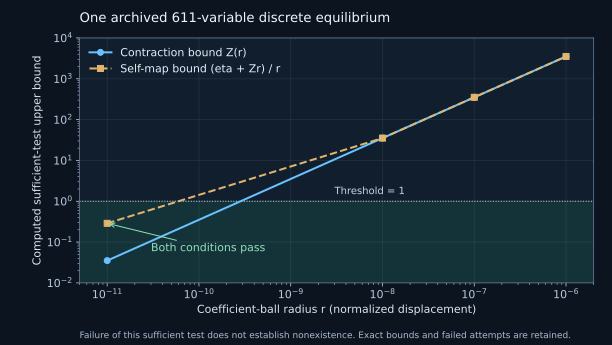

# From a small residual to a certified discrete equilibrium

**For one archived weak-load field, a validated computation proves that a nearby exact discrete root exists and is locally unique.** Its coefficient error is at most approximately \(2.619900\times10^{-12}\) in the model's normalized infinity norm. This is a root of the finite-quadrature mathematical potential with explicitly frozen binary constants. It is not a continuum error bound, a stability theorem or biological validation.

The [implementation](../scripts/algebraic_root_feasibility.py) and [certificate packet](../evidence/algebraic_root_certification_feasibility.json) retain the complete frozen cache and preconditioner, exact rational bound endpoints, failed larger-radius attempts and executable replay. The archived input is the 611-degree-of-freedom, activation-strength-one baseline field—not any newly fitted material proposal. Here “algebraic root” means a finite-dimensional discrete residual root; its energy contains logarithms and square roots, rather than only polynomials.



The markers show evaluated radii; connecting segments only guide the eye. A value above one means this sufficient test fails; it does not establish that no equilibrium exists in that ball.

## 1. Specify the exact mathematical target

Let \(u\in\mathbb R^{611}\) contain free nodal displacements of the quadratic finite-element model. Fixed nodes keep their declared coordinates. The reference coordinates, shape functions and gradients, quadrature radii/weights, material coefficients, activation strength and energy normalization are treated as the **exact real values of their stored binary floating-point constants**. Define

\[
y(u)=X+P u,\qquad f(u)=\nabla_u\widehat E(y(u)),\qquad
H(u)=Df(u).
\]

The map \(P\) inserts free coefficients into their full nodal positions. The addition in \(X+Pu\) is exact real addition. It is not replaced by the separately rounded `current_nodes` array. The frozen cache stores reference coordinates, free indices, the input vector, all quadrature/shape tensors and the proposed preconditioner. The packet also contains the material parameters and exact binary activation strength, so cache replay requires no regenerated quadrature or new equilibrium solve.

The target uses Duffy8 volume and order-12 surface quadrature: 9,216 volume points and 288 surface points. It is the smooth physical potential on the neighborhood where its Jacobians exceed the implementation's clamp/penalty thresholds. The projected-pressure calculation is diagnostic and does not enter this total potential.

This target is deliberately precise. It is distinct from treating every rounded Torch operation as a real-valued function, from replacing the frozen nodes by ideal exact Gauss nodes, and from the continuum variational problem. Differences between those targets require separate error bounds.

## 2. Reduce differentiation to five bulk and three surface variables

At a volume point write the meridional deformation gradient as

\[
F_m=\begin{pmatrix}a&b\\c&d\end{pmatrix},\qquad
h=R/R_0,\qquad D=ad-bc,\qquad J=Dh.
\]

The five variables \(z=(a,b,c,d,h)\) are affine functions of the nodal coefficients. With local activation coefficient \(A\), the density is

\[
W(z)=\frac\mu2\left(\lVert z\rVert^2-3\right)
-\mu\log J+\frac\kappa2(\log J)^2
+\frac A2(b^2+d^2).
\]

Let \(v=\nabla_z\log J\) and \(Q=\nabla_z^2\log J\). When \(D,h>0\),

\[
v=\left(\frac dD,-\frac cD,-\frac bD,\frac aD,\frac1h\right),
\quad
Q_{1:4,1:4}=\frac{\nabla^2D}{D}
-\frac{\nabla D(\nabla D)^T}{D^2},\quad
Q_{55}=-h^{-2},\quad Q_{i5}=0.
\]

Therefore, with \(C=\operatorname{diag}(\mu,\mu+A,\mu,\mu+A,\mu)\),

\[
\nabla W=Cz+(\kappa\log J-\mu)v,
\qquad
\nabla^2W=C+\kappa vv^T+(\kappa\log J-\mu)Q.
\]

At a surface point use \(z_s=(R,t_r,t_z)\), \(\tau=(t_r^2+t_z^2)^{1/2}\), and \(s=(r_0\ell_0)^{-1}\). Then

\[
j=sR\tau,\qquad \Phi=\tfrac12K(j-1)^2+Tj,
\]

\[
\nabla\Phi=[K(j-1)+T]\nabla j,
\qquad
\nabla^2\Phi=K\nabla j(\nabla j)^T+[K(j-1)+T]\nabla^2j.
\]

The implementation uses explicit derivatives of \(j\), with only positive-radius and positive-tangent denominators. It checks 47 symbolic, exact-rational, domain and synthetic-contraction conditions. These formulas replace automatic differentiation inside the certificate; the original floating Hessian is used only to propose a preconditioner.

## 3. Enclose the full neighborhood without a 611-variable interval expansion

Each local strain map has the form \(z_q=z_q^*+B_q\Delta u\), including the correct fixed-node contribution at the center. For \(\lVert\Delta u\rVert_\infty\leq r\), each strain component lies in

\[
(z_q)_a\in (z_q^*)_a+
[-r\lVert(B_q)_{a,:}\rVert_1,
 r\lVert(B_q)_{a,:}\rVert_1].
\]

Arb evaluation of the five- or three-variable formulas encloses the local Hessian throughout that strain box. If \(\Delta H^{q}_{ab}\) bounds its change from the center, the global Hessian row-sum variation satisfies

\[
\sum_j|H_{ij}(u)-H_{ij}(u_*)|
\leq \sum_q w_q\sum_a |(B_q)_{ai}|
\sum_b\Delta H^q_{ab}\sum_j|(B_q)_{bj}|=:d_i(r).
\]

Every normalized weight \(w_q\) is checked strictly positive. Every reference radius, surface length and energy normalization is also checked positive. All summations, divisions, logarithms, square roots, matrix products and final comparisons in the certificate use outward ball enclosures. They do not use a floating eigenvalue as a lower bound.

Let \(R\) be a proposed approximate inverse of the archived floating Hessian, with every stored entry treated as an exact binary rational. The certificate independently computes

\[
\eta\geq\lVert Rf(u_*)\rVert_\infty,
\qquad Z_0\geq\lVert I-RH(u_*)\rVert_\infty,
\]

\[
Z(r)=Z_0+\max_i\sum_j|R_{ij}|d_j(r)
\geq\sup_{u\in B_r}\lVert I-RH(u)\rVert_\infty.
\]

The residual is preconditioned **before** taking its norm. Replacing it by \(\lVert R\rVert\lVert f\rVert\) would lose cancellation and can be much less useful. The roundoff of the inverse proposal does not invalidate the proof: the computed defect and nonlinear bounds must validate the actual stored \(R\).

## 4. Existence, local uniqueness and the error bound

Assume the positive-domain checks hold on the closed coefficient ball \(B_r\), and

\[
Z(r)<1,\qquad \eta+Z(r)r<r.
\]

Define \(T(u)=u-Rf(u)\). The mean-value formula gives \(\lVert DT\rVert_\infty\leq Z(r)\), so \(T\) is a contraction on the ball. Also

\[
\lVert T(u)-u_*\rVert_\infty
\leq\eta+Z(r)\lVert u-u_*\rVert_\infty<r.
\]

Thus Banach's theorem supplies a unique fixed point \(u^\dagger\) in the ball. The center defect below one implies that \(RH(u_*)\), and hence \(R\), is nonsingular. Consequently a fixed point satisfies \(f(u^\dagger)=0\). Finally,

\[
\lVert u^\dagger-u_*\rVert_\infty
\leq\frac\eta{1-Z(r)}.
\]

This proves local uniqueness within the declared ball. It does not prove a global branch selection, positive second variation or energetic stability.

## 5. Actual numerical certificate

The packet contains exact rational endpoints; rounded display values are:

| Quantity | Validated value/bound |
|---|---:|
| Coefficient-ball radius \(r\) | \(10^{-11}\) |
| Preconditioned residual \(\eta\) | \(2.527709803\times10^{-12}\) |
| Center defect \(Z_0\) | \(6.591230456\times10^{-7}\) |
| Neighborhood contraction bound \(Z(r)\) | \(0.03518827166\) |
| Self-map bound \(\eta+Z(r)r\) | \(2.879592520\times10^{-12}<r\) |
| Root-distance upper bound | \(2.619899540\times10^{-12}\) |
| Minimum volume-point \(J\) throughout the ball | greater than \(0.9977915148\) |
| Minimum surface radius throughout the ball | greater than \(0.0006383480\) |
| Minimum squared surface tangent throughout the ball | greater than \(0.0047845587\) |

All 9,504 terms satisfy the required analytic-domain checks. In particular the volume penalty and logarithm clamp are inactive throughout the ball, not merely at its center. The surface square roots avoid zero throughout the ball.

The initially tested radii \(10^{-8},10^{-7},10^{-6}\) failed this conservative bound, with contraction estimates approximately 35.25, 351.91 and 3519.15. Their failure remains in the packet. Shrinking the neighborhood while retaining the actual preconditioned residual made the sufficient test succeed. A broadcast-mask indexing error in the first engineering attempt is also recorded; it produced no certificate and was corrected before complete assembly.

## 6. Replay, verification and limits

Run from the study root:

```powershell
python -B controlled_furrowing/scripts/algebraic_root_feasibility.py test
python -B controlled_furrowing/scripts/algebraic_root_feasibility.py replay
```

The replay reads the embedded, checksummed binary cache and preconditioner; it regenerates neither quadrature nor an equilibrium. The implementation uses python-flint 0.9.0 at 160-bit midpoint precision. Arb represents real quantities by enclosing balls and rounds radii outward; see the primary [python-flint scalar documentation](https://python-flint.readthedocs.io/en/stable/arb.html), [matrix documentation](https://python-flint.readthedocs.io/en/latest/arb_mat.html), and Johansson's [Arb implementation paper](https://arxiv.org/abs/1611.02831). The contraction proof above states the actual mathematical acceptance conditions rather than delegating the claim to a software status label.

This closes one specific gap: a precisely defined discrete root is now known to exist near one computed field. It does not certify all calibration states, the new material proposal, ideal-quadrature equivalence, continuum convergence, global embedding of every field in the ball, or the experiment's temporal observation law. Converting coefficient error into current-radius endpoint error requires additional graph-domain and monotonicity bounds; that is a separate step. Numerical unit conversion does not turn this small discrete-root error into microscopy accuracy.

The method is standard validated nonlinear numerics. Its contribution here is a reproducible certificate for this particular finite model, with the target and remaining errors separated explicitly. No conceptual or biological novelty is claimed.
