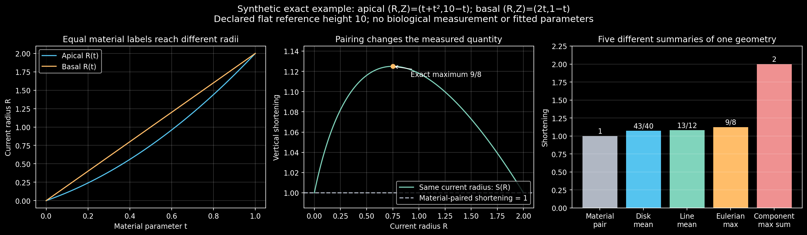

# Independent check: which two points define tissue height?

**21 independent checks pass.** The new observer correctly distinguishes height at one current physical radius from height between material endpoints that have moved to different radii. Separate spatial maxima, line means and disk means also remain distinct. The [replay script](../scripts/verify_endpoint_observer_independently.py), [receipt](../evidence/quadratic_endpoint_observer_independent_review.json), and [observer derivation/API](QUADRATIC-ENDPOINT-OBSERVER.md) are retained.

This review runs no mechanical optimization or biological fit. It uses a new exact analytic geometry, common-reference shifts, and an independent floating-point reconstruction/integration of one previously saved mechanical field. The production observer source is frozen at SHA256 `075dac2148ed26a3bfe83fadf1b97602e4b08536f2be38cb95c2054776c0b926`.

## A counterexample with exact answers

Take two quadratic/linear material boundary curves, with \(0\le t\le1\):

\[
(R_a(t),Z_a(t))=(t+t^2,10-t),\qquad
(R_b(t),Z_b(t))=(2t,1-t).
\]

Both cover the same current-radius interval \([0,2]\), are radially monotone, and enclose a positive vertical thickness. Their common flat reference height is ten. If one pairs equal material parameters, the apparent shortening is

\[
10-Z_a(t)+Z_b(t)=1.
\]

But the top and bottom generally have different current radii at that material label. At the common physical radius \(R=t+t^2\), the basal parameter is \(t_b=(t+t^2)/2\). The correct vertical shortening is therefore

\[
S(R(t))=1+\frac t2-\frac{t^2}2.
\]

It has maximum \(9/8\) at \(t=1/2\), or \(R=3/4\). Its line and disk means are, respectively,

\[
\frac12\int_0^2S(R)\,dR=\frac{13}{12},\qquad
\frac12\int_0^2R S(R)\,dR=\frac{43}{40}.
\]

The individual spatial component maxima are each one, so their sum is two. Thus one geometry gives five different answers: material-paired value one, disk mean \(43/40\), line mean \(13/12\), current-radius maximum \(9/8\), and sum of separate component maxima two. None may be substituted for another without an additional argument.

The image is original and synthetic. The plot is illustrative; the rational formulas supply the exact results. Its [generator and hash receipt](../evidence/endpoint_counterexample_visual.json) are retained.

For the same example, the line-mean components are \(7/12\) and \(1/2\); the disk-mean components are \(89/120\) and \(1/3\). The independent tests compare the observer intervals directly with all these exact rational values.

## A reference change preserves height but changes the partition

Adding \(c=1/2\) to both component reference heights preserves their difference. It increases the declared apical-downward response by \(1/2\) and decreases the basal-upward response by \(1/2\), while leaving both maximum and mean height shortening unchanged. Both spatial-weighting alternatives pass this check.

This illustrates why a height reference alone cannot determine an apical/basal partition. It does not establish that the original experiment lacked a registered component reference. The [source contract audit](JOINT-OBSERVATION-CONTRACT.md) states what its methods, images and workbook establish and what remains unspecified.

## Independent check on an actual saved mechanical field

The review uses the corrected 12×6 field at compression coefficient 5000 and activation strength ten. It independently reconstructs each quadratic boundary from its Lagrange endpoint/midpoint controls, inverts the radial polynomial using numerical roots, and integrates apical motion, basal motion and height shortening separately on every current-radius segment.

For both line and disk weights, the resulting six numerical integrals agree with the exact observer interval midpoints to at most approximately \(1.78\times10^{-15}\) µm. This is an independent floating-point crosscheck, not a validated bound on the quadrature implementation. The observer's exact polynomial primitives and rational inverse brackets remain the basis of its interval claims.

## Consequences for the previous calibration checks

Earlier material-column shortening and axis displacements remain retained, correctly labeled mechanical proxies. Their arithmetic is not erased. However, agreement or disagreement of those proxies with published extrema/regional means is not, by itself, proof that a matched experimental observation was predicted or violated. The source-matched quantity and its reference/aggregation rule must be established first.

The new observer improves that alignment and supports a more explicit joint calibration. It does not supply experimental time coverage, source segmentation uncertainty, a continuum PDE error bound, a physical identified set or novelty. Those remain separate requirements under the original plan.
