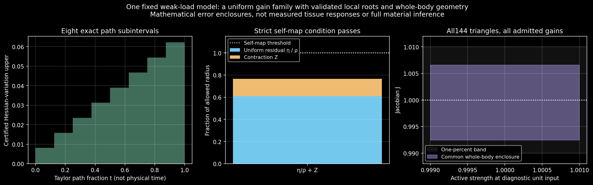

# A whole interval of locally stable, noninterpenetrating discrete states

**For one fixed material and geometry, the validated gain-cell theorem now composes with whole-body geometry.** Every admitted root has positive Jacobian everywhere off-axis, preserves the axis and is globally injective. The common whole-body enclosure is safely rounded outward as

\[
 0.992464257\le J\le1.006576818.
\]

This lies inside the one-percent local volume-ratio band. It is not exact incompressibility or continuum accuracy. The family is the old weak-load benchmark with relative active-strength increment \(\delta\in[-0.001,0.001]\), not the new actual-M calibration cell and not an inferred biological gain interval.

The [energy-cell proof](ENERGY-GAIN-CELL.md), [independent mathematical audit and full reproduction](ENERGY-GAIN-CELL-REVIEW.md), [generic whole-body theorem](ROOT-BODY-GEOMETRY.md), [composition code](../scripts/compose_energy_geometry.py), and [actual composition receipt](../evidence/energy_gain_geometry.json) retain the chain. A [separate composition review](ENERGY-GAIN-GEOMETRY-REVIEW.md) checks the metric, coordinates, inputs and exact geometry calculation.

## 1. The parameter-dependent root tube

For every \(|\delta|\le10^{-3}\), the energy theorem supplies

\[
 u_\delta=u_0+S\delta+Wz_\delta,
 \qquad\|z_\delta\|_2\le\rho=10^{-6}.
\]

W and S are frozen binary constants. The norm and tube are computational proof objects, not measured biological uncertainty. The benchmark active strength is \(1+\delta\) at a diagnostic unit input; it is not a fluorescence-to-force coefficient inferred from the source cohort.

For each free coordinate,

\[
 |(u_\delta-u_0)_i|
 \le10^{-3}|S_i|
 +10^{-6}\sqrt{\sum_jW_{ij}^2}
 =:\varepsilon_i.
\]

All sums of binary squares are represented as exact fractions and square roots are rounded outward by rational arithmetic. Fixed coordinates have radius zero. The maximum free-coordinate radius is less than \(5.919\times10^{-5}\), dimensionless. The composition deliberately uses the full certified corrector radius rather than a smaller posterior error estimate. It also uses the exact reference-plus-displacement center, so no hidden rounding of `current_nodes` enters the body proof.

## 2. From the tube to the complete body

The coordinate hull above contains every member of the parameter-dependent tube. The [interval Bernstein/monotonicity calculation](ROOT-BODY-GEOMETRY.md) certifies all 144 triangles for this entire hull. Degree-four numerator controls bound \(\det(F_m)R/r\), with exact zero coefficients on the axis. Uniform positive symmetric meridional gradients give strong monotonicity, and \(R(r,z)\ge mr>0\) away from the axis. Thus the revolution is globally injective.

The hull discards correlations between gain, predictor and energy-ball coordinates. This makes its bounds conservative. A passed hull proof still covers every admitted root; a failed hull proof would be unresolved, not evidence that one of those roots interpenetrates.

The positive transformed Hessian from the energy theorem makes every interior root a strict local energy minimum of the frozen finite-quadrature potential. The body proof separately supplies geometric admissibility. Neither result establishes a global minimum, physical dynamical stability or the loading trajectory from zero activation.

## 3. A local parameter branch, not a biological activation history

The contraction is uniform on a fixed z-ball and the transformed map is continuous in \((\delta,z)\). Its fixed point is continuous in \(\delta\). The residual is smooth and its Hessian is nonsingular, so the implicit-function theorem gives a smooth branch in the interior of the interval. Local uniqueness makes the local descriptions agree.

This continuity concerns a short mathematical parameter interval around the old weak-load state. It does not prove that an embryo follows that branch or connect the branch to the entire experimental activation protocol. No source timing, growth-reference or chemical force-law ambiguity is resolved by this argument.

The Taylor path fraction t in the first panel is not physical time. The last panel is a common certified enclosure for all gains, not sampled Jacobian measurements or a fitted response curve.

## 4. Why this matters to the five-gate work

The previous one-point proof did not control a parameter interval. This result proves one nonzero-width gain family while retaining local energetic and geometric validity. It shows that the raw infinity-norm failure was partly a limitation of a bound, rather than a demonstrated physical loss of equilibrium.

It still varies only one coefficient, with fixed original material and geometry. It does not infer all material ratios, cover unbounded tails, validate the new seventeen fields, establish continuum/integration error or predict larger-region source observations. The separate actual-M result must use its own source-dose relation, root tube, geometry and observer receipts. Standard contraction, interval differentiation and geometric arguments are not a confirmed novelty claim.
