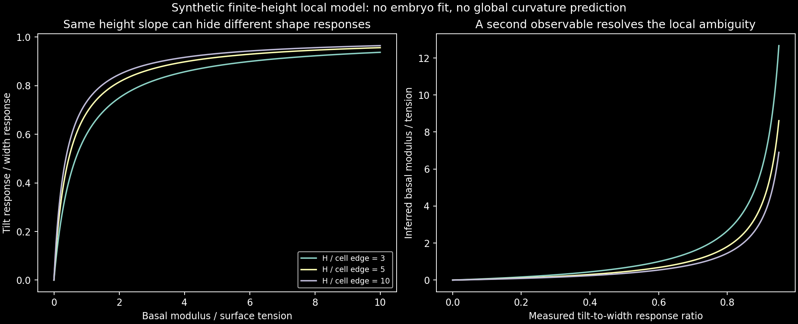

# What extra observation would make the local mechanics identifiable?

This is an exact local calculation for the finite-height frustum candidate, not a newly discovered biological mechanism or a proof of global tissue prediction. It makes a concrete measurement recommendation instead of treating every fitted parameter as known.

Let the resting hexagonal cell edge be one length unit, the height-to-edge ratio be \(q>0\), apical/basal baseline tension be \(T>0\), and basal area modulus be \(K\ge0\). The finite-height energy and exact areas are in [MODEL-CANDIDATES](MODEL-CANDIDATES.html). Its rest-state Hessian is

\[
\mathcal H=\begin{pmatrix}
6\sqrt3(K+3T)&-6\sqrt3K\\
-6\sqrt3K&2\sqrt3(3K+T+9T/q^2)
\end{pmatrix}.
\]

Its first leading minor is positive and

\[
\det\mathcal H=\frac{36T}{q^2}
\left(10Kq^2+9K+3Tq^2+27T\right)>0.
\]

Thus this resting state is a strict local minimum; no global uniqueness of the two-variable nonlinear energy is asserted.

Write \(w\) for mean edge width and \(\delta\) for half the apical/basal edge difference. A small lateral-tension increment gives

\[
r:=\frac{d\delta/dI}{dw/dI}
=\frac{3K}{T+3K+9T/q^2}.
\]

The height derivative at rest is \(dH/dI=-2q\,dw/dI\). If the active lateral-tension gain is \(g\), the positive shortening slope is

\[
m=\frac{12q^2g}{K_{\rm eff}},\qquad
K_{\rm eff}=\mathcal H_{ww}
-\frac{\mathcal H_{w\delta}^2}{\mathcal H_{\delta\delta}}>0.
\]

For **each** \(K/T\ge0\), choose \(g=mK_{\rm eff}/(12q^2)\). The same measured height slope is then reproduced while the asymmetry ratio ranges from zero toward one. A height slope alone therefore does not determine the local shape response. This is a small-signal parameterization-specific result, not a proof that the entire nonlinear dose curve is uninformative.

An independent measurement of the apical/basal shape-response ratio supplies the missing information:

\[
\frac KT=\frac{r(1+9/q^2)}{3(1-r)},\qquad 0\le r<1.
\]

This inverse is unique and increasing. Its sensitivity diverges as \(r\to1\); recording a second observable is insufficient if it is too noisy near saturation. Once \(K/T\) is known, the shortening slope determines \(g/T\), not an absolute force scale. Multiplying every tension, modulus and active gain by the same positive constant leaves equilibrium geometry unchanged.

## Verification and practical meaning

The root implementation rederived the Hessian, determinant, response ratio and inverse symbolically. A separate triangulated-polyhedron integration verified exact frustum volumes and lateral areas for 100 independently sampled geometries; maximum relative discrepancy was \(8.89\times10^{-16}\). [Receipt](../evidence/local_mechanics_independent.json); [replay script](../scripts/verify_local_mechanics.py). Another agent independently checked the design identities in [model_design_symbolic.json](../evidence/model_design_symbolic.json).

The practical recommendation is to measure paired, time-matched apical/basal geometry and initial cell dimensions under small perturbations. Separate apical and basal maxima from different times cannot be substituted for that ratio. A coupled tissue still requires shared-interface mechanics, surrounding-tissue constraints and a spatial observation operator; this calculation does not remove those requirements.
