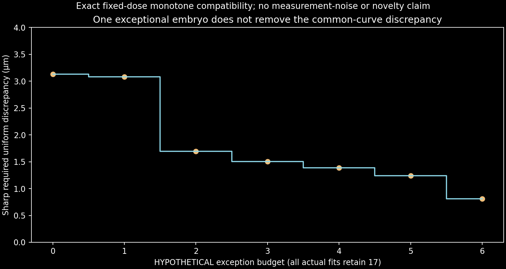

# Does one exceptional embryo explain the calibration obstruction?

**No, under the fixed-dose common monotone-curve contract.** The sharp required uniform discrepancy is 3.131943715 µm using all 17 observations and remains 3.084159745 µm even if one arbitrary record may be treated as an exception. This is a sensitivity calculation, not a decision to remove any embryo. Every actual mechanical calibration continues to retain all 17 records.

## Exact question

For strictly increasing positive reported doses \(I_1<\cdots<I_n\), nonnegative observations \(y_i\), and an exception budget \(k\), define

\[
\delta_k=\min_{S:\,|S|\ge n-k}\ \inf_{f\ge0,\ f\uparrow}
\max_{i\in S}|f(I_i)-y_i|.
\]

A zero-response origin can be imposed by a monotone extension to \(f(0)=0\), since every observed dose is positive. No concavity or mechanical constitutive law is assumed here.

For any retained subset \(S\), the sharp discrepancy is

\[
\delta(S)=\frac12\max_{i,j\in S,\ i<j}(y_i-y_j)_+.
\]

The necessity and matching monotone construction are derived in [CALIBRATION-UNCERTAINTY](CALIBRATION-UNCERTAINTY.html). Thus the entire exception problem is a finite exact minimization. Allowing at most \(k\) deletions has the same minimum as retaining exactly \(n-k\): any larger compatible subset can be reduced without increasing its worst residual.

## Results for the actual 17 records

| Hypothetical exception budget | Required retained records | Sharp uniform discrepancy (µm) |
|---:|---:|---:|
| 0 |17|3.131943715|
| 1 |16|3.084159745|
| 2 |15|1.695976145|
| 3 |14|1.502609595|

For the one-exception matching construction, source-column record I is omitted. Even then, record M at dose 0.78208913 has response 12 µm, while record P at dose 0.80580697 has response 5.83168051 µm. Their drop is 6.16831949 µm, forcing half that discrepancy. Complete enumeration proves that no other single omission does better. The omitted labels in the receipt identify **mathematical witness constructions**, not scientifically established bad observations.

## Complete enumeration and independent dynamic programming

The implementation converts the published decimal response strings into exact common integer units. It evaluates all \(2^{17}=131072\) subsets. For a subset whose last retained index is \(j\), its largest violating drop is the maximum of the prefix's drop and every newly introduced \(y_i-y_j\). Induction on the number of indices proves this recurrence accounts for every pair exactly. The complete cost array is retained and hashed.

An independent interval-subsequence algorithm checks feasibility at each claimed threshold and the preceding distinct critical threshold. For a discrepancy \(\delta\), a retained observation requires a fitted value in

\[
[\max\{0,y_i-\delta\},\ y_i+\delta].
\]

For each retained count, the dynamic program keeps the smallest achievable final fitted value. A smaller final value weakly dominates a larger one for every future nondecreasing interval choice. Updating counts in descending order considers skipping or retaining each record once. Induction gives the maximum possible compatible subset size. Feasibility changes only when \(2\delta\) crosses a reported violating drop, so the predecessor-threshold check establishes sharpness between critical values as well.

For each optimal retained subset, the prefix maximum of the lower interval endpoints supplies a matching nonnegative monotone fitted vector. Interpolation through those values, together with the zero-response origin and a constant tail, constructs a complete admissible curve. This is sharpness in a **relaxed scalar function class**; the construction is not claimed to arise from the specific three-dimensional tissue energy.

[Implementation](../scripts/calibration_contamination.py), [exact results and matching constructions](../evidence/calibration_contamination.json), and the independent [review](CALIBRATION-EXCEPTION-REVIEW.html) retain the evidence.

## Scientific interpretation and limits

The analysis shows that the strongest incompatibility is not caused solely by one low-response embryo. It does not identify measurement error, determine a biological outlier fraction, justify discarding records, or supply a confidence interval. Measured-dose order is treated as fixed; unmeasured dose errors can change the obstruction. Different initial geometry/materials, dose-dependent trajectories, or non-common response branches can invalidate the common-curve assumption.

The nested-amplitude peak theorem in the uncertainty document makes the monotone restriction relevant to a declared common quasistatic peak model even when instantaneous mechanical shortening is nonmonotone. Its common-branch, scaled-cap and observation-window assumptions remain necessary. This result neither computes the full physical parameter identified set nor establishes novelty: it is standard order-constrained compatibility applied transparently to the actual calibration data.
