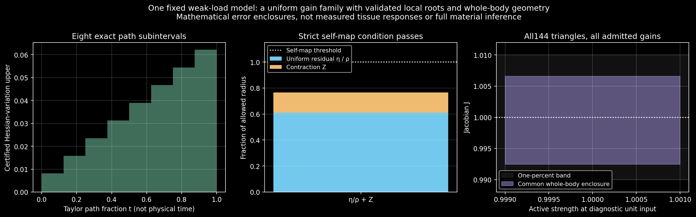

# Parameter inference: verified progress and the remaining five gates

**The project now certifies small parameter families and one conditional calibration exclusion. It has not established a satisfactory biological fit, a full compatible parameter set, a continuum prediction or a novel mechanism.** The original [five-gate contract](../PLAN.md) remains unchanged.

This checkpoint distinguishes two different physical cases. The old weak-load case supports a useful numerical-method demonstration. The new-material case is attached to actual calibration record M, but its certified material box is extremely narrow. Neither result may be substituted for the other.

## 1. What was proved for the old weak-load case

The archived model has 611 free displacement coefficients and 9,504 positive-weight energy terms. Its mathematical target is the smooth finite-dimensional potential defined by frozen binary geometry and quadrature arrays. This is different from the ideal quadrature integral or continuum boundary-value problem.

An independent interval-automatic-differentiation reconstruction first certified one nearby equilibrium. A separate exact interval-Bernstein argument now encloses the entire revolved body, including the axis. The one-root box satisfies the safe displayed bounds

\[
0.997631142<J<1.002708290.
\]

The proof establishes orientation preservation and global injectivity using strong monotonicity of the meridional map and preservation of the rotation axis. It does not infer Cartesian smoothness at the axis from directional limits. See the [whole-body proof](ROOT-BODY-GEOMETRY.md) and [independent review](ROOT-BODY-GEOMETRY-REVIEW.md).

### From a point to a genuine parameter interval

Let the old active coefficient be \(f=1+s\), with \(|s|\le10^{-3}\). Other material coefficients, geometry, dose normalization and discretization remain fixed. With a frozen binary affine predictor and an invertible energy-coordinate matrix W, write

\[
u(s)=u_0+sS+Wz,\qquad \|z\|_2\le\rho=10^{-6}.
\]

Validated Taylor bounds over eight subintervals give

\[
\eta\le6.100637164\times10^{-7},\quad
Z\le0.155994805449,\quad
\eta+Z\rho\le7.660585219\times10^{-7}<\rho.
\]

The uniform contraction theorem therefore supplies a unique nearby root for every admitted s. The symmetric transformed Hessian stays positive definite, so these roots are strict local minima of the declared discrete energy. This is not a proof of global minimality, physical dynamical stability, or selection by a zero-to-activation history.

The full metric ball maps into coordinate radii

\[
\varepsilon_i=10^{-3}|S_i|+10^{-6}\sqrt{\sum_jW_{ij}^2}.
\]

Exact outward square-root bounds and interval geometry then prove, throughout the family,

\[
0.992464257<J<1.006576818.
\]

Thus the whole-body Jacobian remains within one percent of one for this particular weak-load family. This is a finite-model result, not an incompressible or continuum limit. The [energy proof](ENERGY-GAIN-CELL.md), [71-check independent review](ENERGY-GAIN-CELL-REVIEW.md), [geometry composition](ENERGY-GAIN-GEOMETRY.md) and [independent composition review](ENERGY-GAIN-GEOMETRY-REVIEW.md) retain the derivations and exact bounds.

The horizontal Taylor-path coordinate is an integration device in the proof, not biological time. The geometry band is a common enclosure, not a measured or sampled response curve.

## 2. What was proved for actual calibration record M

The source-column record has canonical extracted dose 0.78208913 and reported apical response 12 micrometres. The new candidate has common gain approximately 7.8126545043. The certificate uses the exact rational product of declared gain and extracted dose; it does not silently replace it by the rounded solver input.

The five coordinates are

\[
\theta=(K_a,K_b,T_a,T_b,g).
\]

The certified closed box C has relative half-width \(10^{-8}\) in the four positive baseline coordinates and \(T_a\in[0,2\times10^{-10}]\). These are computational choices, not measured physiological uncertainty bounds. Compression coefficient, reference geometry, mesh, quadrature and boundary constraints are fixed.

For every parameter in C, a nearby discrete stationary root exists. Its entire-body geometry is admissible. Under the **single static, same-current-radius, spatial-maximum apical observer**, the root family has apical response enclosed by approximately

\[
A(C)\subset[6.813612639694854,\ 6.813612858035664]\;\mu\mathrm m.
\]

The exact rational endpoints in the receipts, rather than nearest-rounded decimal displays, determine all decisions. In particular, a safe consequence is

\[
|A(\theta)-12|>5.186387141\;\mu\mathrm m
\qquad\text{for every }\theta\in C.
\]

Consequently this selected nearby root family is excluded whenever the declared apical discrepancy allowance is below that lower bound. The illustrative allowance 5.1 micrometres is a conditional query, not an estimated measurement error. A sufficiently larger allowance would admit this **one channel**; it would not certify the other 67 entries or a biological fit.

No energetic stability or common physical activation trajectory is certified for this actual-M family. The weak-load energy-family proof above cannot supply those missing conclusions. The source measurements involve temporal summaries whose complete matching to this static observer is unresolved. See [uniform root cells](PARAMETRIC-ROOT-CELLS.md) and [actual-M independent review](PARAMETRIC-ACTUAL-M-REVIEW.md).

## 3. What the inference machinery can and cannot conclude

The [validated inference layer](VALIDATED-IDENTIFIED-SET.md) retains all 17 records and four entries per record. Uniform root and observer providers must be tied to the exact parameter cell, source dose, numerical target, observation contract and declared branch semantics. A small nonlinear solver residual is not such a provider.

The actual-M application now exists. Nine exact coordinate cuts partition a broader, explicitly numerical finite seed into ten leaves. One leaf is the certified C above and is OUT for its selected root family at the illustrative allowance. The other nine leaves remain UNRESOLVED. All leaves retain all 68 constraints; the certified leaf still has 67 unprovided channels. Other equilibrium branches, zero-coefficient faces and unbounded domain tails remain unresolved or uncovered.

An OUT decision here means a contradiction for the supplied branch family. It does not rule out every equilibrium in that material box or the full mechanical model. An IN decision would require all 68 compatible output bounds. Even a complete stationary-root tuple would not establish a shared stable physical time history. See the [independent inference review](VALIDATED-IDENTIFIED-SET-REVIEW.md) and [actual cover receipt](../evidence/validated_identified_set_actual_M_cover.json).

## 4. Verification evidence and its independence

| Component | Retained evidence | What the check supports |
|---|---|---|
| Whole-body one-root geometry | [producer](../evidence/root_body_geometry_verification.json), [independent review](../evidence/root_body_geometry_independent_review.json) | Exact interval body enclosure, conditional on the reviewed root radius |
| Energy-gain interval | [producer](../evidence/energy_gain_cell.json), [review](../evidence/energy_gain_cell_independent_review.json) | Uniform finite-energy contraction and local minima; full unchanged-source Arb replay plus independent acceptance arithmetic and mathematical review |
| Energy-to-geometry transfer | [composition](../evidence/energy_gain_geometry.json), [review](../evidence/energy_gain_geometry_independent_review.json) | Coordinate radii and all-element geometry for the old one-gain family |
| Actual-M five-coordinate cell | [results](../runs/parametric_root_cells_v1/actual_M/results.json), [review](../evidence/parametric_actual_M_independent_review.json) | Independently assembled uniform root bounds and reviewed static-apical composition |
| Inference and finite cover | [actual application](../evidence/validated_identified_set_actual_M.json), [cover](../evidence/validated_identified_set_actual_M_cover.json), [review](../evidence/validated_identified_set_independent_review.json) | All constraints retained; exact cover bookkeeping; conditional exclusion and unresolved remainder |

Internal independent AI review is different from external expert review. The energy replay is not an independent reimplementation of every majorant; the actual-M review separately reconstructs its uniform root assembly. Failed sufficient tests and earlier guard revisions remain archived. A failed contraction test is UNRESOLVED, never a nonexistence proof.

## 5. What remains required by the original five gates

1. Originality: scalar size-transfer novelty is rejected. Generic nonidentifiability, inverse morphogenesis and optimal experiment design are established. No source-specific transfer-ambiguity theorem or confirmed new concept has been obtained.
2. Data: public workbook decoding is verified. Per-specimen initial surfaces, raw trajectory/ROI crosswalks, growth references and synchronized component summaries remain incomplete. The [concrete data request](DRAFT-DATA-REQUEST.md) is unsent; no author contact is authorized by this checkpoint.
3. Model and inference: full compatible material/geometry sets, unresolved branch handling and uniform integral/continuum errors remain incomplete. Tiny successful parameter cells do not cover that domain.
4. Prediction: revised larger-region shape predictions propagated from the full retained uncertainty are not frozen and scored. Historical conditional proxy experiments do not fill this gap.
5. Assessment: numerical correctness is increasingly supported, but predictive increment and novelty are unproved. No new gate is marked complete by this checkpoint.

## 6. The next substantive operation and the novelty target

The executable numerical dependency is to apply one **shared** five-coordinate cell to all 17 saved calibration states, then compose every one of the 68 static output intervals. Do not shrink to a different cell for each record and call the result a common identified set. At a declared discrepancy family this may give an inner stationary-tuple witness, further exclusions, or unresolved tests. At 5.1 micrometres, extending the already excluded M family cannot produce a compatible tuple.

This local operation is a prerequisite component, not completion of the full-domain original contract. The source-data dependency must be resolved before claiming biological calibration or source-matched shape transfer. No tolerance may be increased and relabeled as measured noise merely to produce a fit.

For an assessable original contribution, the strongest candidate remains the [audited transfer-ambiguity target](TRANSFER-CLAIM-AUDIT.md): two physically admissible explanations satisfying the same defensible calibration contract, substantially different larger-region shape predictions, and a feasible extra measurement with certified separation. A two-point gap d gives the standard worst-case prediction lower bound d/2. That inequality and experimental-design principle are established mathematics; the source-specific mechanical gap and attainable resolution would need to supply the contribution. Neither witness pair nor separating measurement has yet been established. The search has a legitimate negative outcome if compatibility fails or the predictions remain indistinguishable.
