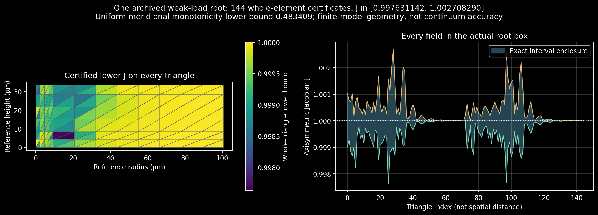

# Independent review of whole-body geometry for the certified weak root

**The actual root's entire nodal-coordinate box passes an independent exact geometry review.** All 144 elements have positive Jacobian bounds, the meridional map is uniformly strongly monotone, and axis preservation gives injectivity after revolution. The exact enclosure is safely displayed as

\[
 0.997631142<J<1.002708290,\qquad
 m>0.483409.
\]

This is one old strength-one root and every field in its certified coefficient box. It is not a statement about the new 17 material-calibration fields, a parameter family, energetic stability or continuum accuracy.

The [independent receipt](../evidence/root_body_geometry_independent_review.json) passes **2,002 checks** and retains the complete replay program. The [producer proof and figure](ROOT-BODY-GEOMETRY.md), [implementation](../scripts/root_body_geometry.py) and [actual geometry receipt](../evidence/root_body_geometry_verification.json) remain unchanged.

## 1. Binding the correct box to the correct root

The center is reconstructed as exact binary reference coordinates plus exact binary archived free displacements. Each free coordinate receives the larger of the two independently established root-distance bounds; fixed coordinates receive zero radius. The radius is approximately \(2.625447\times10^{-12}\) in normalized coordinates.

The review checks the source and dependency hashes, actual input-state hash, embedded cache checksum, root-certificate and independent-root-review bindings, free/fixed map, and exactly fixed radial axis coordinates. It replays the complete actual 144-element box and obtains the identical rational result.

This explicitly avoids confusing the exact center with the separately rounded saved current-node array. Root existence is supplied by [the independent algebraic proof](ALGEBRAIC-ROOT-INDEPENDENT-REVIEW.md); the geometry module itself proves only the properties of a supplied coordinate box.

## 2. Independent checks of the polynomial controls

The six quadratic Lagrange shape functions were symbolically differentiated through a separate SymPy route at vertices, edge points and interior points. This checks the implementation's derivative signs and coordinate conventions.

For **every actual element**, zero-radius output was compared with the earlier independent power-polynomial-to-Bernstein route. All degree-four numerator coefficients, reference denominators, axis-zero conditions and Jacobian bounds agree exactly. All **432 vertex symmetric-gradient matrices and eigenvalue lower bounds** also agree exactly with that older route.

The checked formulas are:

\[
 F_m=G D_X^{-1},\qquad
 G=\frac{\partial Y}{\partial(\xi,\eta)}.
\]

Since G is affine, its vertex values are degree-one Bernstein controls. The determinant's diagonal controls are \(\det(G^i)/\det D_X\); mixed controls are the symmetric cross-products divided by \(2\det D_X\). The division uses the positive oriented reference determinant, and the inverse multiplies on the right.

Radial degree-two controls are the current vertex radii and

\[
 R_{e_i+e_j}=2R_{m_{ij}}-\frac{R_i+R_j}{2}.
\]

Multiplying those controls with the determinant controls produces degree-four numerator controls, with the multinomial product weights. The reference-radius controls after degree elevation are

\[
 r_\gamma=\sum_i\frac{\gamma_i}{4}r_i.
\]

For \(r_\gamma>0\), interval ratios \(n_\gamma/r_\gamma\) bound the axisymmetric Jacobian \(J=\det(F_m)R/r\). At zero reference controls the **entire numerator interval must be exactly zero**, not merely contain zero. This preserves all possible axis constraints rather than relying on cancellation of uncertain intervals.

For every off-axis point, J is a positive-weight average of those ratios. Consequently their minimum lower and maximum upper bounds enclose J throughout each whole element. The conclusion concerns off-axis J and all existent directional limiting values at the axis; it does not assert a classical Cartesian \(C^1\) Jacobian on a piecewise-polynomial axis.

## 3. Why the interval result covers more than tested corners

The review tested eight distinct **global** nodal-box corners: all-positive, all-negative and six mixed sign patterns. Every corner preserves shared-node conformity and exactly fixed coordinates. All 1,152 corner-element cases lie within the computed coefficient bounds and have positive Jacobians; each whole corner mesh passes the independent exact monotonicity test.

Another 100 exact signed-interval cases check products and squares, including intervals crossing zero. These tests catch arithmetic and assembly mistakes. They are not the proof for untested corners or interior points.

That proof is interval inclusion: each nodal interval contains every permitted coordinate; exact interval arithmetic encloses every polynomial control; nonnegative Bernstein weights carry those control bounds to every material point. Correlations between repeated or shared variables may widen the enclosure, but cannot remove an allowed field. A single global coordinate assignment remains conforming because shared nodes have one value.

## 4. Global injectivity and positive interior radius

For each admissible field, the symmetric meridional gradient is affine within each element. At its vertices the intervals certify

\[
 S=\frac12(F_m+F_m^\mathsf T)
 =\begin{pmatrix}a&b\\b&d\end{pmatrix},
 \qquad a>0,\quad ad-b^2>0.
\]

The interval square of b treats zero-crossing intervals correctly. For every matrix in those bounds,

\[
 \lambda_{\min}(S)
 =\frac{\det S}{\lambda_{\max}(S)}
 \ge\frac{\underline{\det S}}
          {\overline a+\overline d}
 \ge m>0.
\]

Convexity extends the vertex bounds through every triangle. On the conforming convex reference rectangle, integration along a segment gives

\[
 (Y(x)-Y(y))\cdot(x-y)\ge m\|x-y\|^2,
\]

so the meridional map is injective. Piecewise derivatives suffice: traces agree and element-edge crossings do not invalidate the line integral.

Exact axis preservation supplies \(R(0,z)=0\). Since \(\partial_rR\ge m\),

\[
 R(r,z)=\int_0^r\partial_rR(s,z)\,ds\ge mr>0
 \quad(r>0).
\]

An off-axis physical point therefore retains a well-defined azimuth. Meridional injectivity and preservation of that azimuth imply injectivity of the revolved body; the reference axis already identifies its angular copies. No energetic stability or biological branch-selection theorem is used.

## 5. Actual bounds and retained provenance

The actual exact J enclosure is contained in \([0.997631142,1.002708290]\), so this weak root's entire box is also within a one-percent local volume-ratio band. This is not exact incompressibility, a result for stronger loads, or a bound on continuum error. The interval endpoints need not be attained.

The independent receipt binds the current producer proof document, figure and visual receipt. It records:

| Independent check | Coverage |
|---|---:|
| Whole actual interval-box replay | 144 elements |
| Zero-radius coefficient/J comparisons | 144 elements |
| Zero-radius symmetric-gradient comparisons | 432 vertices |
| Global mixed corner maps | 8 |
| Corner-element inclusion tests | 1,152 |
| Exact signed interval tests | 100 |

Producer geometry source SHA256:

    18013c6c50c5f679eb6c4abc04e3cf9ce447ee18d0bf1efbf6dcfbd6806f49c2

Independent review receipt SHA256:

    f7463b263d39294d576417372469f5580c651e5070ca2ea627aaef86cdcbd6f2

This closes the whole-body noninversion/noninterpenetration gap for the one certified weak root. It does not close source-observation, parameter-cell, stability, integration/PDE or full identified-set gaps. Bernstein bounds and strong-monotonicity arguments are standard methods; no novelty is claimed.
