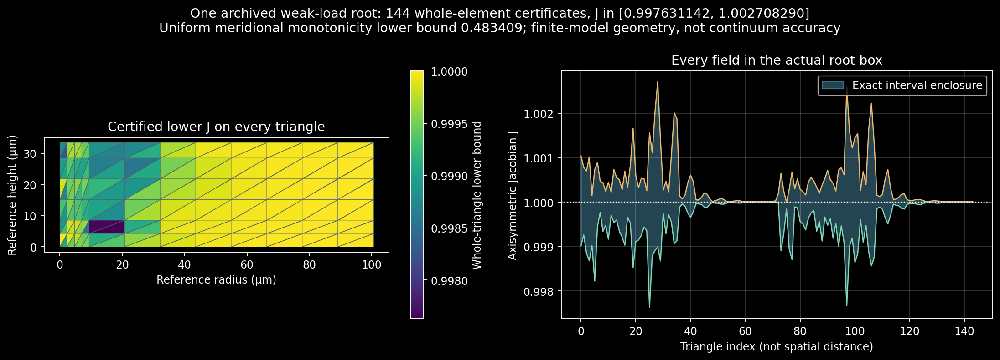

# Whole-body geometry of the certified discrete root

**The previously certified weak-load root now lies inside a nodal-coordinate box whose every field has positive whole-element Jacobian and is globally injective.** This is stronger than checking Jacobians only at the integration points. It remains a certificate for one finite-dimensional target, not continuum accuracy, biological validity, material inference or a proof about the seventeen new calibration fields.

The [implementation](../scripts/root_body_geometry.py), [exact synthetic checks](../evidence/root_body_geometry_synthetics.json) and [actual application](../evidence/root_body_geometry_verification.json) are retained. The [independent review](ROOT-BODY-GEOMETRY-REVIEW.md) must verify the formulas, axis treatment, global argument and actual source bindings before this result is used elsewhere.

## 1. Use the root ball rather than the rounded stored field

The [independent interval-AD proof](ALGEBRAIC-ROOT-INDEPENDENT-REVIEW.md) encloses an exact root in the free-coordinate infinity ball around the archived vector. The geometric center uses exact binary reference coordinates plus exact binary displacement values. Each free coordinate has radius at least the larger of the two retained root-distance bounds, approximately \(2.625447\times10^{-12}\); fixed coordinates have radius zero.

This avoids treating the separately rounded `current_nodes` array as the exact center. The application checks the root certificate/review hashes, cache digest, reference/vector agreement and the actual free-index map. The exact geometric result then covers every coordinate choice in that box, including the certified root.

## 2. Bound every Jacobian, including between quadrature points

On a reference meridional triangle, let \((\xi,\eta)\) be affine coordinates and let the current map be quadratic:

\[
 Y(\xi,\eta)=\sum_{a=0}^{5}N_a(\xi,\eta)Y_a,
 \qquad F_m=\frac{\partial Y}{\partial(\xi,\eta)}D_X^{-1}.
\]

Every entry of \(G=\partial Y/\partial(\xi,\eta)\) is affine, so its degree-one Bernstein controls are its three vertex values \(G^0,G^1,G^2\). The meridional determinant has degree two. For a diagonal degree-two index its control is

\[
 d_{2e_i}=\frac{G^i_{00}G^i_{11}-G^i_{01}G^i_{10}}{\det D_X};
\]

for \(i\ne j\), it is

\[
 d_{e_i+e_j}=\frac{
 G^i_{00}G^j_{11}+G^j_{00}G^i_{11}
 -G^i_{01}G^j_{10}-G^j_{01}G^i_{10}}
 {2\det D_X}.
\]

All arithmetic uses rational intervals containing every permitted nodal value. Interval dependencies may enlarge bounds; they do not discard allowed fields.

The radius R also has degree-two controls: the vertex radii, and

\[
 R_{e_i+e_j}=2R_{m_{ij}}-\frac{R_i+R_j}{2}.
\]

This direct conversion preserves exactly fixed zeros along the axis. Computing a power polynomial first and relying on interval cancellation could lose them.

The axisymmetric Jacobian is \(J=\det(F_m)R/r\). Its numerator has degree four, with controls

\[
 n_\gamma=\sum_{\alpha+\beta=\gamma}
 \frac{\binom2\alpha\binom2\beta}{\binom4\gamma}
 d_\alpha R_\beta.
\]

The reference radius elevated to degree four has controls

\[
 r_\gamma=\sum_{i=0}^2\frac{\gamma_i}{4}r_i.
\]

For \(r_\gamma>0\), bound \(n_\gamma/r_\gamma\). For \(r_\gamma=0\), require the complete numerator interval to be exactly zero. Bernstein basis functions are nonnegative, so for \(r>0\), J is a positive-weight average of these coefficient ratios. Their minimum lower and maximum upper endpoints therefore enclose J everywhere in the triangle. Exact axis preservation gives the corresponding positive axis limit. Classical differentiability on the three-dimensional axis is not assumed merely from this limit.

## 3. Prove global injectivity for every field in the box

Positive local Jacobians alone do not establish global noninterpenetration. Let

\[
 S=\tfrac12(F_m+F_m^T)=
 \begin{pmatrix}a&b\\b&d\end{pmatrix}.
\]

At each triangle vertex, interval bounds certify \(a>0\) and \(ad-b^2>0\). The bound for \(b^2\) handles intervals crossing zero. For every admissible matrix,

\[
 \lambda_{\min}(S)=\frac{\det S}{\lambda_{\max}(S)}
 \ge\frac{\underline{\det S}}{\overline a+\overline d}>0.
\]

Because \(F_m\), and therefore S, is affine within a P2 triangle, vertex bounds extend throughout the triangle by convexity. Taking the smallest bound over the mesh gives \(S\succeq mI\), with \(m>0\), uniformly for the entire nodal box.

The reference meridian is a convex rectangle with conforming traces. Integrating the directional derivative along any segment gives

\[
 (Y(x)-Y(y))\cdot(x-y)\ge m\lVert x-y\rVert^2.
\]

Thus distinct meridional points cannot coincide. Also \(\partial_rR\ge m\) and \(R(0,z)=0\), so \(R(r,z)\ge mr>0\) for interior radii. Exact axis preservation and this positive radius make the axisymmetric revolution injective as well. This argument covers the whole box; it does not infer a physical branch-selection or energetic-stability theorem.

## 4. Actual receipt and scope

The actual root application covers all **144 triangles**, with a positive whole-body J enclosure and positive uniform meridional monotonicity constant. Exact rational endpoints are in the receipt; the visual shows their numerical values without presenting them as measured tissue data.

The generic `certify_box` function can also check a box produced by a future uniform parameter-cell root enclosure. It supplies no such root enclosure by itself. An unresolved geometric test is not a proof of inversion. Missing continuum, integration, source-observation and full compatible-set requirements remain explicit under the [original five-gate plan](../PLAN.md).

An initial synthetic test used an incorrect expected negative-product range; the exact arithmetic implementation was correct. The failed test, source version and correction are retained under `runs/root_body_geometry/first_test_failure/` before any actual root application. The standard Bernstein and strong-monotonicity arguments are not a novelty claim.
