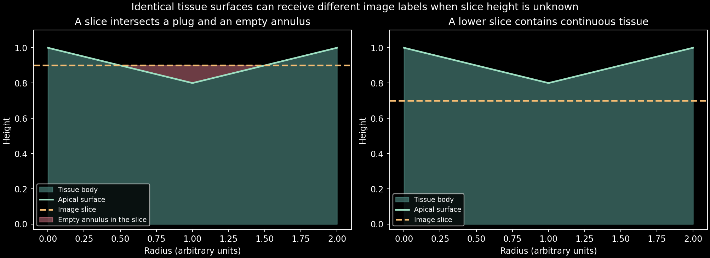

# What this study is trying to connect

This project is a small, assessable part of the embryo-shape question. It does not explain an entire embryo or establish a new bridge between disciplines. The controlled experiment supplies a chemical-signaling intervention; mechanics must then predict a geometric outcome that is actually measured.

## The biological experiment in physical language

An epithelium is a layer of cells with an **apical** face toward the exterior and a **basal** face toward the embryo interior in this setting. The experiment recruits a Rho-signaling regulator to cell membranes using light. This increases the cell's contractile response. The illuminated lateral membranes run along the cell height; their contraction can shorten a cell rather than simply shrink its top face.

For an approximately volume-conserving cell, shortening requires transverse expansion. If the two faces and surrounding cells resist that expansion differently, the same cell shortening can produce different face displacements and tissue curvature. Countryman et al. already demonstrate the importance of activation size, basal mechanics and embryo geometry. Those observations and their qualitative explanation belong to the published work, not this project.

The paper's activation value is normalized optical recruitment during the first scan. It is not an absolute mechanical force, an energy measurement, or solely a pre-exposure laser command. A prediction conditioned on that measured recruitment is a narrower task than predicting shape from a chosen laser setting.

## The mathematical chain

The model must connect

\[
\text{measured recruitment}
\longrightarrow \text{active constitutive response}
\longrightarrow \text{force balance}
\longrightarrow \text{deformed tissue body}
\longrightarrow \text{microscopy observation}.
\]

Each arrow has its own assumptions. A curve that fits shortening verifies none of the other arrows automatically.

We first tested a local, finite-height cell energy. It has a unique equilibrium in its scalar column version, but independent identical columns cannot generate a tissue-scale size effect or determine face positions. Its useful role is a simple response comparator. The scalar small-to-large test reproduces a relationship already examined by the source paper.

The next model resolves a whole finite-height body, including nonactivated neighboring tissue. A meridional section is revolved into three dimensions, with radial, axial and circumferential deformation retained. It is not a thin plate: the small activation radius is only about 9.36 µm whereas tissue height is 32–35 µm. A generic thin-tissue approximation would have the wrong geometric hierarchy.

Its energy combines elastic deformation, a volume-change penalty, apical/basal surface elasticity and a prescribed contraction potential in the illuminated region. Mechanical equilibrium means that the energy's first variation vanishes for every allowed displacement. Optical recruitment controls a parameter of that potential; its parameter-work ledger is not a calibrated chemical or photon-energy expenditure.

## Why the first coupled model was inadequate

The first model fits maximum height shortening reasonably, but moves the basal face too much relative to the apical face. It also permits large local volume changes and remains mesh-sensitive. Its valid discrete geometry and small force residual do not repair those failures.

The two revisions have distinct purposes:

* **Baseline surface tension** represents stress already present before stimulation. Unlike a flat stress-free area-elastic membrane, it resists small normal deflections at quadratic order. This is a standard mechanical effect and a plausible correction to test against the small-region face motions.
* **A mixed higher-order finite-element formulation** separates pressure from displacement more appropriately and allows a stronger numerical convergence investigation. It does not automatically impose pointwise incompressibility or make coarse results accurate.

Neither extension is a new concept by itself. A scientifically useful contribution would require a new quantitative consequence that survives those checks and comparison with prior work.

## Why an image is not the shape itself

The published bending label is an image-slice phenotype: a central tissue plug surrounded by an empty annulus. A three-dimensional tissue body may permit that appearance at one slice height and show continuous tissue at another. Unknown slice height can therefore leave both labels possible. Timing matters too: the illustrative movie develops the pattern and later recovers.

The exact observer criterion makes this uncertainty explicit. It can test whether a horizontal slice with an apical-groove annulus exists under declared geometry assumptions. It does not reconstruct the missing acquisition metadata or certify that the actual microscope saw the witness slice.

## What would count as a substantive result

The target remains a model calibrated only on small-region data that makes informative larger-region predictions without new condition-specific parameters. A complete assessment needs identifiable parameter combinations or honest prediction sets, initial geometry supplied independently, numerical accuracy appropriate to the claim, and a matching observation model.

Correctness, predictive adequacy and originality are separate. This study has verified components and useful negative results; it has not established a new general concept or a validated embryo-shape predictor. [Exact originality audit](ORIGINALITY.html), [v1 findings](SPATIAL-V1-RESULTS.html), [data limits](DATA.html), and [original gate contract](../PLAN.md).

## Primary references

Countryman et al. (2025), [Endogenous OptoRhoGEFs reveal biophysical principles of epithelial tissue furrowing](https://doi.org/10.1038/s41467-025-62483-6).

Guerra Santillán, Dahmann and Fischer-Friedrich (2024), [Elastic Contractile Stress in the Basement Membrane Generates Basal Tension in Epithelia](https://doi.org/10.1103/PRXLife.2.013004).

Cheikh et al. (2023), [A comprehensive model of Drosophila epithelium reveals the role of embryo geometry and cell topology in mechanical responses](https://doi.org/10.7554/eLife.85569).

The broader originality comparison, exact source locators and explicit access gaps are retained separately; this overview does not replace them.
