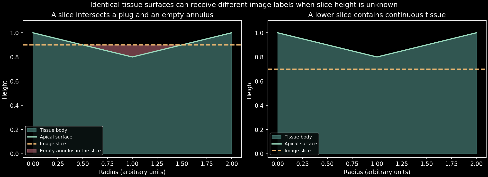

# From a mechanical surface to the published bending observation

The source paper classifies the central tissue plug surrounded by acellular perivitelline space in apical slices (Countryman et al. 2025, Results section 7, Fig. 4d–f). A positive central displacement or incremental crest is not automatically that classifier. This document defines an explicit **conditional**, axisymmetric version. It does not supply the missing acquisition slice heights or spatial resolution, and it is not claimed as a new theorem in the literature.

## Assumptions and exact criterion

Suppose an axisymmetric tissue occupies

\[
\Omega=\{(R,\theta,z):0\le R\le R_o,\quad b(R)\le z\le a(R)\},
\]

where apical and basal profiles are continuous, single-valued, and \(a\ge b\). Consider horizontal slices, ignoring finite optical resolution. A central plug separated from far-field tissue **by an apical groove** means: the slice contains tissue at \(R=0\) and \(R=R_o\), but there is an interior open annulus where its height exceeds \(a(R)\).

Define

\[
U=\min\{a(0),a(R_o)\},\qquad
L=\max\{b(0),b(R_o),\min_{[0,R_o]}a\}.
\]

There is an open interval of slice heights giving this phenotype if and only if \(g=U-L>0\). Every height \(z\in(L,U)\) is a witness.

**Proof.** Such a height lies strictly between the basal and apical endpoints, hence contains central and far-field tissue. It also exceeds the apical minimum. The minimum cannot be an endpoint because both endpoint apical heights exceed the slice. Continuity therefore supplies an interior open interval of radii with \(a(R)<z\), which becomes an empty annulus under revolution. Conversely an open range of admissible slice heights lies below both apical endpoints, above both basal endpoints, and above the interior apical minimum; thus \(L<U\). Boundary coincidences are excluded by the strict inequalities; they do not give a robust open range. This proof addresses apical-groove voids, not every possible basal cavity or folded/non-single-valued topology.

For piecewise-linear monotone-radius profiles the minimum occurs at a vertex, so the interval and its witness annuli can be computed directly. Surface crossing, overhangs or nonmonotone radii invalidate this representation and are rejected.

## Conditional error bound

If both computed profiles approximate true profiles on the same physical radius domain in uniform norm by at most \(\epsilon\), then

\[
|\widetilde U-U|\le\epsilon,\quad
|\widetilde L-L|\le\epsilon,\quad
|\widetilde g-g|\le2\epsilon.
\]

This follows because minimum and maximum are 1-Lipschitz in uniform norm. Therefore a computed gap greater than \(2\epsilon\) certifies existence **conditional on that surface-error bound**. A gap at most \(-2\epsilon\) certifies absence. The script does not establish an a posteriori finite-element error bound; differences between two meshes alone are not such a certificate.

## What can be compared with the source labels

Without acquisition slice height, positive existence permits labels \(\{0,1\}\); the chosen slice may miss the interval. Robust absence permits only \(\{0\}\) under these idealized assumptions. An observed positive label can therefore exclude a model that robustly forbids a plug, but possible existence does not predict an observed positive label. A finite optical point-spread function, unknown slice placement, embryo curvature and non-axisymmetric morphology introduce additional uncertainty. No source labels are used to select a numerical gap threshold.

The implementation is [spatial_observer.py](../scripts/spatial_observer.py); [its receipt](../evidence/spatial_observer_checks.json) checks exact examples, witness annuli, basal occupancy and 1,000 bounded profile perturbations. The analytic Lipschitz proof, rather than those samples, justifies the conditional error statement.
