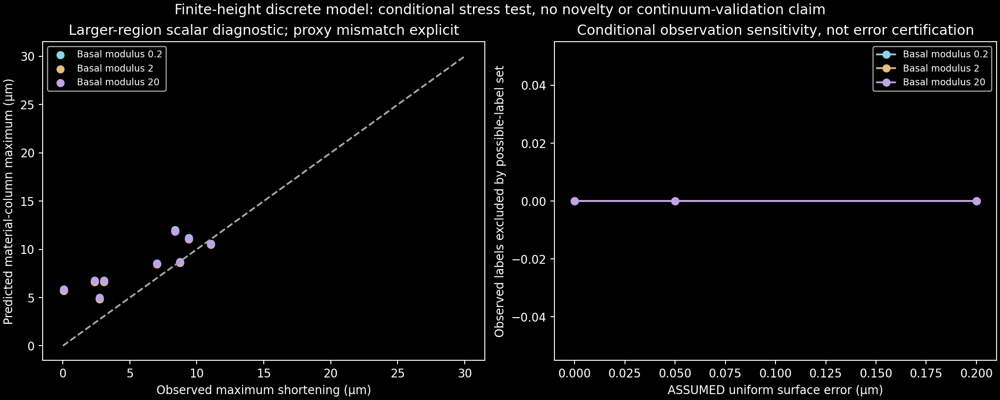

# First coupled model: executed, but spatial adequacy fails

This is the retained **v1** finite-height nonlinear axisymmetric model. It is a conditional mechanical stress test, not a new biological discovery. Its original sources, calibration, 93 larger-region fields and frozen hashes remain unchanged while a separate prestress revision is developed.

## What was fitted and what was held out

Only the 17 small-region dose/maximum-shortening values fit one activation gain per declared basal-area-modulus scenario. All use height 33.5 µm, a flat stress-free reference, finite thickness, an activation depth 5–25 µm below the apical surface, and the same outer boundary. Parameters are exploratory scenarios, not independently measured bounds or a complete identified set.

The field observation used for calibration is the maximum vertical shortening of matched material columns. It is an explicitly conditional peak-equilibrium proxy, not automatically the source's current-spatial/time-maximum measurement. Separate small-region apical and basal maxima are used as an independent adequacy check, not added together or silently promoted to paired trajectories.

| Basal area modulus / µh | Fitted gain | Direct small-region height-proxy RMSE (µm) | Larger-region scalar RMSE (µm), n=9 |
|---:|---:|---:|---:|
| 0.2 | 8.66 | 2.2472 | 3.0881 |
| 2 | 8.88 | 2.2558 | 3.0477 |
| 20 | 9.50 | 2.2694 | 3.1503 |

The nonlinear-response interpolation used for fitting was checked against 51 direct small-region solves; maximum discrepancies are 0.01126, 0.01107 and 0.00784 µm, below the predeclared 0.05-µm calibration-surrogate tolerance. These are checks at the selected gains, not a uniform interpolation certificate or proof of a continuous-parameter optimum.

## The decisive training-only failure

Every scenario predicts basal motion larger than apical motion in all 17 small-region records. The source component maxima are apical-dominant in 16 of 17. Component ordering agrees in only 1/17, despite a reasonable scalar shortening fit. Apical-component RMSE is 5.25–5.64 µm; basal-component RMSE is 3.36–3.80 µm. The static-versus-temporal-maxima mismatch limits a formal biological falsification, but the declared family plainly has not established small-region spatial adequacy. [Independent component audit](../evidence/spatial_calibration_adequacy.json); [observation qualifications](SPATIAL-CALIBRATION.html).

The larger-region runs are therefore retained as **diagnostics of an already inadequate candidate**, not advertised as validated forecasts. Their scalar errors are also worse than the frozen calibration-only linear comparator's 2.2270 µm.

## Why zero label exclusions is not predictive success

All 31 larger-region cases in every branch allow both image labels \(\{0,1\}\) when acquisition slice height is unknown, for each reported illustrative surface-error assumption. Consequently no observed label is excluded, but **the label test is non-discriminating**. It does not have 100% accuracy. A physical surface that permits a plug-like slice does not determine whether the actual recorded slice intersected it. The source phenotype is also transient; a static calculation does not establish its peak or recovery time. [Exact conditional observer and error bound](SLICE-OBSERVER.html).

The assumed 0, 0.05 and 0.2 µm uniform surface errors in the diagnostic figure are sensitivity scenarios. None is a measured error or a finite-element continuum certificate.

## What the numerical receipts prove

All 93 larger-region solves meet the locked normalized nodal-force tolerance, with maximum residual below \(1.44\times10^{-10}\). Exact rational checks independently verify the 51 calibrated and 93 larger-region P1 bodies: triangle orientation, disk topology, simple boundary, axis preservation, local Jacobian bounds and volume ratios. This establishes valid, noninterpenetrating **discrete geometries**, not closeness to the unknown continuum solution. [Proof and certificate](DISCRETE-GEOMETRY-CERTIFICATE.html).

Local Jacobians reach approximately 0.797 in the larger-region fields, corresponding to about 20% local material-volume compression. Small global volume loss does not remove that problem. The log-volume penalty coefficient divided by shear modulus is 50; that does not guarantee near incompressibility when fitted activation is large. Mesh sensitivity is substantial even at low activation. Neither material biology nor continuum accuracy has been validated.

## The justified revision

A stress-free area-elastic membrane gives no quadratic normal stiffness about a flat surface. For a normal graph \(w\),

\[
J_s=\sqrt{1+(w')^2},\qquad
\frac K2(J_s-1)^2=\frac K8(w')^4+O((w')^6).
\]

Baseline membrane tension instead contributes

\[
T(J_s-1)=\frac T2(w')^2+O((w')^4).
\]

This standard geometric-stiffness distinction motivates a **separate, small-region-driven** prestress revision. It does not prove that the revision will fit the biology or solve compressibility. A mixed higher-order numerical model and matched mesh/penalty tests are also being developed before stronger continuum claims.

## Five-gate status

Originality and data-availability audits are executed. The coupled discrete model, calibration and conditional larger-region fields now exist and are independently checked. The original stronger gates remain incomplete: the material identified set is not characterized, specimen geometry and source acquisition mapping are missing, the current candidate fails spatial calibration adequacy, and continuum accuracy is unresolved. A correct diagnostic computation is not a passed biological prediction or confirmed novelty.
