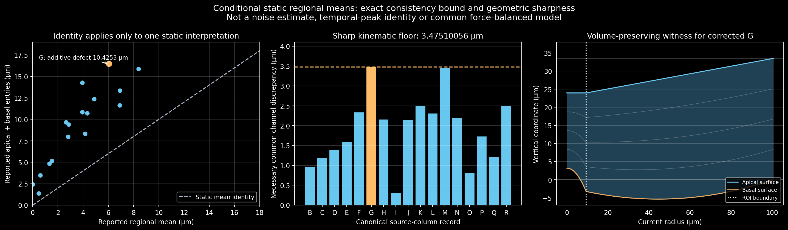

# A sharp limit of the single-state regional-mean interpretation

**Every single-state model using the same regional average for all three components must incur at least 3.47510056 µm worst-case discrepancy on the canonical small-region table.** This bound does not depend on elastic coefficients, activation gain, finite-element mesh or a particular constitutive law. It follows from the observation identity \(V=A+B\).

The bound is sharp over independent admissible kinematic configurations, including a volume-preserving construction below. It is **not** proved sharp over equilibria of the project's material law, and no common material/gain realization is constructed. This is a conditional assessment of a static observation interpretation, not a claim that the experiment or biology violates an identity. Separate temporal maxima of regional means generally do not obey that identity.

Retained evidence: [exact source calculation](../scripts/static_mean_compatibility.py), [71-check receipt and matching constructions](../evidence/static_mean_compatibility.json), [independent review](STATIC-MEAN-REVIEW.md), and [isochoric construction](../scripts/static_isochoric_construction.py) with [204 exact checks](../evidence/static_isochoric_construction.json). These are standard additive constraints and bottleneck matching, not a novelty claim.

## Why the identity is unavoidable under this interpretation

For one registered static tissue state, let \(a(x)\) and \(b(x)\) be signed apical-downward and basal-upward motions relative to coherent reference surfaces. Then height shortening is \(s(x)=a(x)+b(x)\). For one common normalized nonnegative spatial measure \(\nu\), define

\[
A=\int a\,d\nu,\qquad B=\int b\,d\nu,\qquad
V=\int s\,d\nu,\qquad M=\sup s.
\]

Linearity gives \(V=A+B\); nonnegative normalized averaging gives \(V\le M\). These statements apply to either fixed line or disk weighting and any coherent reference split. They do not require monotonic response to input dose.

Let the observed four-vector in one source-column record be \((m,v,a,b)\). If every channel is matched within \(\delta\), then

\[
|a+b-v|
=|(a-A)+(b-B)+(V-v)|\le3\delta.
\]

Thus every material model using this static operator needs

\[
\delta\ge\delta_{\rm static}
=\frac13\max_i|a_i+b_i-v_i|.
\]

This is a lower bound for the entire mechanical parameter domain under that operator, rather than the score of one optimizer.

## Exact source witness

The canonical source-column G entries are:

| Quantity | Recorded value |
|---|---:|
|Maximum height shortening \(m\)|12.73324306 µm|
|Regional mean \(v\)|6.04118444 µm|
|Apical entry \(a\)|13 µm|
|Basal entry \(b\)|3.46648612 µm|

Their additive defect is 10.42530168 µm. Hence

\[
\boxed{\delta_{\rm static}
=\frac{43438757}{12500000}
=3.47510056\,\mu\mathrm m.}
\]

Exactness concerns the retained decimal records, not biological measurement precision. The cohort contains distinct samples; the cross-panel component association uses the documented canonical common-column ordering. This is not an independently verified specimen-ID crosswalk. Neither the defect nor this bound estimates measurement noise.

## Matching the lower bound with all four quantities

Every source row has \(v\le m\). Define, independently for each row,

\[
t=\frac{a+b-v}{3},\qquad
A'=a-t,\quad B'=b-t,\quad V'=v+t,
\quad M'=\max(m,V').
\]

Then \(V'=A'+B'\) exactly and \(M'\ge V'\). The three component/mean errors equal \(|t|\). If \(t\le0\), \(V'\le v\le m\), so the maximum remains \(M'=m\). If \(t>0\), its possible increase is \(V'-m\le t\). Thus the maximum channel also has error at most \(|t|\). Every row therefore attains its individual lower bound, and all 17 attain the global bound simultaneously when independent configurations are allowed.

For witness G the corrected values include \(A'=9.52489944\), \(B'=-0.00861444\), \(V'=9.516285\) µm, while \(M'=12.73324306\) µm. A signed negative basal mean is permitted; silently clipping it to zero would change the problem.

## Explicit finite-height geometric configurations

Let the current-radius observation disk have radius \(R\) and let \(u=r/R\). On that disk choose

\[
s(r)=M'-c u^2,\qquad a(r)=A',\qquad b(r)=s(r)-A',
\]

where

\[
c=3(M'-V')\quad\text{for line weighting},\qquad
c=2(M'-V')\quad\text{for disk weighting}.
\]

The normalized mean of \(u^2\) is \(1/3\) for a radial line and \(1/2\) for a disk. Hence the two separately defined constructions have mean shortening \(V'\), apical mean \(A'\), basal mean \(B'\) and maximum shortening \(M'\). A different field is used for each weighting; simultaneous attainment by one identical field is not asserted.

All corrected maxima are below the chosen reference height \(H=33.5\) µm. Consequently \(h(r)=H-s(r)>0\) and the surfaces \(z_a=H-a\), \(z_b=b\) have positive thickness. A simple radial-identity interpolation through this thickness gives an orientation-preserving embedded body, although it changes local volume. The next construction also enforces exact volume preservation.

## Volume-preserving sharpness with a fixed outer rim

The [exact construction script](../scripts/static_isochoric_construction.py) uses the reported ROI radius \(R=9.35512037\) µm and an outer radius \(R_o=100.5\) µm. Let \(d=R_o-R\), \(e=s(R)=M'-c\), and use normalized annular radius \(u=(r-R)/d\). Continue the shortening and apical motion outside the ROI by

\[
s_{\rm ann}(u)=e(1-u)-K u(1-u),\qquad
a_{\rm ann}(u)=A'(1-u),\qquad b_{\rm ann}=s_{\rm ann}-a_{\rm ann}.
\]

Both motions vanish at the outer rim. The exact radial integrals are

\[
I_c=R^2\left(\frac{M'}2-\frac c4\right),\quad
I_L=d\left(\frac R2+\frac d6\right),\quad
I_B=d\left(\frac R6+\frac d{12}\right)>0.
\]

Choosing \(K=(I_c+eI_L)/I_B\) gives \(\int_0^{R_o}r s(r)\,dr=0\). Exact quadratic extrema verify \(H-s(r)>0\) on the whole radius for all 68 constructions: 17 canonical or permuted rows, each with line or disk weighting. The minimum certified height among them is 20.76675694 µm.

Define the reference radius as a function of current radius by

\[
\rho(r)^2=\frac2H\int_0^r x\,h(x)\,dx,
\qquad h=H-s.
\]

Positive height makes this map strictly increasing. The zero total shortening integral gives \(\rho(R_o)=R_o\). Let \(r=\mathcal R(\rho)\) be its inverse. On the reference cylinder use the map

\[
(\rho,\theta,z)\longmapsto
\left(\mathcal R(\rho),\theta,
b(\mathcal R(\rho))+\frac{h(\mathcal R(\rho))}{H}z\right).
\]

On each smooth piece, the cylindrical volume Jacobian is exactly

\[
J=\frac{\mathcal R}{\rho}\mathcal R'(\rho)\frac hH=1,
\]

because \(\rho'(r)=rh/(H\rho)\). The positive axis limit is regular. At the outer rim the radial map is the identity, \(b=0\) and \(h=H\), so every rim point is fixed. Radial and vertical monotonicity give global injectivity; piecewise-smooth bounded derivatives and positive height give a finite-energy continuum configuration. The core/annulus derivatives may jump, which is allowed in this Lipschitz kinematic class. No exact P2 representation is asserted.

Consequently \(J=1\) almost everywhere on the full Lipschitz body; a classical gradient at the core/annulus interface is not asserted. Thus the sharp kinematic fit does not require local compression or interpenetration. It still supplies **configurations, not force-balanced solutions**. It does not realize the cohort through one common constitutive law, activation gain, branch or dynamics.

## Sensitivity to an unknown component-pair crosswalk

If instead one allows one unknown permutation of the intact observed apical/basal pairs, retain the verified maximum/mean rows but pair their means \(v_i\) with sums \(q_j=a_j+b_j\). The same correction proves the cost of assigning pair \(j\) to row \(i\) is \(|q_j-v_i|/3\), since the fixed row still has \(v_i\le m_i\).

Sorting both scalar lists minimizes the largest absolute assignment difference by the standard uncrossing argument. The sharp kinematic floor under this weaker contract is

\[
\delta_{\rm perm}
=\frac13\max_k|q_{(k)}-v_{(k)}|
=\frac{895512391}{300000000}
\approx2.9850413033\,\mu\mathrm m.
\]

The receipt also retains a matching at that exact threshold and a Hall obstruction at the preceding critical threshold. This is a conservative crosswalk sensitivity, not permission to rearrange the published data or a claim that the author-provided column order was wrong. Apical and basal observations remain paired together.

## What this does and does not resolve

The inequality supplies an exact necessary discrepancy for the static regional-mean version of every mechanical parameter candidate. It helps separate an observation-closure limitation from material fitting. For the spatial-maximum component interpretation, the identity \(V=A+B\) is absent; these observations instead satisfy the weaker \(V\le M\le A+B\). The static regional-mean lower bound must not be applied to that different operator.

Nor does it apply to separately temporally maximized means: generally \(\sup_t\langle a+b\rangle\ne\sup_t\langle a\rangle+\sup_t\langle b\rangle\). Time-dependent counterfactual references and different ROI/aggregation rules require their own contract. The [source audit](JOINT-OBSERVATION-CONTRACT.md) does not establish that the experiment used the static regional-mean rule tested here.

The full mechanical compatible set, its larger-region predictions, exact algebraic/PDE error, empirical adequacy and novelty remain unresolved. The result is a useful conditional consistency limit, not an explanation of embryo shape or a completed five-gate study.
