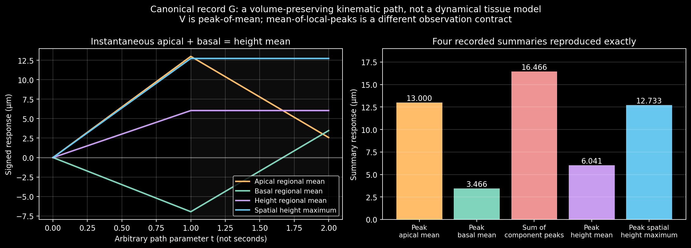

# Why separate temporal maxima need not match one static state

**All 17 canonical four-summary records admit exact time-dependent kinematic witnesses under the regional-mean component interpretation.** This does not supply mechanical dynamics or validate that source interpretation. It demonstrates why the [3.47510056 µm static consistency floor](STATIC-MEAN-COMPATIBILITY.md) must not be applied to separately maximized temporal means.

The [construction script](../scripts/temporal_mean_witness.py) and [102-check receipt](../evidence/temporal_mean_witness.json) retain the exact values and volume-preserving configurations. Each record and weighting uses a separate constructed path. No common material law, activation gain, force history, timescale or biological explanation is inferred.

Here \(V=\sup_t\langle s(\cdot,t)\rangle\), the peak of a regional mean. The construction does not assert the same value for \(\langle\sup_t s(\cdot,t)\rangle\), the mean of local temporal peaks. Where the final profile is negative, including the initial zero state changes those local peaks. The source's unresolved max/mean ordering therefore remains substantive.

## The two-peak construction

Let a record's nonnegative summaries be maximum height shortening \(M\), peak regional mean \(V\), and separate regional component peaks \(A,B\). Assume

\[
0\le V\le M<H,\qquad V\le A+B.
\]

Every canonical source row satisfies these conditions at the declared \(H=33.5\) µm. Consider the following instantaneous mean component values:

\[
\begin{array}{c|ccc}
&\langle a\rangle&\langle b\rangle&\langle s\rangle\\
\text{state 0}&0&0&0\\
\text{state 1}&A&V-A&V\\
\text{state 2}&V-B&B&V.
\end{array}
\]

Each row obeys the instantaneous identity \(\langle s\rangle=\langle a\rangle+\langle b\rangle\). Since \(V-B\le A\) and \(V-A\le B\), separately maximizing the two component means over the three states gives exactly \(A\) and \(B\), while maximizing the height mean gives \(V\). Thus

\[
\sup_t\langle a+b\rangle=V,
\qquad
\sup_t\langle a\rangle+\sup_t\langle b\rangle=A+B,
\]

and the latter can be strictly larger. Signed negative component means are allowed at the other component's peak. These are different times, not an inconsistent height decomposition.

## Continuous paths with the same exact summaries

Use an arbitrary time parameter \(t\in[0,2]\). Between states0 and1, let the component means ramp linearly from zero to \((A,V-A)\). Between states1 and2, interpolate linearly between \((A,V-A)\) and \((V-B,B)\). Every component mean is affine on each segment; its maximum therefore occurs at an endpoint and remains the recorded peak.

To include the spatial maximum, choose a final radial shortening profile \(s_*(r)\) with mean \(V\) and maximum \(M\), using the weighting-specific parabola

\[
s_*(r)=M-c(r/R)^2,
\quad c=3(M-V)\;\text{for line weighting},
\quad c=2(M-V)\;\text{for disk weighting}.
\]

Set \(s(r,t)=t s_*(r)\) on \([0,1]\), then keep \(s=s_*\) on \([1,2]\). Make the apical motion spatially constant inside the ROI with the chosen mean, and put \(b=s-a\). The temporal spatial maximum is exactly \(M\), and all four summaries are reproduced with zero discrepancy.

During the second segment the total shortening profile is constant while the apical and basal means change oppositely. This explicitly exhibits information discarded when the two component peaks are reduced to separate numbers.

## Volume preservation and fixed-rim geometry

The [isochoric construction](STATIC-MEAN-COMPATIBILITY.md) extends the target profiles into an annulus with zero total radial shortening integral, positive tissue height and a fixed outer rim. Its monotone radial-transport map has \(J=1\) almost everywhere.

For the first time segment, both the core shortening and annular volume compensation scale linearly with \(t\). Height remains positive because \(M<H\), and the same radial-transport construction applies at each time. In the second segment the height profile and radial map remain fixed; changing the component partition changes the vertical offset, without changing the determinant. This gives a continuous path of embedded, volume-preserving configurations. A different path is used for line and disk weighting; simultaneous realization of both by one identical path is not asserted.

This is a kinematic existence construction. Neither acceleration nor viscous/elastic forces are balanced, no light/recruitment waveform is prescribed, and the parameter \(t\) is not calibrated to seconds. It is not a dynamic model of the experimental tissue.

## Consequence for interpreting the calibration

A positive static floor and a zero-error temporal kinematic witness are compatible statements because their observation contracts differ. Neither establishes which contract generated the published summaries. The [source audit](JOINT-OBSERVATION-CONTRACT.md) records the unresolved component aggregation, reference and time/mean ordering.

The direct finite-height gain study remains an explicit static-endpoint proxy calculation. Improving its mesh, optimizer or material coefficients cannot by itself justify treating separate experimental temporal maxima as simultaneous means. Correct observation semantics and input/reference histories are needed before interpreting physical parameter uncertainty or larger-region prediction. No full identified set, biological result or novelty is established by this construction.
