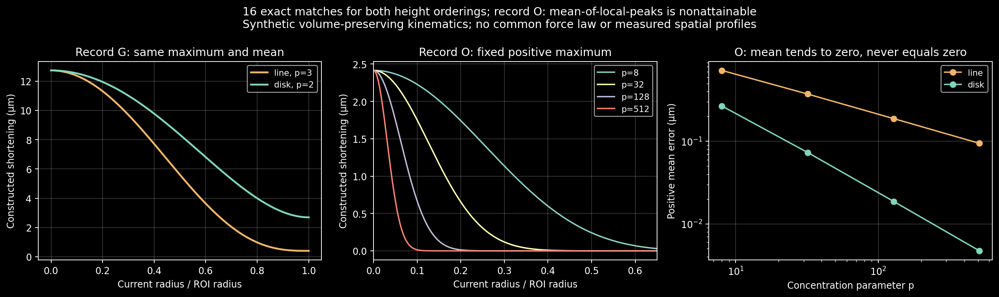

# What the four summaries can establish before mechanics

**Sixteen of the seventeen source records admit exact volume-preserving kinematic paths under either ordering of the height maximum and spatial mean. The remaining record has a zero reported mean and a positive maximum: it is a nonattained boundary under one explicitly stated observation class, with arbitrarily accurate approximations.** This is a classification of summaries, not a common mechanical fit, a criticism of the experiment, or a novel biological mechanism.

The [exact-rational implementation](../scripts/temporal_mean_order_robust_witness.py) and [174-check classification receipt](../evidence/temporal_mean_order_robust_witness.json) retain all seventeen records. The earlier failed attempt to construct seventeen exact nonnegative profiles is preserved under `runs/temporal_mean_order_robust/initial_failure/`; record O was not deleted or assigned an invented measured epsilon. The [independent review](TEMPORAL-ORDER-ROBUST-REVIEW.md) distinguishes the mathematical assumptions from the source definitions.

## 1. Two different height summaries

Let signed local height shortening be \(S(t,r)\), with normalized line or projected-disk weights \(d\nu(r)\) on \([0,R]\). The summaries

\[
 V_1=\sup_t\int S(t,r)\,d\nu(r),\qquad
 V_2=\int\sup_t S(t,r)\,d\nu(r)
\]

obey \(V_1\le V_2\). They need not agree. The [source audit](JOINT-OBSERVATION-CONTRACT.md) finds that the Methods wording favors \(V_2\); the exact masks, temporal sampling and reference implementation remain unresolved. Our [earlier parabolic paths](TEMPORAL-MEAN-WITNESS.md) establish feasibility for \(V_1\), including record O, but generally not \(V_2\).

Here we construct paths for which both height summaries agree. Component summaries remain **separate temporal maxima of regional means**,

\[
 A=\sup_t\int a(t,r)\,d\nu(r),\qquad
 B=\sup_t\int b(t,r)\,d\nu(r),\quad S=a+b.
\]

We do not interchange mean and maximum for these component observables. Their source definition is a separate unresolved issue.

## 2. An exact nonnegative profile for every positive mean

Given \(0<V\le M<H\), choose an integer \(p\ge2\) such that

\[
 F_p=\int_0^R(1-(r/R)^2)^p\,d\nu(r)\le V/M.
\]

For disk weights \(F_p=1/(p+1)\); for line weights

\[
 F_p=\prod_{k=1}^p\frac{2k}{2k+1}\longrightarrow0.
\]

The limit also follows directly from dominated convergence. Set

\[
 C=\frac{V-MF_p}{1-F_p},\qquad
 S_*(r)=C+(M-C)(1-(r/R)^2)^p.
\]

Then \(0\le C\le S_*\le M\), \(S_*(0)=M\), and \(\int S_*d\nu=V\). The code verifies these identities with exact fractions, using an independently expressed moment recurrence as a check. Among the sixteen actual positive-mean records, the largest chosen \(p\) is 20.

Ramp from \(S=0\) to \(S=S_*\), then hold it fixed. Because \(S_*\ge0\), the pointwise temporal peak is exactly \(S_*\). Consequently \(V_1=V_2=V\), while the global spatial-temporal maximum is \(M\).

## 3. Separate component peaks need not add to the height peak

If \(V\le A+B\), prescribe regional-mean component states

\[
 (\bar a,\bar b):\quad (0,0)\ \longrightarrow\ (A,V-A)
 \ \longrightarrow\ (V-B,B).
\]

During the first segment ramp the profile and the components proportionally. During the second hold \(S_*\) fixed and interpolate the component allocation. Choose \(a\) spatially constant within the ROI at each time and \(b=S-a\). The separate temporal peaks of the regional means are \(A,B\), since \(V-B\le A\) and \(V-A\le B\). The instantaneous identity \(\bar a+\bar b=\bar S\) is never violated. Signed intermediate component motions are allowed.

This construction does not establish the same component summaries under \(\int\sup_t a\,d\nu\) or \(\int\sup_t b\,d\nu\): initial-zero clipping of negative local motions can change them. It is robust to the **two height-mean orderings only**.

## 4. Exact volume preservation and fixed outer rim

The nonnegative core shortens, so compensation must occur outside it. Let \(R_o>R\), \(d=R_o-R\), and \(x=(r-R)/d\). Extend

\[
 S_{\rm ann}(r)=C(1-x)-Kx(1-x),
\]

where

\[
 I_c=\frac{R^2}{2}\left(C+\frac{M-C}{p+1}\right),\quad
 I_L=d(R/2+d/6),\quad I_B=d(R/6+d/12),\quad
 K=(I_c+CI_L)/I_B>0.
\]

This gives \(\int_0^{R_o}rS(r)\,dr=0\), continuity at the core edge, and \(S(R_o)=0\). Also \(S_{\rm ann}\le C\le M\), hence thickness \(h=H-S\ge H-M>0\). Extend apical motion linearly to zero at the rim and set \(b=S-a\). Apply the compensated extension at every time.

Define a reference radial coordinate by

\[
 \rho(r)^2=\frac{2}{H}\int_0^r xh(x)\,dx.
\]

It is strictly increasing, and volume compensation gives \(\rho(R_o)=R_o\). With inverse \(r=r(\rho)\), use

\[
 (\rho,z,\phi)\mapsto
 \left(r(\rho),\ b(r(\rho))+\frac{h(r(\rho))}{H}z,\ \phi\right).
\]

Its axisymmetric Jacobian is

\[
 J=\frac r\rho\frac{dr}{d\rho}\frac hH=1
\]

almost everywhere, with a fixed outer rim, positive thickness and global injectivity. Core/annulus derivatives may jump; this is a piecewise smooth Lipschitz construction, not a claim of globally smooth equilibrium. See the [independently checked radial-transport construction](STATIC-MEAN-COMPATIBILITY.md).

## 5. Record O: exact nonattainment, but no positive error floor

Record O reports \(V=0\) and \(M=2.41505646\) µm. Suppose the observation includes a pointwise-zero initial reference, the spatial field is continuous, and the averaging weights give positive measure to every nonempty relative open interval. Then \(P(r)=\sup_t S(t,r)\ge0\). Any positive value of \(S\) persists on a spatial neighborhood at that time, so \(M>0\) implies \(\int P\,d\nu>0\). Thus \(V_2=0<M\) is unattainable under these assumptions.

This does **not** exclude \(V_1=0<M\) for signed fields: the earlier parabolic path realizes it. Nor does it establish that the reported data violate their actual observation pipeline; pointwise initial zero, clipping, rounding, masks and spatial support have not been verified there.

There is nevertheless no strictly positive uniform mean discrepancy forced by continuity alone. The sequence

\[
 S_p(r)=M(1-(r/R)^2)^p
\]

has fixed maximum \(M\) and positive mean \(\varepsilon_p=MF_p\to0\). Use the same annulus/radial construction and replace \(V\) by \(\varepsilon_p\) in the component path. For sufficiently large \(p\), \(\varepsilon_p\le A+B\), so \(A,B,M\) remain exact and only the mean differs. Exact finite-sequence receipts for \(p=8,32,128,512\) are retained for both weights. The error infimum is zero but is not attained in this class.

The figure shows constructed profiles, not measured spatial traces. The horizontal concentration scale has no independently imposed biological cutoff.

## 6. Consequence for the original five-gate study

Summary incompatibility in a static model can disappear when separate peak times are allowed. Conversely, one exact zero makes an observation class nonclosed without a positive quantitative discrepancy floor. These facts prevent us from mistaking observation assumptions for a mechanical discovery.

Each record and weighting receives its own constructed path. No shared material, gain, force balance, chemical activation dynamics, physical timescale, constitutive stress bound or common equilibrium branch is supplied. In particular, these witnesses do not prove that the model-compatible set \(\Theta_\delta\) is nonempty. Actual material inference and uncertainty-propagated predictions under the original [five-gate contract](../PLAN.md) remain required. The underlying maximum/mean inequalities, concentration sequences and radial volume transport are standard mathematics; no originality claim is attached.
