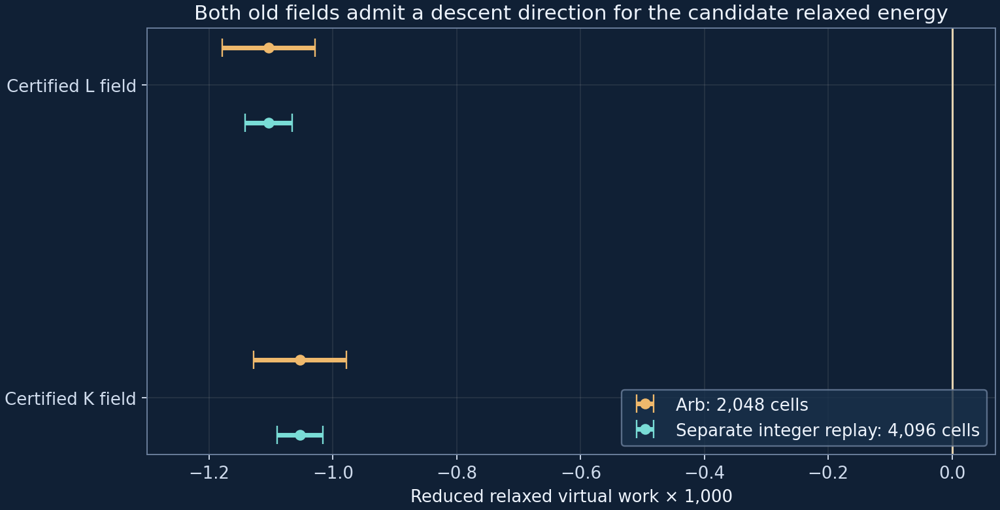
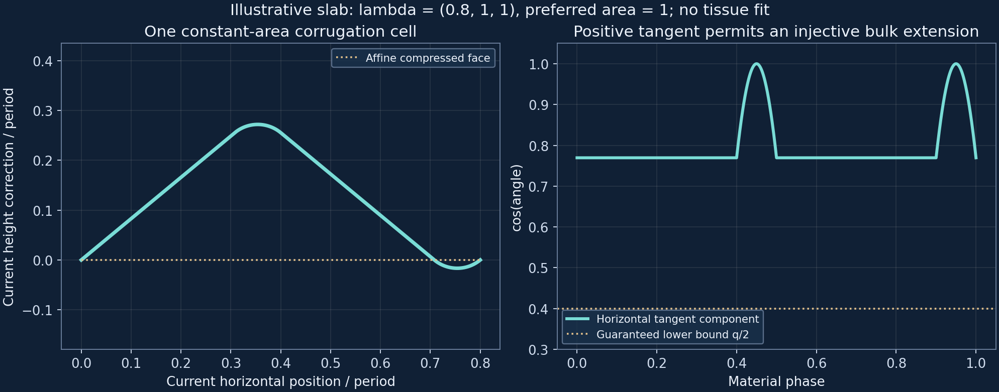
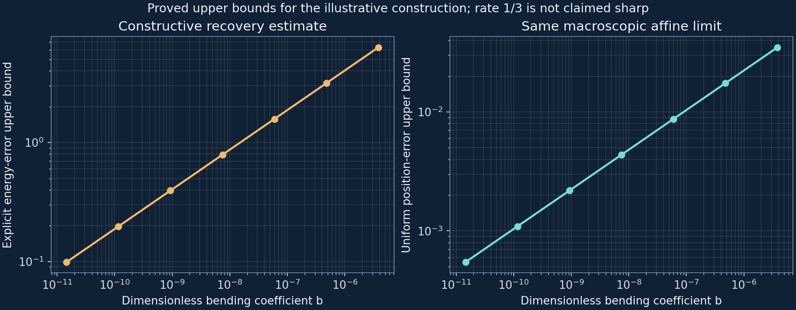

# Relaxed force balance and finite-height surface recovery

**Shape convention:** see [How we describe tissue shape mathematically](../../../docs/SHAPE-DESCRIPTION.html). The diagnostic uses the existing finite-dimensional axisymmetric body map and one fixed nodal variation. The slab theorem uses a separate explicit 3D affine-periodic embedding. Its illustrative folds are not fitted tissue equilibria.

## Outcomes of the three authorized steps

| Step | Result | Verification and limit |
|---|---|---|
| 1. Isolate and verify the image-runtime upgrade | Pillow 13.0.0 installed in an isolated environment. Active dependency pin updated; exact historical dependency bytes preserved. Image privacy checker rejects Pillow older than 13. | All 45 saved raster images decode to identical RGBA pixels in old/new runtimes. Matplotlib canvas pixels and PNG/TIFF/JPEG/GIF checks pass. Base historical interpreter unchanged. This does not fix the separate low-severity Torch alert. |
| 2. Test relaxed virtual work at certified fields | Strictly negative virtual work at both archived K/L calibration fields. Neither is stationary for the candidate relaxed surface density in the original finite space. | Complete certified nodal boxes, transition-safe positive-part law, an Arb enclosure and a separate directed-integer replay. No new equilibrium or biological shape change has been computed. |
| 3. Prove the periodic finite-slab construction | A constructive injective fixed-height recovery sequence with explicit positive determinant, exact relaxed face area, finite bending, and an O(b^(1/3)) upper estimate. | Written derivation, symbolic determinant/curvature identities, four interval angle brackets and separate 320-bit constant replay. No matching lower bound, full cylinder limit or minimizer-selection result is claimed. |

These are scoped completed steps, not completion of the five-gate study. External mathematical peer review and a theorem-level originality audit remain outstanding.

## 1. Runtime upgrade without rewriting the historical computation

The image-processing library Pillow was pinned to 11.0.0. GitHub reported 56 Pillow advisories, including five critical alerts. The active requirements now pin 13.0.0. The exact earlier file is retained as a non-installable [historical environment record](../../../reproducibility/environment-before-pillow13.record), with [migration provenance](../../../reproducibility/ENVIRONMENT-PROVENANCE.json). This is an explicit change to image-runtime dependencies, not a change to the frozen mechanics or numerical target.

The local comparison used an isolated virtual environment sharing the unchanged numerical packages and overriding Pillow locally. The default historical interpreter still has Pillow 11.0.0. That interpreter is not the active image-processing runtime. The public privacy script rejects it before opening images. Fresh installations should use the active requirements; an existing environment should be upgraded and checked in isolation.

The retained [pixel comparison](pillow13_regression.json) verifies all 45 saved raster assets and the Matplotlib RGBA canvas against the old runtime. Generated PNG and TIFF roundtrips preserve exact pixels; JPEG and GIF decode successfully with the expected dimensions. The [old-runtime rejection check](old_runtime_guard.json) confirms that the guarded privacy checker fails with a clear message under Pillow 11. The [baseline privacy check](pillow13_privacy_baseline.json) and scoped mathematical publication replay pass under the new interpreter. These tests use trusted saved/generated images; no malicious exploit files were executed.

The separate Torch advisory was not addressed by changing numerical kernels. A Torch upgrade requires its own CUDA/CPU compatibility and numerical regression assessment. [Official Pillow 13.0.0 release notes](https://pillow.readthedocs.io/en/stable/releasenotes/13.0.0.html).

## 2. Exact scope of the K/L fields

The authenticated inputs identify `optoGEF2_small_col_K` and `optoGEF2_small_col_L`: **small-patch calibration fields at different optical doses, with the same material operator**. Their doses are approximately 1.28898317 and 1.51057344 in the declared normalized input convention. The [source readback](scope_readback.json) retains the record identities and geometry.

**Scope correction:** the earlier next-step proposal described the two fields used for the 58-negative-window stress scan as large-region fields. The frozen input identities show that label was incorrect. The result here concerns K/L calibration fields, not the two transferred large-patch witnesses. The correction changes the application scope, not the signed arithmetic. It is not a test of the held-out large-region shapes or a new calibration-versus-transfer conclusion.

## 3. Derive the virtual-work diagnostic

The original face density and its proposed relaxed counterpart are

\[
\psi_s(J_s)=\frac{K_s}{2}(J_s-1)^2+T_sJ_s,
\qquad \psi'_{s,\mathrm{rel}}(J_s)=\max\{\tau_s,0\},
\quad \tau_s=K_s(J_s-1)+T_s.
\]

At an exact old finite-dimensional equilibrium \(y_*\), the old first variation is zero for every admissible variation in that space. Subtraction therefore gives

\[
DE_{\mathrm{rel}}(y_*)[v]
 =-\sum_s\int_{\{\tau_s<0\}}\tau_s DJ_s(y_*)[v]\,dA_0.
\]

The correction is continuous through \(\tau_s=0\). There is no additional moving-boundary term: the two densities agree there and their derivative difference vanishes there. This identity tests the candidate effective density; its physical derivation for the full curved cylinder is a separate unproved problem.

Fix a radial unit P2 midpoint variation at apical ordered edge 10, node 323, degree of freedom 646. It is zero at every other node, satisfies the original axis/rim restrictions, and has trace on exactly one surface edge. On that edge, for local coordinate \(t\in[0,1]\),

\[
v_r=4t(1-t),\qquad v_z=0,
\qquad J_s=\frac rR\ell,\quad \ell=\sqrt{r_R^2+z_R^2}.
\]

Differentiating with respect to the variation and multiplying by the reference radial weight gives

\[
R DJ_s[v]=v_r\ell+
 \frac r\ell(r_Rv_{r,R}+z_Rv_{z,R}).
\]

The reported reduced virtual work is

\[
I=\int_{\mathrm{edge}}
 [K_s-T_s-K_s(r/R)\ell]_+
 \left[v_r\ell+\frac{r r_R v_{r,R}}\ell\right]dR.
\]

For the original positive energy normalizer \(S\), \(DE_{\mathrm{rel}}[v]=(2\pi/S)I\). Thus a strictly negative bound on \(I\) proves a genuine descent direction. The strict geometric guards at the archived root permit sufficiently small steps along this finite-element variation.

## 4. Certify the diagnostic rather than sample a rounded field

The producer evaluates the complete P2 trace over each of 2,048 closed subintervals, using the full previously certified nodal posterior box. It encloses the square root, derivative and positive-part compression law with 160-bit Arb balls. Each cell's range times its exact length is a valid integral enclosure; summing covers the whole edge, including any compression transitions.

The separate replay uses signed integers representing intervals on a 96-bit dyadic grid, directed rounding for every product and quotient, and integer square roots. It does not import the Arb integration code. It uses the same authenticated historical input loader, then evaluates an endpoint-linear plus midpoint-bubble representation on 4,096 cells.

The exact rational endpoints are retained in the [Arb result](virtual_work_radial_2048.json) and [separate integer result](virtual_work_integer_recentered_4096.json). Conservative readable enclosures from the producer are:

| Calibration field | Reduced virtual work, rigorous outward-rounded enclosure |
|---|---|
| K | \([-0.001129,-0.000978]\) |
| L | \([-0.001180,-0.001028]\) |

Both intervals are strictly negative. The narrower integer enclosures independently establish the same sign. Interval overlap is not the proof; each implementation has its own strict signed bound.

The first direct-basis integer enclosures at 4,096 and 32,768 cells were too wide and did not establish a sign. Those failed attempts and source versions are retained under `failures/`. Algebraically recentering the same P2 polynomial reduces dependency inflation. The acceptance criterion, direction, physical fields and root boxes were unchanged.

**Conclusion:** the original certificates remain certificates for their original energy. Under the candidate relaxed surface density, these two fields are no longer stationary even in the old axisymmetric finite space. This requires a new equilibrium calculation for that new density. The chosen variation is radial and leaves the nodal heights unchanged; the descent therefore does not itself prove a change in a material mean-height observable. No numerical lower bound on macroscopic fold change is claimed.

## 5. Prove that fine folds can fit into a finite body

The separate [finite-slab theorem](THEOREM.html) takes a fixed positive height and a positive diagonal affine base. A periodic constant-speed curve raises each compressed free-face area to its preferred value. A smoothstep collar extends it into the bulk. The proof gives:

\[
\det\nabla y_b\ge\tfrac14\det F_0>0,
\qquad \|y_b-y_0\|_\infty\le C_y b^{1/3},
\]

\[
|E_b[y_b]-E_{\mathrm{rel}}[y_0]|\le C_E b^{1/3}.
\]

The surface area matches the relaxed density exactly. The bulk disturbance occupies a collar of depth proportional to the corrugation period \(\varepsilon\), costing at most a constant times \(\varepsilon\). Bending costs at most a constant times \(b/\varepsilon^2\). Choosing integer periods with \(\varepsilon\) comparable to \(b^{1/3}\) yields the estimate.

Positive determinant is supplemented by an actual global injectivity proof: horizontal fibers are strictly ordered, and height is strictly monotone at fixed current horizontal position. Two free faces use disjoint collars; a prescribed face can instead remain unchanged. The proof permits volume changes and does not impose exact incompressibility. It has affine-periodic lateral conditions, not the full cylinder's lateral clamp.

The [symbolic and interval checks](slab_verification.json) verify the determinant identity, curvature numerator, angle mean, four exact angle brackets and seven explicit bound rows. A [separate 320-bit replay](slab_independent_constants.json) confirms the saved signs and upper constants. This is separate arithmetic checking, not outside expert review of the full written proof.

The illustrated parameters are \(F_0=\operatorname{diag}(0.8,1,1)\), with unit preferred face area and unit illustrative bulk coefficients. They are not a tissue fit. The constants are conservative. No matching lower bound proves the exponent optimal, and the result does not establish that actual minimizers retain the macroscopic affine shape.

## 6. What we learn and what remains open

The current model's limitation is substantive: restoring the candidate relaxed surface law changes the force balance at certified calibration fields, even before solving an angular wrinkle problem. Keeping the old field and merely adding a visual wrinkle texture would not satisfy the new equilibrium equations.

The slab theorem supplies an explicit, admissible mechanism for surface relaxation in a finite-height body. The open next step is to extend the construction to a nonuniform curved base with the actual cylinder boundary conditions, establish the relevant lower-bound/compactness result, and solve or certify the relaxed equilibria. A quantified coarse-shape theorem additionally needs observable growth or a validated prediction profile, plus branch accessibility and a biologically meaningful scale window.

Classical tension-field relaxation, smooth periodic folds, boundary matching, negative surface stress and bending regularization are prior art. The closest sources include [Conti, DeSimone and Müller, 2005](https://people.sissa.it/~desimone/Publications/CDM2005.pdf) and [Binysh, Wilks and Souslov, 2022](https://arxiv.org/html/2101.04006v2). The present results are a source-specific certified diagnostic and a scoped constructive adaptation. **No new general concept or publication priority is established.**

The chemical-to-stress link, measured constitutive parameters, matched observation timing/ROIs, global continuum prediction and developmental trajectory remain separate requirements. None is supplied by the runtime repair or this prototype theorem.

## 7. Recheck the released evidence

The [release identity and signed-bound check](../../../verification/site/executed-slab-20261121/scalar-release.json) checks the exact source bindings and strict rational inequalities. The [site-wide static rendering receipt](../../../verification/site/executed-slab-20261121/static/receipt.json), [JavaScript-enabled rendering receipt](../../../verification/site/executed-slab-20261121/javascript/receipt.json) and [privacy screen](../../../verification/site/executed-slab-20261121/privacy.json) assess the current public presentation. Their scopes differ from mathematical proof and experimental validation. Post-deployment commit and served-byte receipts are retained separately to avoid a self-referential commit record.
