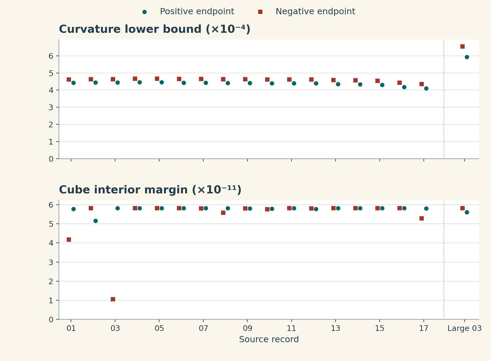

# 36 strict minima of the cached-quadrature energies

Each of the 36 fixed parameter and drive cases has a unique minimum of its normalized cached-quadrature energy within a matched closed cube. Each minimum lies strictly inside its cube.

The smallest normalized Hessian eigenvalue lower bound is **4.09887 × 10⁻⁴** (+small 17). The smallest certified interior margin is **1.06061 × 10⁻¹¹** (−small 03).

For a whole-cube defect $Z_Q$ and the fixed preconditioner $R$, the lower Hessian bound is $m=(1-Z_Q)/\|R\|_\infty>0$. The same $R$ has an independently verified positive-definite symmetric part. Smoothness and the lower Hessian bound give an energy gap of at least $(m/2)\|u-u_*\|_2^2$ for every $u$ in the cube.

For each of the 18 source records, the two markers show the positive and negative endpoint. Curvature is for the normalized cached energy. The interior margin is r − e in dimensionless free coordinates, for r = 2⁻³⁴.

## Root localization and observer errors

For +small 02, the native posterior of 9.05979 × 10⁻¹¹ came from the larger radius 2⁻³². The unchanged point force and a fresh whole-cube derivative bound give a strict self-map on the smaller cube, with posterior 6.59641 × 10⁻¹². The two cubes share the same center, so uniqueness on the larger cube identifies the same root. The frozen observer error uses the original native posterior. The two recentered proofs retain their actual shifts σ and archived binary addition gaps ξ.

These minima concern the frozen binary cached-quadrature energies. Exact-spatial finite-element integration, continuum equations, loading stability, and experimental compatibility require separate evidence.

## All 36 bounds

| Case | Normalized Hessian lower bound | Cube interior margin |
|---|---:|---:|
| +small 01 | 4.43613035e-04 | 5.77214989e-11 |
| −small 01 | 4.60919957e-04 | 4.18043212e-11 |
| +small 02 | 4.44329565e-04 | 5.16112544e-11 |
| −small 02 | 4.62841095e-04 | 5.82007104e-11 |
| +small 03 | 4.44865965e-04 | 5.81095034e-11 |
| −small 03 | 4.63849391e-04 | 1.06061144e-11 |
| +small 04 | 4.45506622e-04 | 5.82068683e-11 |
| −small 04 | 4.65670255e-04 | 5.81852609e-11 |
| +small 05 | 4.45490144e-04 | 5.82065754e-11 |
| −small 05 | 4.65703001e-04 | 5.81938826e-11 |
| +small 06 | 4.43059221e-04 | 5.82063829e-11 |
| −small 06 | 4.64460004e-04 | 5.81055166e-11 |
| +small 07 | 4.42603134e-04 | 5.81567641e-11 |
| −small 07 | 4.64100527e-04 | 5.80277086e-11 |
| +small 08 | 4.41728534e-04 | 5.82062954e-11 |
| −small 08 | 4.63393676e-04 | 5.57117348e-11 |
| +small 09 | 4.41104678e-04 | 5.80237349e-11 |
| −small 09 | 4.62874948e-04 | 5.80368955e-11 |
| +small 10 | 4.40519659e-04 | 5.78209594e-11 |
| −small 10 | 4.62382436e-04 | 5.75519180e-11 |
| +small 11 | 4.40114784e-04 | 5.82003522e-11 |
| −small 11 | 4.62039572e-04 | 5.82043658e-11 |
| +small 12 | 4.39343377e-04 | 5.77318759e-11 |
| −small 12 | 4.61378752e-04 | 5.80033565e-11 |
| +small 13 | 4.34818752e-04 | 5.82076414e-11 |
| −small 13 | 4.58116598e-04 | 5.81429166e-11 |
| +small 14 | 4.34204969e-04 | 5.82065474e-11 |
| −small 14 | 4.57527940e-04 | 5.82067297e-11 |
| +small 15 | 4.30815726e-04 | 5.82067991e-11 |
| −small 15 | 4.54481065e-04 | 5.82067661e-11 |
| +small 16 | 4.18579674e-04 | 5.82038394e-11 |
| −small 16 | 4.43239158e-04 | 5.82076327e-11 |
| +small 17 | 4.09887398e-04 | 5.80845848e-11 |
| −small 17 | 4.35606320e-04 | 5.28567054e-11 |
| +large 03 | 5.92966049e-04 | 5.60379653e-11 |
| −large 03 | 6.53492658e-04 | 5.81585572e-11 |

[Exact scalar readback](../independent_readback/receipt.json) · [Proof and interpretation](../independent_readback/READBACK.md) · [Observed exit](../independent_readback/os_exit_observation.json) · [Exact plot data (CSV)](bounds.csv)
