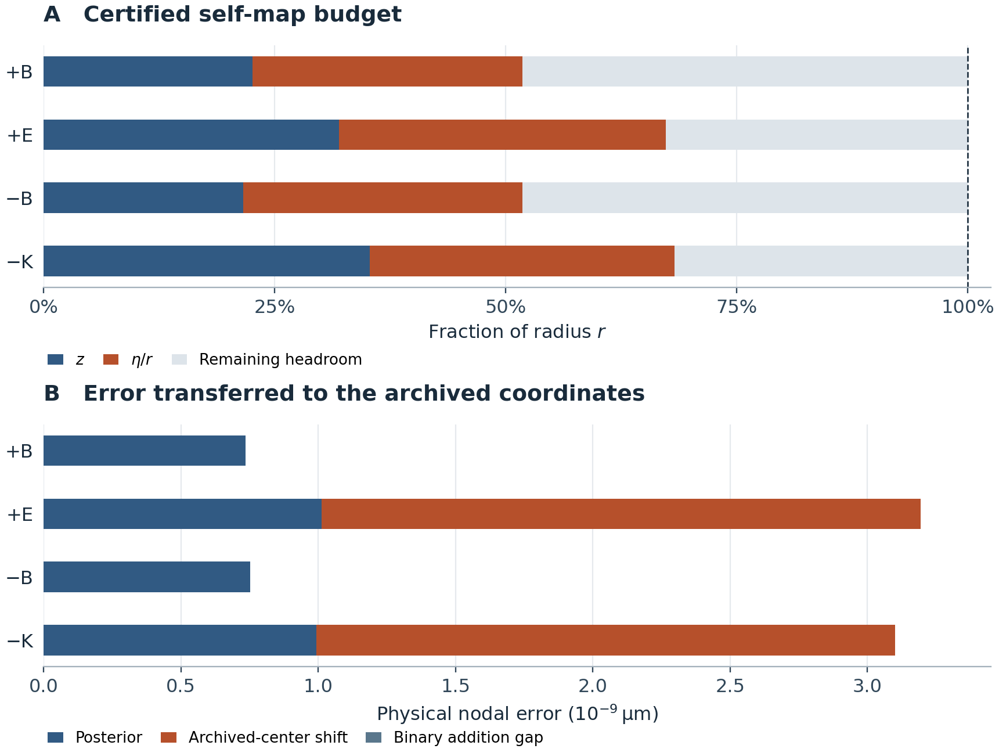

# Exact spatial mechanics in the first new wave

Four additional fixed-input finite-element equilibria have a unique root in their respective certified cubes and a strict local energy minimum. The cumulative count is **8 of 36** roots with exact spatial integration. All **36 of 36** also have independently certified cached-quadrature roots. The four earlier exact-spatial certificates are documented separately. [Earlier exact-spatial checkpoint](../../four_spatial_checkpoint_v1/SPATIAL.html) · [Cached-quadrature checkpoint](../../../full_outcome_coverage_v1/observer_checkpoint_v1/OBSERVERS.html)

## Mechanics and contraction

The fixed cubes have radius $r=2^{-34}$ in normalized free coordinates. The signed residual gives $\eta\geq\lVert RF_I(u_c)\rVert_\infty$ at the center. The whole-cube bound $z=Z_Q+b_H$ controls $\lVert I-RH_I\rVert_\infty$ using the cached derivative bound and the spatial Hessian correction. All four satisfy the strict self-map inequality.

$$
\eta/r+z<1.
$$

Headroom is $1-z-\eta/r$, shown as a percentage of the cube radius. The positive symmetric part of the same $R$ and the whole-cube derivative bound give the following lower bound on the normalized energy Hessian.

$$
\lambda_{\min}(H_I) \ge (1-z)/\lVert R\rVert_\infty > 0.
$$

| Case | $z$ | Headroom | Curvature lower |
| --- | --- | --- | --- |
| +B | 0.22629 | 48.18% | 0.000442482 |
| +E | 0.31937 | 32.70% | 0.000415655 |
| −B | 0.21602 | 48.17% | 0.000459586 |
| −K | 0.35302 | 31.75% | 0.000406378 |

Here **+** and **−** identify the two fixed parameter endpoints. B, E and K are archived small-field record labels. Numeric tables display rounded values, with the geometry lower bounds rounded down. [Exact rational bounds and case identities](exact_bounds.csv)

## Geometry and archived observer coordinates

Independent geometry checks covered all 144 body elements and 24 surface traces in each complete cube. They give positive body Jacobian, positive trace metric, positive trace hoop, and a positive body monotonicity bound. The table shows the first three lower bounds.

| Case | Body $J$ lower | Trace $G$ lower | Hoop lower |
| --- | --- | --- | --- |
| +B | 0.99732 | 0.85318 | 0.93337 |
| +E | 0.97039 | 0.86806 | 0.93083 |
| −B | 0.99722 | 0.85318 | 0.93336 |
| −K | 0.96129 | 0.87093 | 0.92431 |

The posterior is $e=\eta/(1-z)$. The center shift $\sigma$ is zero for the two B evaluations. For +E and −K, the proof center shifts while observer comparisons continue to use the original archived fields. The transfer bound includes the original binary coordinate-addition gap $\xi$.

$$
\epsilon = 33.5(e+\sigma+\xi)\,\mu\mathrm{m}.
$$
 The posterior and shift columns are in normalized nodal coordinates.

| Case | Posterior | Center shift | Nodal error (µm) |
| --- | --- | --- | --- |
| +B | 2.1964e−11 | 0 | 7.3580e−10 |
| +E | 3.0246e−11 | 6.5128e−11 | 3.1950e−9 |
| −B | 2.2445e−11 | 0 | 7.5191e−10 |
| −K | 2.9641e−11 | 6.2901e−11 | 3.1002e−9 |

[Independent geometry closure](../../remaining32_geometry_v1/independent_actual_preparation/actual_replay/receipt.json) · [Independent global signed reduction](../first_wave_reduction_v1/independent_actual_preparation/actual_replay/receipt.json) · [Figure data with exact rational endpoints](figure_data.json)

## Four observers per convention

The same frozen model-discrepancy allowance applies to all comparisons. The very small nodal bounds above quantify numerical error in reaching a root. The allowance governs mismatch between the model observer and the archived measurement. These bounds leave physical accuracy and experimental detectability open. Each of the four fields contributes four observables to each convention. All **16 primary comparisons are IN**. Of **48 alternative comparisons**, 47 are IN and one is OUT.

| Convention | IN | OUT |
| --- | --- | --- |
| Disk, spatial maximum (primary) | 16 | 0 |
| Disk, regional mean | 15 | 1 |
| Radial line, spatial maximum | 16 | 0 |
| Radial line, regional mean | 16 | 0 |

The OUT result is the **apical regional mean at −K** under disk averaging. Its absolute residual lies in **[5.559945785, 5.559945802] µm** after outward decimal rounding. The allowance is at most **5.389835675 µm** at the displayed precision. The exact difference between the residual lower endpoint and the exact allowance is positive, at least **0.170110110 µm** after rounding down. The archived data key names the apical channel; the disk regional-mean convention determines the statistic in this row. [All 64 comparisons and the exact OUT deficit](exact_observer_comparisons.csv) · [Independent observer readback](../first_wave_observer_v1/independent_readback/actual/receipt.json)

## Independent intervals and scope

The independent component replay enclosed the signed point force correction, the whole-cube Hessian correction, and the same-coordinate cache correction separately. It retained the full interval hull of each producer and independently valid enclosure for the signed reduction. Among the 672 components, 519 force entries and 307 Hessian entries had independent enclosures that extended outside the corresponding producer interval. No channel had a disjoint pair. The independent validity of the intervals supports the reduction. Their overlap is a consistency check. [Signed interval hull policy](../admission/INDEPENDENT-HULL-IMPLEMENTATION-POLICY.md)

The certificates cover eight fixed inputs and their stated cubes. Twenty-eight exact-spatial targets remain outside this checkpoint. The observer outcome is sensitive to the stated averaging convention. The fixed-input cubes and observer inequalities leave source compatibility, loading stability, and continuum adequacy open.
