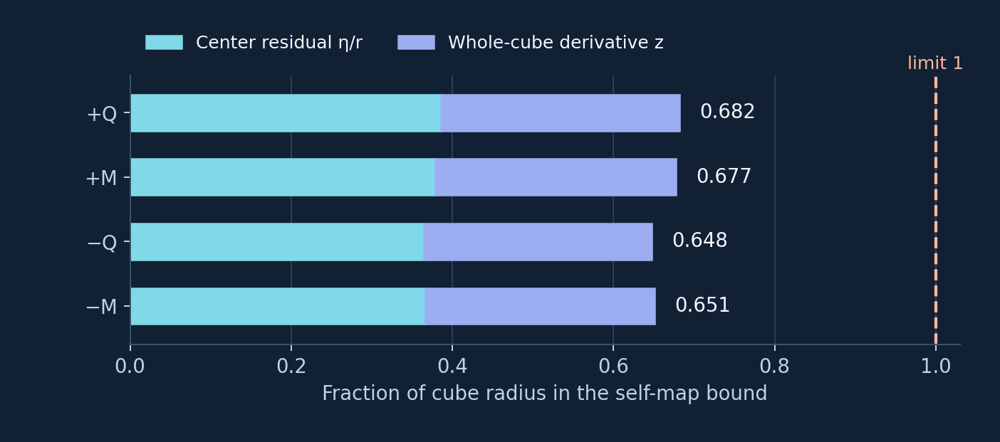
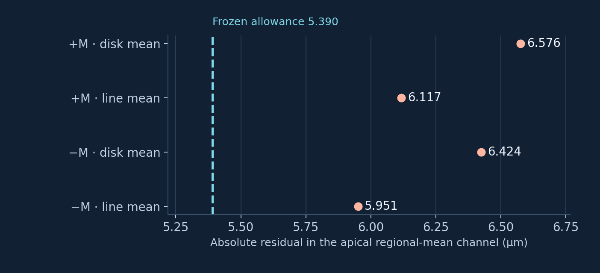

# Wave 02 exact-spatial roots and observer bounds

Four more fixed-input equilibria have independently verified exact-spatial roots and strict local energy minima. The count is now **12 of 36** after matching case IDs across the original four, the first new wave and wave 02. This includes ten small fields and two large fields. All 36 already have cached-quadrature proofs. [Wave 02 signed reduction](../global_reduction_v1/independent/results.json) · [First-wave report](../../../../first_wave_checkpoint_v1/REPORT.html)

## Root and minimum proofs

The four new cases use small records Q and M at both frozen material choices. The + and − labels name the two material choices. For each cube of radius \(r=2^{-34}\), \(\eta\) bounds the signed preconditioned center residual and \(z\) bounds the full-cube derivative. The independently verified local self-map requires

\[
\eta/r+z<1.
\]

The normalized curvature lower bound is \((1-z)/\lVert R\rVert_\infty\) using the verified positive symmetric part of the same \(R\). Positive exact body and trace domains apply on each certified cube. Headroom below is \(1-z-\eta/r\). The observer error uses the root posterior \(e\), archived center shift \(\sigma\), and original binary addition gap \(\xi\).

\[
\epsilon=33.5(e+\sigma+\xi)\,\mathrm{\mu m}.
\]

| Case | \(z\) | Headroom | Curvature floor | Nodal error (µm) |
|:--|--:|--:|--:|--:|
| +Q | 0.29585 | 31.80% | 0.000427712 | 1.069e-09 |
| +M | 0.29797 | 32.29% | 0.000426925 | 1.053e-09 |
| −Q | 0.28312 | 35.24% | 0.000449222 | 9.915e-10 |
| −M | 0.28517 | 34.89% | 0.000448536 | 9.982e-10 |

The table shows rounded displays. Exact proof endpoints determine all decisions. [Exact bounds CSV](exact_bounds.csv) · [Observed independent process](../global_reduction_v1/independent/root_observed_exit.json)

## Observer comparisons at the same allowance

The frozen maximum residual allowance is approximately **5.389835675 µm**. It expresses a model discrepancy threshold. The wave 02 independent scalar replay recovered **16 primary IN**, and **44 IN / 4 OUT** across the three alternatives. All four OUT rows are comparisons of the apical regional mean at M. The plotted intervals are far narrower than one pixel.

| Convention | Wave 02 IN | OUT | Cumulative IN | OUT |
|:--|--:|--:|--:|--:|
| Disk, component maxima | 16 | 0 | 40 | 0 |
| Disk, component means | 14 | 2 | 37 | 3 |
| Radial line, component maxima | 16 | 0 | 38 | 2 |
| Radial line, component means | 14 | 2 | 36 | 4 |

The cumulative exact small-field coverage consists of **40 primary IN** and **111 alternative IN / 9 OUT**. Twenty-four small fields and 96 primary inequalities remain for the specified exactly integrated two-candidate comparison. Timing, a source-matched large shape outcome, and an experimental error model remain open. [All 64 exact wave comparisons](exact_observer_comparisons.csv) · [Independent scalar receipt](../observer_application_v1/independent_actual_readback/receipt.json)

## Separate K–L loading check

At the already certified negative-material K and L states, the same finite-element law and fixed 24-element active support give a negative signed difference in the coefficient \(V\) of activation energy. With the common positive normalization factor removed, the independent bound encloses

\[
\begin{aligned}
\frac{\Delta V}{2\pi/S} &\in [-0.0003613543734162,\\
&\hspace{1em}-0.0003613542656077].
\end{aligned}
\]

On a differentiable branch of strict minima of \(E_0+gIV\), the derivative is \(dV/dI=-g\nabla V^T H^{-1}\nabla V\le 0\). The certified endpoint order satisfies this necessary condition. Intermediate roots, branch continuity, and loading from zero still need separate certificates. The two endpoints alone also leave biological dynamics, continuum accuracy, and source compatibility unresolved. [Independent active-energy calculation](../../../../../negative_KL_active_energy_v1/independent_actual/receipt.json) · [Loading-tube design](../../../../../../../../exact_loading_tube_design_v1/METHOD.md)
