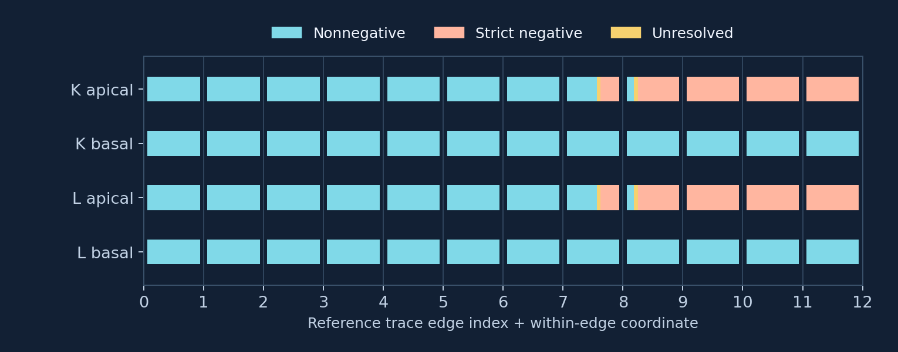
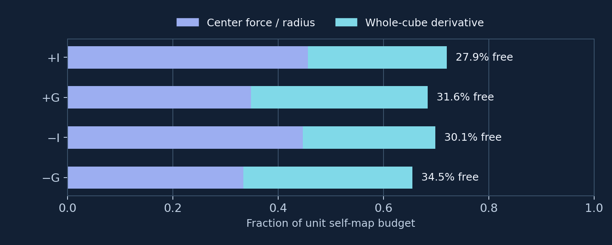

# Wave 03 exact-spatial roots and transverse stability

Four new exact-spatial root and minimum proofs bring the total to **16 of 36** frozen fixed-input outcomes. A separate transverse test gives a stricter limit on interpretation. At the previously certified negative-material K and L fields, the natural three-dimensional extension of the same energy admits lower-energy angular perturbations. Both facts hold because the finite axisymmetric certificate tests only zero-swirl meridional degrees of freedom. [Wave 03 root proofs](../global_reduction_v1/independent/results.json) · [Independent K/L transverse result](../../../../../../../../nonaxisymmetric_surface_sign_preparation_v1/root_actual_acceptance.json)

## Transverse stability at K and L

The surface density on either disk is \(K_s(J_s-1)^2/2+T_s(J_s-1)\). Its derivative with respect to the area ratio \(J_s\) gives the total surface stress coefficient,

\[
\tau_s=K_s(J_s-1)+T_s.
\]

At a compressed patch, the area-elastic term can make \(\tau_s\) negative. The exact P2 traces and certified posterior nodal enclosures give **58 strictly negative, 276 nonnegative, and 2 unresolved windows per anchor**. The independent readback verified all 672 windows, and every strict negative window lies on the apical face. The same apical witness on edge 7, at local coordinate \(t\in[5/8,11/16]\), has the following outward-rounded bounds. Here \(r_R\) is the radial derivative with respect to reference radius, and \(-\tau_a r_R^2/J_s\) is the positive weight associated with the negative angular surface term.

| Anchor | Upper bound on \(\tau_a\) | Lower bound on \(-\tau_a r_R^2/J_s\) |
|:--|--:|--:|
| K | −0.000110474142 | 0.000108675752 |
| L | −0.000100542640 | 0.000098773641 |

Each plotted edge has equal width. Blank pieces are outside the predeclared interior windows. The CSV supplies exact reference radii and the individual bounds used to classify each window. The result rests on full windows away from the axis and the clamped wall. [All 672 exact window records](transverse_windows.csv) · [Independent scalar readback](../../../../../../../../nonaxisymmetric_surface_sign_preparation_v1/independent_actual_readback.json)

For the declared natural three-dimensional extension with no surface bending, take a smooth annular axial displacement \(\psi(R,Z)\cos(m\theta)e_z\) supported near one strict apical patch. The first variation in that angular harmonic averages to zero. The second variation has form

\[
D^2E[v_m,v_m]=\frac{\pi}{S}(C_0+m^2C_2).
\]

The negative surface part of \(C_2\) stays fixed when the support extends a shorter distance into the bulk. Its positive bulk part decreases with that support depth. After choosing a depth with \(C_2<0\), \(C_0\) is finite and sufficiently large integer \(m\) gives a negative second variation. Small amplitudes preserve the wall clamp and admissible geometry. This proves energy descent in the enlarged variation space at the revolved K and L fields. The axisymmetric exact finite-element minima remain valid in their own space.

The construction probes arbitrarily short wavelengths of the bending-free extension. The thin layer and angular wavelength used in the proof may fall below cell-scale validity. A physically resolved transverse prediction calls for a declared scale cutoff or bending law and tests of finite angular modes. A three-dimensional continuum equilibrium, the first unstable mode, a physical wavelength and tissue behavior remain unestablished. Negative-surface-stress instability and its short-wave regularization by bending are established in prior work. [Derivation and scope](../../../../../../../../nonaxisymmetric_adequacy_audit_v1/READBACK.md) · [Binysh, Wilks and Souslov, *Science Advances*, 2022](https://arxiv.org/html/2101.04006)

## Wave 03 fixed-input proofs

The four new exact-spatial cases are small records I and G at both frozen material choices. The signs label those choices. For each 611-dimensional cube of radius \(r=2^{-34}\), the signed preconditioned center residual has upper bound \(\eta\) and the whole-cube derivative has contraction bound \(z\). The strict test is \(\eta/r+z<1\). The positive symmetric part of the same binary \(R\) gives the normalized Hessian lower bound \((1-z)/\|R\|_\infty\). The observer error in the table includes the root posterior, any archived center shift and the original binary addition gap.

| Case | \(z\) | Headroom | Curvature floor | Nodal error (µm) |
|:--|--:|--:|--:|--:|
| +I | 0.26401 | 27.93% | 0.00043820 | 1.21e-09 |
| +G | 0.33516 | 31.60% | 0.00040497 | 1.023e-09 |
| −I | 0.25192 | 30.13% | 0.00045848 | 1.165e-09 |
| −G | 0.32067 | 34.50% | 0.00042866 | 9.597e-10 |

The new four case IDs are distinct from the previous twelve. The exact-spatial total contains fourteen small and two large fields, all within the already certified 36 cached-quadrature outcomes. The plotted marks are rounded displays. The exact signed certificates govern the classifications. [Exact bounds CSV](exact_bounds.csv) · [Observed independent root process](../global_reduction_v1/independent/root_observed_exit.json) · [Wave 02 checkpoint](../../wave_02/checkpoint_v1/REPORT.html)

## Observer comparisons at the fixed allowance

The frozen residual allowance is approximately **5.389835675 µm**. It is a model discrepancy threshold. An IN comparison has an entire absolute residual interval at or below that allowance. An OUT comparison has its entire interval above it. All four new OUT rows concern the apical shortening channel at G when computed using regional means. The primary disk-max comparisons are all IN.

| Convention | Wave 03 IN | OUT | Cumulative IN | OUT |
|:--|--:|--:|--:|--:|
| Disk, maxima | 16 | 0 | 56 | 0 |
| Disk, means | 14 | 2 | 51 | 5 |
| Radial line, maxima | 16 | 0 | 54 | 2 |
| Radial line, means | 14 | 2 | 50 | 6 |

Cumulative exact coverage gives **56 primary IN** and **155 alternative IN / 13 OUT**. Twenty small fields and 80 primary inequalities remain for the numerically exact two-candidate comparison across all 34 small fields. Source joining, experimental discrepancy bounds, and a physically matched large shape outcome remain separate open questions. [All 64 Wave 03 exact comparisons](exact_observer_comparisons.csv) · [Accepted independent observer replay](../observer_application_v1/independent_actual_readback/root_acceptance.json)

## K–L continuation geometry

The wide rectangular hull of the exact secant predictor failed the sufficient body-enclosure test. Twenty element bounds could not prove positive \(J\), and 34 could not prove positive-definite symmetric meridional gradients. The failure concerns this enclosure. It supplies no evidence of an inverted state or a broken branch. Retaining the same predictor and corrector radius, the first complete tested dyadic partition uses four closed subintervals. Each subinterval passes the body embedding, bulk log expansion and literal nodal radial bound checks. Across those four enclosures the worst lower bound on \(J\) is at least 0.479218, the worst lower bound for strong monotonicity is at least 0.006871, and the bulk log expansion bound is at most 0.533038 on its dimensionless convergence parameter.

Surface and cached analytic domains, uniform mechanical bounds on the slabs, and same-root junction proofs remain required. The accepted geometry result narrows the continuation calculation. A strict-minimum branch between these endpoint fields, zero-to-full loading, and biological dynamics remain open. [Broad-box independent readback](../../../../../../../../exact_loading_tube_pilot_geometry_actual_readback_v1/actual/receipt.json) · [Exact geometry bounds CSV](exact_slab_geometry.csv) · [Independent dyadic replay](../../../../../../../../exact_loading_tube_pilot_geometry_actual_readback_v1/root_segment_actual_readback/receipt.json)
