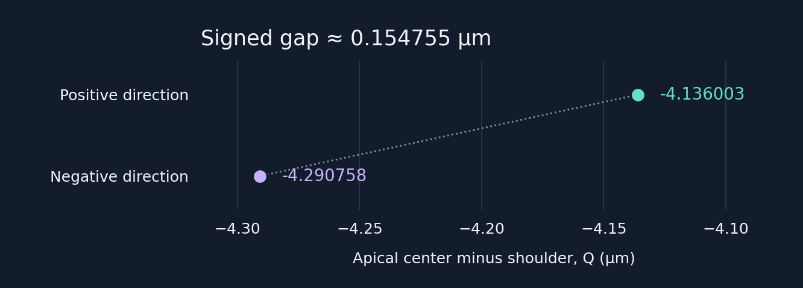

# Observer comparisons at 36 cached-quadrature equilibria

Both frozen parameter choices satisfy all 68 primary small-region comparisons at the same conditional allowance of **5.389835674801 µm**. They still differ on the model’s large-region apical contrast. The certified positive-direction minus negative-direction gap is **[0.15475515644, 0.15475515689] µm**. [Independent observer readback](../observer_application_v1/independent_readback/receipt.json)

## Calibration and prediction

Each candidate contributes 17 small-region equilibria and one large-region equilibrium. At each small state the primary observer compares maximum shortening, disk-averaged shortening and the separate apical and basal spatial maxima on a fixed region in current radius.

| Frozen candidate | Primary comparisons within allowance | Large-region Q (µm) |
| --- | --- | --- |
| Positive direction | 68 / 68 | [-4.13600326187, -4.13600326142] |
| Negative direction | 68 / 68 | [-4.29075841832, -4.29075841830] |

The smallest slack across all 136 comparisons is about **0.004812538323 µm**. It occurs at the negative-direction L state for region-averaged shortening. Slack is the frozen allowance minus the upper endpoint of the absolute residual interval.

The plot marks the centers of the enclosures. The certified intervals are narrower than the plot resolution. The large observable **Q = Zₐ(0) − Zₐ(Rₛ)** compares the apical height on the axis with the height at the same fixed current shoulder radius Rₛ in each field. Both Q values are negative. The signed gap is positive because the positive-direction candidate has the higher Q. These values are model predictions at the prescribed large input.

## From a root bound to an observer bound

Let **e** be the certified root error measured from the verification center in dimensionless free coordinates. Let **ξ** be the original binary storage gap between the exact nodal sum and the saved coordinates. For verification at the original center, each nodal coordinate differs from the archived field by at most **33.5(e + ξ) µm**. For the two recentered fields, positive E and negative K, the actual binary center shift **σ** gives the bound **33.5(σ + e + ξ) µm**. The comparison uses the original saved observer and the original ξ in both cases.

A strictly positive radial derivative bound and fixed axis and rim radii keep the quadratic traces invertible over the same region. The nodal error bounds the apical and basal heights at fixed current radius. Their error bounds add for total shortening. Each component maximum uses its own surface bound. The bound on Q adds the axis-node vertical error and the same-radius apical shoulder error. Every comparison uses the worst absolute residual over the full inflated interval. [Observer transfer method](../observer_application_v1/METHOD.md)

## Dependence on observer convention

The primary convention uses current-radius disk weighting and spatial maxima for the separate components. In the earlier stored-field comparison, the three alternate conventions each exceeded the same frozen allowance for the pair.

| Alternate stored-field convention | Required common allowance, approximately |
| --- | --- |
| Disk weighting, component regional means | 6.576090 µm |
| Radial-line weighting, component spatial maxima | 6.191999 µm |
| Radial-line weighting, component regional means | 6.191999 µm |

The allowance is a chosen model discrepancy bound. Its calibration as experimental noise and the experimental observation mapping remain unresolved. This comparison covers fixed states of the finite, cached-quadrature model. Exact-spatial integration has separate certificates for four fixed-input equilibria and minima. The full 36-state exact-spatial observer comparison, loading-path validity, continuum adequacy and novelty remain open. [Alternate-observer review](../../../observer_robustness/independent_actual/receipt.json) · [Four exact-spatial certificates](../../exact_targets_v1/four_spatial_checkpoint_v1/SPATIAL.html)
