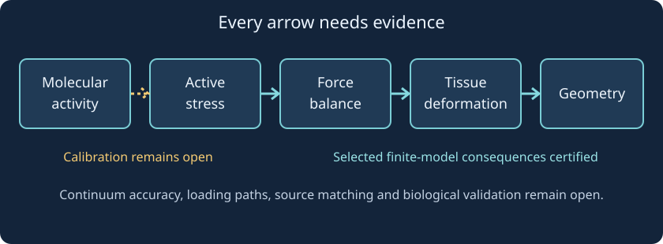

# Development journey: from Tsimerman's challenge to an auditable tissue model

**Publication record: 20 November 2026.** This account reconstructs earlier research phases from charters, reports, and retained evidence. The latest numerical checkpoint and publication work have direct verification receipts. It is a research history, not a complete transcript of private conversations. No personal biography, contact details, private workspace identifiers, or local computer paths are included.

## 1. The video: increase the ambition, preserve the standard of proof

The starting point was Jacob Tsimerman's Golden Gate Institute video. In the closing section, around 8:22–8:39, the retained caption record attributes to him a prediction of dramatically accelerated mathematical progress. Around 8:57–9:28, he asks whether stronger AI should change the ambitions of researchers and the practical boundaries between mathematics, physics, chemistry, and biology. Around 9:36–9:56, he extends that invitation to philosophical questions.

> we have to start revisiting how ambitious we are with our science

[Watch the closing argument from 8:57](https://www.youtube.com/watch?v=kbzIVh405r8&t=537s). [Caption provenance and attribution limits](TALK-PROVENANCE.md).

These statements supplied motivation. They were predictions and opinions, not results established by this project. “Tsimerman barriers” is an informal description of disciplinary boundaries; it is not the name of a mathematical conjecture that this study has proved.

The scientific interpretation was concrete: attempt an explicit chain from molecular activity to stress, from stress to tissue motion, and from motion to geometry. Each arrow needs independently constrained inputs, a mathematical model, and a meaningful observable. An AI system can help calculate a missing consequence; calculation cannot replace a missing measurement.

## 2. From a broad research program to embryonic geometry

An earlier, separate program investigated finite reserves, sensing, repair, and survival. Its stochastic and thermodynamic results remain in [Finite Reserve Survival](https://az9713.github.io/finite-reserve-survival/). Those results do not constitute evidence for the tissue model developed here.

The new program asked: “Explain how an embryo acquires its geometry.” The initial surviving charter, dated 18 November 2026, selected early quail gastrulation and a published mechanochemical baseline. Its proposed test was to constrain a feedback law using available observations and predict a changed intervention without supplying future geometry as input. The scope included a 15-step verification plan, with three-dimensional folding as a later milestone. [Initial research charter](../CHARTER.md). [Historical evidence ledger](JOURNEY-EVIDENCE.json).

The original ambition was not simply to draw an embryo-shaped surface. The intended bridge was:

Reporter intensity, molecular activity, active stress, velocity, and accumulated deformation are different quantities. Several reconstructed from the same movie are statistically dependent. A supplied final deformation cannot serve as a legitimate initial condition for a claimed forecast of that deformation.

## 3. The first limits: reproduction, available data, and causal interpretation

The published avian baseline could be executed, but the strict serialized-reference comparison did not pass. Runs in two DOLFIN environments differed from archived fields. A supplied-initial-mesh diagnostic improved initial agreement; later discrepancies remained associated with regenerated meshes. This localized part of the software discrepancy without establishing a unique cause or falsifying the biological model.

An endpoint response analysis also produced useful predictive scores, but its inputs included measured endpoint deformation. It therefore supported a conditional association, not a forecast of future embryonic shape from molecular initial conditions. A later planar mask forecast failed its locked affine-versus-persistence criterion in the detached example.

Those outcomes mattered to the research direction. The records did not support collapsing an entire embryo into one calibrated, causally identified, three-dimensional prediction pipeline. The project retained the failed criteria and narrowed the next computational question. The historical reconstruction above is supported by the charter and archived findings; the curated public release does not contain the complete older avian simulation record. [Archived avian findings](ARCHIVED-AVIAN-FINDINGS.html). [Evidence and coverage limits](JOURNEY-EVIDENCE.json).

## 4. Why controlled tissue folding became the next test

The subsequent controlled-furrowing study used published optogenetic experiments in Drosophila epithelia. Light provides a specified intervention on contractility. The practical question became: can measurements from a small activated patch constrain a model sufficiently to predict a larger patch without condition-specific refitting?

This was an experimental route toward embryonic geometry. Its results do not amount to a theory of the whole embryo. The model contains a finite-height tissue body, two opposed epithelial faces called apical and basal, bulk elasticity, surface energies, a fixed activation mask, and a prescribed contractile drive. A finite-height formulation was chosen because a thin-sheet approximation would need justification at the relevant activation sizes.

The reduced mechanical energy has the schematic form

\[
E(u;\theta,I)=E_{\mathrm{bulk}}(u;\theta)+E_{\mathrm{surface}}(u;\theta)+gI\,V(u).
\]

Here the finite-element displacement vector is \(u\), the chosen material parameters are \(\theta\), and the imposed dose is \(I\). This is a prescribed constitutive model. It does not derive active stress from molecular chemistry. [Model and assumptions](../controlled_furrowing/docs/AXISYMMETRIC-MODEL.html). [Five-gate execution contract](../controlled_furrowing/PLAN.md).

The five gates separated originality, actual data feasibility, adequate mechanics and identifiability, frozen prediction, and contribution assessment. A completed numerical calculation was never sufficient to pass all five.

## 5. Calibration exposed the role of the observer

The scalar reproduction was useful as a benchmark, but published work had already demonstrated size-dependent furrowing and basal mechanical effects. Those ideas were removed from any novelty claim. The first coupled spatial model did not improve the declared larger-region scalar proxy comparison over a simple linear comparator. Later source analysis showed that several compared summaries were not sufficiently matched to support a direct biological falsification.

The revised study explicitly distinguished regional averaging, spatial maxima, radial-line weighting, and disk-area weighting. These operations need not commute. A model can pass one convention and fail another even when its computed field is unchanged. Source timing, reference geometry, tracked regions, specimen associations, and uncertainty therefore became part of the scientific question rather than hidden preprocessing choices. [Source observation contract](../controlled_furrowing/docs/JOINT-OBSERVATION-CONTRACT.html). [Originality audit](../controlled_furrowing/docs/ORIGINALITY.html).

Two frozen material choices were then studied within the same law. They give larger-patch apical contrasts separated by approximately **0.154755 micrometres**. Both contrasts have the same sign. The calibration allowance, approximately **5.3898 micrometres**, is a declared model-discrepancy allowance; it has not been established as experimental noise. A small numerical separation does not establish an experimentally discriminating measurement.

## 6. Turning approximate fields into mathematical certificates

The finite axisymmetric displacement space has 611 free coordinates. A solver's small residual is useful, but it does not by itself establish a nearby root. The project therefore developed validated bounds on a Newton-like map. The decisive sufficient inequalities have form

\[
Z<1,\qquad \eta+Zr<r.
\]

The radius is \(r\), the preconditioned center residual is bounded by \(\eta\), and the derivative of the map is bounded by \(Z\) throughout the same cube. Under the stated domain and matrix premises, contraction supplies a unique nearby finite-dimensional equilibrium. A separately checked matrix-positivity premise establishes strict local minimality in that displacement space.

The work kept two targets separate: the cached binary quadrature potential and the exactly spatially integrated finite-element potential. Neither is the continuum PDE. Signed integral-minus-cache contributions were retained before norms were taken, allowing cancellations that coarse absolute-value bounds had lost. Independent implementations checked local interval components, their assembly, global bounds, and the error transfer to the original stored observers.

**At this release, 16 of 36 selected outcome fields have independently verified exact-spatial equilibria and axisymmetric finite-space minima.** The 14 certified small fields pass all 56 primary comparisons. Across the three alternative conventions, 155 comparisons pass and 13 violate the same allowance. The remaining 20 small fields and 80 primary inequalities are not yet certified. [Latest proofs, figures, and receipts](../controlled_furrowing/runs/transfer_ambiguity_nonlinear_probe_v1/certification_design/exact_targets_v1/remaining32_bridge_v1/remaining28_preparation_v1/waves/wave_03/checkpoint_v1/REPORT.html).

## 7. What went wrong, and what the failures changed

### Interval coefficients were discarded unsafely

One earlier polynomial helper used an uncertain comparison with zero to decide whether to retain a coefficient. For an Arb ball containing zero and nonzero values, equality and inequality tests need not behave as logical complements. A nonzero possible coefficient could be discarded, invalidating an enclosure. Affected integration receipts were withdrawn. The correction removes a term only when it is certified exactly zero, rejects nonfinite coefficients, and uses adversarial checks and fresh independent calculations. Agreement with old numbers was not used to rehabilitate the old proof. [Corrected arithmetic and retained withdrawal](../controlled_furrowing/docs/SAFE-INTEGRATION-REPLAY.html).

### An enclosing-box failure was almost stronger than its evidence

For a K–L loading pilot, the full rectangular hull of an exact secant predictor failed sufficient geometry tests: 20 elements lacked a positive Jacobian bound, and 34 lacked a positive strong-monotonicity bound. These were failures of an enclosure, not witnesses of inversion or a broken physical branch.

Keeping the original dose interval, predictor, and corrector radius, four closed subintervals passed the tested body and bulk-logarithm guards. Independent implementations reproduced the bounds. Surface and cached analytic domains, uniform force/Hessian estimates, contraction, and same-root junctions remain necessary. Geometry across the interval does not establish a loading branch. [Whole-span and segmented results](../controlled_furrowing/runs/transfer_ambiguity_nonlinear_probe_v1/certification_design/exact_targets_v1/remaining32_bridge_v1/remaining28_preparation_v1/waves/wave_03/checkpoint_v1/REPORT.html).

### Metadata and rendering checks also rejected real mistakes

An observer replay rejected incomplete phase metadata with the message “genuinely observed same later observer.” The observation record was corrected after preserving the failed attempt; the verifier and scientific values were unchanged. A report renderer then rejected a new document because an older helper expected exactly three display equations: “expected all inline and display expressions.” The new renderer counts every equation in the source and strictly compiles all 24 expressions. The old helper was preserved. Browser tests then checked the rendered equations and assets at desktop and mobile widths. Publication checks also exposed two legacy unit-typography errors. Their HTML unit notation was normalized to standard TeX, with the changes logged and original Markdown retained; numerical values were unchanged.

### Novelty language needed correction

Literature comparison showed that same-law parameter ambiguity, intervention-based discrimination, optimal experimental design, and compression-driven surface instability already have substantive precedents. More sophisticated certification did not establish a new general concept. The contribution language was narrowed to the specific model, assumptions, results, and limits. Originality remains a separate, unresolved assessment. [Claim-by-claim follow-up](../controlled_furrowing/runs/transfer_ambiguity_nonlinear_probe_v1/originality_followup/README.md).

## 8. A new adequacy test changed the interpretation

The strongest recent diagnostic asks whether an axisymmetric minimum remains a minimum when angular disturbances are allowed. The total surface-stress coefficient is

\[
\tau_s=K_s(J_s-1)+T_s.
\]

At each of the certified K and L fields, two independent calculations found **58 strictly negative whole windows**, **276 nonnegative windows**, and **two unresolved windows** among 336 tested surface windows. Negative windows lie on the apical face. The bounds include the certified uncertainty in the finite-element root.

For the documented natural three-dimensional extension without surface bending, an annular axial disturbance with angular harmonic \(m\) has second variation

\[
D^2E[v_m,v_m]=\frac{\pi}{S}(C_0+m^2C_2).
\]

A sufficiently thin support near a strict compressive patch makes \(C_2<0\); sufficiently large integer \(m\) then gives energy descent. This establishes a limitation of the enlarged idealized energy at the certified revolved fields. The finite axisymmetric minimum certificates retain their stated scope.

It does not establish a continuum equilibrium, a measured tissue instability, an unstable biologically resolved wavelength, or a stable alternative shape. The mathematical construction may use scales outside a cell-level continuum approximation. Bending, a declared cutoff, and finite-wavelength tests therefore matter. The generic negative-surface-tension mechanism is established prior work. [Derivation](../controlled_furrowing/runs/nonaxisymmetric_adequacy_audit_v1/READBACK.md). [Independent exact window receipt](../controlled_furrowing/runs/nonaxisymmetric_surface_sign_preparation_v1/independent_actual_readback.json). [Binysh, Wilks and Souslov](https://arxiv.org/abs/2101.04006).

## 9. Toolchain, evidence, and public delivery

| Method or tool | Role in this work | What its success does not establish |
|---|---|---|
| Finite elements and numerical solvers | Proposed tissue fields and sensitivity calculations. | A continuum solution or biological fit. |
| Exact rationals and Arb interval arithmetic | Outward bounds and strict inequalities under frozen assumptions. | Validity of an incorrect interval algorithm or an unmeasured input. |
| Separate AI-assisted production and checking | Different polynomial, assembly, and scalar-replay implementations. | External expert review or freedom from shared conceptual errors. |
| Matplotlib and exact CSVs | Figures tied to retained numerical bounds. | Scientific significance from visual appearance alone. |
| Strict static KaTeX rendering | Accessible equations that display without page JavaScript. | Mathematical correctness of their content. |
| Playwright and Edge | Desktop/mobile rendering, assets, and link checks. | Scientific validation. |
| Git, manifests, and committed-archive checks | Identifiable source snapshots and byte integrity. | Reproduction of omitted raw computations. |

The earlier publication inventory contained about 5.36 GB of local controlled-furrowing material. The curated public snapshot preserves eligible source and scientific receipts, lists omitted raw artifacts, and distinguishes document-only portability edits from original mathematical data. The public summary replay checks file integrity, links, four new root certificates' scalar arithmetic, 64 observer comparisons, 672 stress classifications, and six segmented-body slots. The complete historical raw-integration and process-observation closure is not supplied by that lightweight replay. [Manifest](../PUBLICATION_MANIFEST.json). [Omissions](../PUBLICATION_OMISSIONS.json). [Publication checks](../verify_publication.py).

The public repository starts with clean publication history and uses a nonpersonal commit identity. Private paths, correspondence drafts, and private workspace references are excluded. No authors were contacted. Reliable monetary cost totals and a complete per-stage model/version log are not available in the released record; no cost claim is made.

## 10. Where the journey stands

The computational bridge from a chosen mechanical law to selected finite-dimensional geometry is much better specified than at the start. The observation contract, biochemical calibration, complete admissible parameter set, loading accessibility, continuum accuracy, and experimental validation remain open. The complete five-gate study and the broader 15-step program remain incomplete.

The strongest next scientific question is whether a feasible additional measurement or intervention makes a larger-fold prediction reliable across the compatible parameter and nuisance set. That direction requires its own originality audit, physical scale limits, and measurement-error budget. It is not a new concept merely because it is the next item in this project.

Tsimerman's challenge increased the ambition. The practical lesson of this journey is that stronger computation makes assumptions and failure modes more inspectable; it does not remove the need for observations, physical adequacy, or independent assessment of originality.

## 11. Making the shape explicit and choosing the next theorem

On 21 November 2026, the project added a [canonical shape guide](SHAPE-DESCRIPTION.html). It connects a finite-height material deformation to its apical/basal surfaces, metric, area, curvature, angular modes and declared observables. Three analytic teaching figures show a circular depression, an asymmetric deformation with the same annular mean contrast, and a flat patch rolled without intrinsic stretching. Their formulas establish illustrative geometric facts, not force-balanced tissue predictions or new biological findings. The guide separates the general embedding framework from the current axisymmetric implementation and explains topology, contact, growth, cellular and resolution limitations. Future scientific shape documents must explain their representation or refer to this guide.

The [next research plan](../controlled_furrowing/research_directions/regularization_shape_v1/PLAN.html) asks whether coarse fold geometry remains reliably predictable after fine surface corrugations are admitted. It includes a standard isolated-surface relaxation derivation, a virtual-work correction that could test old fields, and a conditional observable-error inequality. The fixed-height injective bulk recovery theorem, useful observable-growth constant and biological applicability are research targets, not completed results. A [bounded originality audit](../controlled_furrowing/research_directions/regularization_shape_v1/LITERATURE-AUDIT.json) records substantive prior art and outstanding theorem-level comparisons. The plan explicitly accepts a rigorous obstruction as an alternative outcome.

This release publishes explanations, visuals and a research plan; it does not add exact root certificates or complete the five gates. [Source provenance and verification limits](PUBLICATION-UPDATE-20261121.md).
