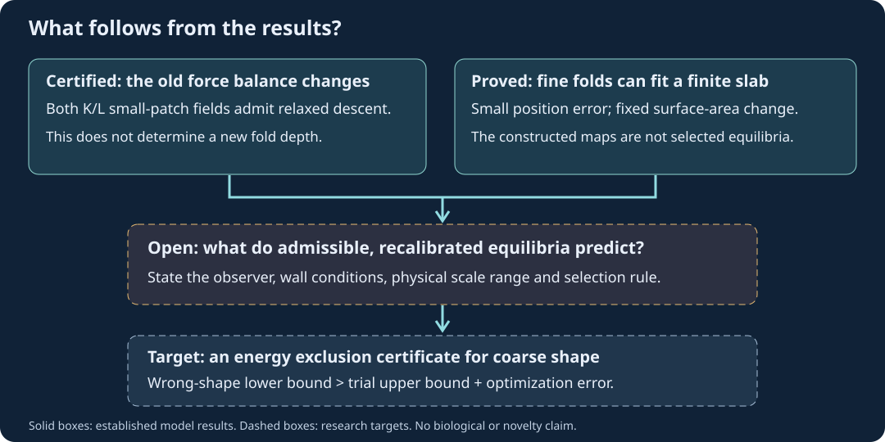
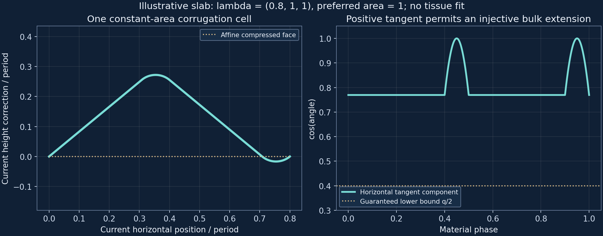

# What the results mean for embryonic shape

**Assessment: 21 November 2026.** Based on the [executed results](../controlled_furrowing/research_directions/relaxed_slab_execution_v1/REPORT.html) and [complete slab proof](../controlled_furrowing/research_directions/relaxed_slab_execution_v1/THEOREM.html), published at revision `e0f482d8360f547d0fb301c9b76ba45849b4f891`. This page interprets those results and proposes the next research target. It adds no computed tissue equilibrium, experimental result or confirmed originality claim.

**Shape convention:** see [How we describe tissue shape mathematically](SHAPE-DESCRIPTION.html). Shape is a material deformation into three-dimensional space. The current tissue calculation restricts that map to axisymmetry; the recovery theorem instead uses a separate affine-periodic slab. Neither is a model of an entire developing embryo.

## The answers in three sentences

The results show that omitted surface relaxation can invalidate the force balance of our certified tissue fields, and that a finite-height body can accommodate fine surface folds with vanishing position error. They establish a concrete mathematical model-adequacy diagnostic and a scoped constructive theorem, but no confirmed new general concept or embryological law. The strongest next target is a **certified bound, or a physically admissible failure of such a bound, for a specified coarse fold measurement after relaxation and calibration are treated consistently**.

## 1. What we have learned about shape

### Force balance is sensitive to the surface law

The original energy permits a compressive surface stress. Replacing that density by its candidate compression-relaxed version changes the first variation. At each of the two certified K/L fields there is a fixed admissible radial finite-element variation with strictly negative relaxed virtual work. The rigorous reduced enclosures are

\[
I_K\in[-0.001129,-0.000978],\qquad
I_L\in[-0.001180,-0.001028].
\]

Thus the old fields are not stationary for the candidate new energy even within the old axisymmetric finite space. The original equilibrium certificates remain valid for their original energy. **A change of constitutive law requires a new equilibrium calculation and a recheck of the calibration fit.** It does not by itself show that the previously fitted material parameters must change.

These are **small-patch calibration cases**, `optoGEF2_small_col_K` and `optoGEF2_small_col_L`, at two doses. They are not the two held-out large-patch fields. The [scope readback](../controlled_furrowing/research_directions/relaxed_slab_execution_v1/scope_readback.json), [Arb enclosure](../controlled_furrowing/research_directions/relaxed_slab_execution_v1/virtual_work_radial_2048.json) and [separate directed-integer replay](../controlled_furrowing/research_directions/relaxed_slab_execution_v1/virtual_work_integer_recentered_4096.json) identify the inputs and signed bounds.

### A nearly unchanged position can conceal a finite area change

For a compressed free face of the periodic affine slab, write the base area stretch as \(j_0\) and the preferred area stretch as \(j^*>j_0\). The construction gives globally injective maps with

\[
\|y_b-y_0\|_\infty\le C_y b^{1/3}\longrightarrow0,
\qquad J_s[y_b]\equiv j^*>j_0=J_s[y_0].
\]

The surface area stretch therefore differs by a fixed amount even while the positions converge uniformly. In this construction the bulk gradients converge strongly in every finite \(L^p\), but the face tangents keep oscillating. There is no contradiction: convergence of positions does not control surface derivatives.

In physical terms, an unresolved corrugated surface can look smooth in its coarse position while carrying a different area and stress. This is a mathematical possibility established in the stated slab class, not evidence that an actual embryo occupies these configurations. The construction's period is a device for proving an upper bound, not a predicted biological wavelength.

### Neither fact yet determines fold depth

For fixed reference regions of interest \(A_1,A_2\) on the apical face, a possible coarse observable is

\[
Q(y)=\frac1{|A_1|_0}\int_{A_1}y_3\,dA_0
     -\frac1{|A_2|_0}\int_{A_2}y_3\,dA_0.
\]

This is the guide's material-ROI mean-height contrast, with inner-minus-outer sign if the regions are a central patch and surrounding annulus. It is not a spatial maximum, a current-area-weighted mean or an unspecified image measurement. Physical height is obtained using the declared reference length scale.

The certified variation is radial and leaves nodal heights unchanged. Hence its instantaneous change of this fixed material height observable is zero. Relaxed forces could subsequently couple radial motion to vertical motion, but that response has not been solved. Conversely, the slab construction preserves the coarse position of a chosen affine comparator; it does not prove that actual energy minimizers preserve its coarse shape.

A transparent algebraic illustration makes the logical gap explicit. Let the old energy be \(E_{\rm old}(r,z)=r^2+z^2\), and change it to

\[
E_c(r,z)=(r-a)^2+(z-cr)^2,\quad a>0.
\]

At the old equilibrium the radial derivative is \(-2a<0\) and the height derivative is zero for every \(c\). The new minimizer is \((a,ca)\): its height stays zero when \(c=0\) and changes when \(c\ne0\). The same radial descent fact permits both outcomes. This example is a logical illustration, not a tissue model or a new scientific result.

## 2. Which disciplinary barriers have moved?

| Connection | What is now established | What remains missing |
|---|---|---|
| Mathematics to specified mechanics | A signed, whole-root-box force diagnostic; an explicit injective slab construction with determinant and energy bounds | Full curved-cylinder relaxation, global competing branches and observable bounds |
| Mechanics to geometric observations | A precise distinction between position, area, surface tangents and a declared height contrast | A certified relaxed equilibrium prediction for a matched measured observable |
| Cell chemistry to stress | A prescribed activation-dependent mechanical potential remains an assumption | A measured biochemical-to-force constitutive map, energetic accounting and appropriate response timing |
| Tissue mechanics to embryonic development | The work identifies a failure mode that a predictive tissue model must address | Cell rearrangement/growth, dynamic branch selection, biological validation and whole-embryo geometry |

In the spirit of the disciplinary challenge that motivated the project, the advance is that assumptions and their consequences are more testable. No barrier between chemistry and biology, or between a tissue-patch model and a developing embryo, has been overcome by these results.

## 3. Have we established a conceptually new result?

**No confirmed new general concept has been established.** There are specific proved/certified statements in this project. Their truth and their originality are separate questions.

The literature refresh below checks nearby primary sources. It is bounded: selected full-text sections and abstracts, not a complete theorem-by-theorem priority review. Absence of an identified exact match is not evidence of novelty. The [retained search and comparison record](RESULTS-LITERATURE-AUDIT.json) states the inspection limits.

| Source | Existing contribution relevant here | Consequence for our claims |
|---|---|---|
| [Conti, DeSimone and Müller, 2005](https://people.sissa.it/~desimone/Publications/CDM2005.pdf), Section 3.1 | Smooth fine folds, boundary-layer matching and energy-scaling constructions in compressed sheets | Fine folds and recovery/scaling arguments are established methods. Our fixed-height slab guards require a precise comparison; a different exponent notation is not novelty. |
| [Binysh, Wilks and Souslov, 2022; preprint version 2021](https://arxiv.org/html/2101.04006v2), continuum theory and Methods | Active negative surface tension, competition with bulk elasticity, and stabilization by surface bending or bulk dispersion | Surface stress can select shape, and regularization matters, are established ideas. |
| [Andrenšek, Ziherl and Krajnc, 2023](https://arxiv.org/abs/2210.11883), abstract | A cell-based epithelial elasticity theory with differential apico-basal-tension-driven wrinkles | Epithelial wrinkling itself is not our discovery. |
| [Kružík and Mainini, 2025](https://doi.org/10.1007/s00332-025-10156-5), introduction and main-results description | Bulk-surface elasticity for nonsimple materials and a rigorous small-strain Gamma-convergence/linearization analysis | Rigorous bulk-surface limits already exist. Its second-gradient/small-strain setting must be compared with our first-gradient fixed-strain, vanishing-bending target; different hypotheses alone do not prove originality. |
| [Becker and Rannacher, 2001](https://www.cambridge.org/core/journals/acta-numerica/article/abs/an-optimal-control-approach-to-a-posteriori-error-estimation-in-finite-element-methods/5C67A03F528C6FA69F37A97DF5C3BE19), publisher abstract | Error control tailored to an observable through dual-weighted residuals | An adjoint or goal-oriented error estimate is an established technique. |
| [Kreutz, Raue and Timmer, 2012; preprint 2011](https://arxiv.org/abs/1107.0013), abstract | Prediction-focused uncertainty/observability analysis distinct from parameter identifiability | Predictability despite uncertain parameters is an established inference question. Our proposed deterministic energy profile is not a statistical confidence interval. |

The closest next contribution would be a materially useful theorem or counterexample about **coarse fold predictability in a fixed-height, injective, boundary-constrained active body**, with explicit errors and consistent calibration. That is a candidate to investigate, not a cleared novelty claim. Interfacial quasiconvexity and nonlinear bulk-surface relaxation references cited by Kružík and Mainini remain important theorem-level comparison leads. Earlier project work already studied calibration/transfer ambiguity in restricted models; repeating that ambiguity in new notation is insufficient.

## 4. The strongest next target: exclude wrong coarse shapes by energy

Freeze the actual reference cylinder, its wall clamp, activation, constitutive family, material ROIs and length normalization. Let \(\mathcal A\) be the declared admissible class of injective three-dimensional maps with positive determinant and enough face regularity for bending. Define the objective curvature-regularized energy \(E_b\), and the candidate comparison energy

\[
\widehat E(y)=\int_\Omega W(X,\nabla y)\,dX
 +\sum_s\int_{\Gamma_{s,0}}\psi_{s,\mathrm{rel}}(J_s[y])\,dA_0.
\]

For the present surface law, \(\psi_{s,\mathrm{rel}}\le\psi_s\), and bending is nonnegative. Therefore the pointwise comparison

\[
\widehat E(y)\le E_b(y)
\]

is immediate on the common admissible class. It does **not** establish a Gamma-liminf inequality at a weak limit, lower semicontinuity, existence of minimizers or that this is the full effective energy. Those are different questions.

For a target value \(q_0\) and a predeclared scientifically meaningful tolerance \(d>0\), seek two certificates:

\[
E_b(z_b)\le U_b,\quad z_b\in\mathcal A,
\]

\[
L(d)\le\inf_{\substack{y\in\mathcal A\\|Q(y)-q_0|\ge d}}
                   \widehat E(y).
\]

The first is an admissible competitor and energy upper bound. The second is a lower bound for every excluded coarse shape, not merely for axisymmetric perturbations of one equilibrium.

**Conditional exclusion proposition, a standard variational argument.** If

\[
L(d)>U_b+\eta,
\]

then every \(\eta\)-global-near-minimizer of \(E_b\) has \(|Q(y)-q_0|<d\). Here global near-minimality means \(E_b(y)\le\inf_{\mathcal A}E_b+\eta\), not a small force residual.

**Proof.** Such a map has \(E_b(y)\le E_b(z_b)+\eta\le U_b+\eta\). If its observable were excluded, then \(E_b(y)\ge\widehat E(y)\ge L(d)>U_b+\eta\), a contradiction. This argument does not require an attained global minimizer or a complete Gamma-limit theorem. The hard research is obtaining useful cylinder-specific bounds on the full stated class, not this elementary implication.

An equivalent stronger growth assumption would be \(\widehat E(y)\ge m+c|Q(y)-q_0|^p\), together with a recovery upper bound \(U_b\le m+\delta_b\). It would imply

\[
|Q(y)-q_0|\le[(\delta_b+\eta)/c]^{1/p}.
\]

If a future cylinder construction supplied \(\delta_b=O(b^{1/3})\) and a proved quadratic observable gap supplied \(p=2\), the conditional rate would be \(O(b^{1/6})\) for zero optimization error. **Neither premise has been proved for the tissue cylinder.** The slab exponent alone cannot produce this conclusion. A local positive finite-element Hessian is not a global continuum observable gap.

## 5. The first executable milestone and its verification gates

1. **Audit the exact target against existing theorems.** Compare domain, fixed versus vanishing body thickness, admissible topology/injectivity, wall conditions, bulk density, surface law, regularization, observables and quantitative constants. Retain a claim-by-claim table, including any result that makes the target a direct corollary. No publication-priority language before this audit.
2. **Compute the full relaxed force correction and its coupling to the height observable.** On a differentiable admissible local continuation of the old finite-element root, set \(E_t=E_{\rm old}+t(\widehat E-E_{\rm old})\). With \(H=D^2E_{\rm old}(y_*)\), \(r=D\widehat E(y_*)-DE_{\rm old}(y_*)\) and \(H^Tz=DQ(y_*)^T\), differentiation gives

\[
\left.\frac{dQ(y_t)}{dt}\right|_{t=0}=-z^Tr.
\]

This requires the full correction vector, an invertible constrained Hessian, and justified branch differentiability; the one certified radial component is insufficient. Enclose the adjoint solve and remainder, verify compression-switch handling, and certify any continuation used. A nonzero slope is a finite-space local response at fixed parameters, not yet a biological or endpoint prediction. An interval containing zero is inconclusive. Even an exactly zero initial slope does not imply no endpoint change: the earlier quadratic example under this energy interpolation has

\[
z_t=\frac{t^2ca}{1+c^2t(1-t)},\qquad z'_0=0,\qquad z_1=ca.
\]

Thus the continuation and its observable remainder matter even when the initial adjoint response vanishes.

3. **Recheck and, if necessary, refit the small-patch calibration.** Use the new energy's actual equilibria, unchanged declared data and ROI/time/discrepancy contracts. Prove the data-compatible parameter set is nonempty. An empty set rejects that model/contract; it does not establish transfer nonidentifiability. The old approximately 5.3898-micrometre discrepancy allowance is a declared allowance, not measured experimental noise. Without justified observations the conclusion remains conditional on that contract.
4. **Prove the wall-compatible finite-b competitor and the coarse-shape exclusion bound.** Extend the slab construction to an explicitly controlled curved/nonuniform cylinder base, check injectivity and positive determinant globally, and retain all wall/collar/curvature errors. Obtain a certified lower bound outside the allowed height interval. A finite-element lower bound has finite-space scope until unresolved continuum and angular competitors are controlled. A failed exclusion bound is inconclusive; a real negative result needs two certified, admissible, calibration-compatible near-minimizing states with coarse predictions separated beyond the declared errors.
5. **Quantify which missing physics or observation matters.** Uniformity over a predeclared parameter/regularization family needs the same resource, geometry and observation conventions and bounds valid for every admitted member. A state-selection rule is necessary if real loading follows metastable local minima rather than global near-minima. If ambiguity persists, propose a specific added observable and prove that it excludes the conflicting certified alternatives.

The recommended immediate calculation is step 2 after the focused audit: a validated **observable response**, followed by the calibration recheck. The ambitious theorem is step 4. An actual novel result would require the mechanics and quantitative conclusion to add something beyond the standard adjoint and variational arguments written here.

## 6. Physical and scientific stopping criteria

The mathematical small-b limit must be distinguished from a biological scale window. If \(L_0\varepsilon\) is the construction period, a continuum interpretation needs a justified separation from cell scale and the coarse observation scale, as well as space for the bulk collars:

\[
\ell_{\rm cell}\ll L_0\varepsilon\ll\ell_{\rm ROI},
\qquad 2CL_0\varepsilon<H_{\rm physical}.
\]

The period bound is not a selected physical wavelength. Sending bending to zero eventually violates a fixed cellular cutoff. No present calculation establishes that the required biological window exists or supplies a measured bending coefficient.

**A meaningful positive result:** a useful error interval for the specified coarse observable, under full declared admissibility and consistent calibration, robust over a physically defended finite scale range. **A meaningful negative result:** certified indistinguishable calibration observations but distinguishable large-fold predictions within that same defended class, together with the missing datum or mechanism causing the failure. Both need separate closest-theorem comparison before being called novel.

The present work makes the mechanics-to-geometry question more precise. The next decisive result must connect the newly admitted mechanics to an observable; biological validity and chemistry-to-stress inference still require their own evidence.

## Evidence and reading order

Start with the [shape guide](SHAPE-DESCRIPTION.html), then the [executed report](../controlled_furrowing/research_directions/relaxed_slab_execution_v1/REPORT.html), [full slab proof](../controlled_furrowing/research_directions/relaxed_slab_execution_v1/THEOREM.html) and [development journey](DEVELOPMENT-JOURNEY.html). The [new interpretation verification](../verification/site/shape-interpretation-20261121/assessment.json) binds this page's local evidence and bounded literature audit. The [earlier scientific release receipt](../verification/site/executed-slab-20261121/COMPLETION.json) records the completed steps; this explanatory update does not increase their certificate counts.
