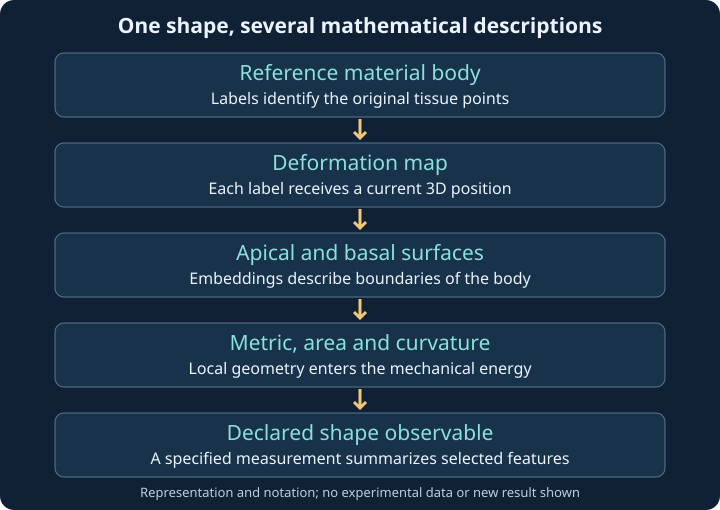
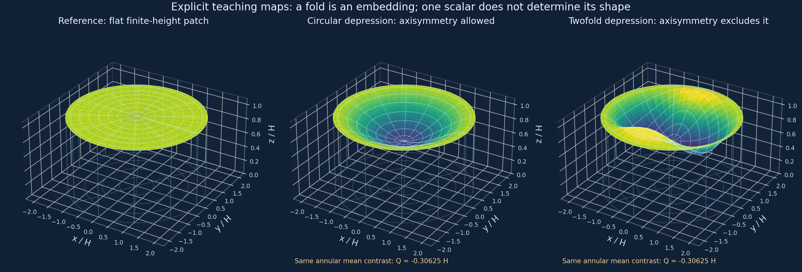
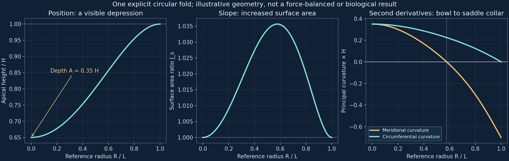
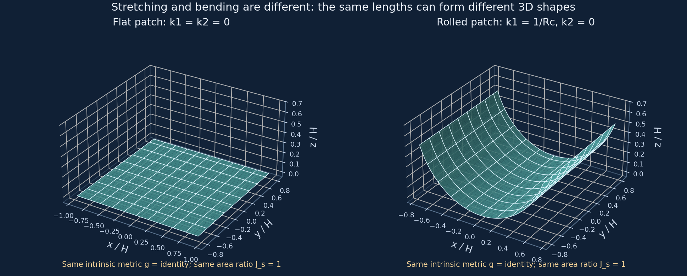

# How we describe tissue shape mathematically

**Canonical shape guide · 21 November 2026.** This document consolidates the project's mathematical shape explanation. It is a guide to representation and notation, not a new research result. Future scientific documents should explain their shape convention or link here before using it.

We describe a shape by a map assigning a three-dimensional position to every material point of the tissue. From that map we extract surfaces, lengths, areas, curvature, folds and wrinkles. A coarse measurement summarizes selected aspects of this geometry; it does not specify the entire shape.

## 1. The entire tissue: a deformation map

Start with a reference body \(\Omega_0\). A simple declared geometry is the finite cylinder

\[
\Omega_0=\{(X_1,X_2,Z):X_1^2+X_2^2<R_o^2,\ 0<Z<H\}.
\]

This is a model reference configuration, not automatically a measured or stress-free embryo. A material point \(X\in\Omega_0\) moves to

\[
y(X)=X+u(X)\in\mathbb R^3,
\]

where \(u\) is its displacement. The deformed body occupies \(y(\Omega_0)\). Including time gives \(y(X,t)\), but representing time does not supply a dynamical law; the current equilibrium calculations are static fixed-input problems.

The map contains more information than a visible outline. It records which original material region moved where, so it can describe stretching and cell-associated observations. Two maps can have the same geometric image while assigning material points differently; that distinction matters mechanically.

The deformation gradient and local volume ratio are

\[
F=\nabla_X y,\qquad J=\det F.
\]

The matrix \(F\) describes local stretch, shear and rotation. The scalar \(J\) compares current to reference volume: \(J=1\) means local volume preservation. Positive \(J\) prevents local orientation reversal, but does not by itself prove global noninterpenetration. Global injectivity or an appropriate contact/noninterpenetration condition is a separate requirement.

Boundary conditions are part of the problem. A lateral clamp restricts admissible maps and fixes a spatial frame. A continuous embedding of a fixed reference body preserves its topology; rupture, fusion and pinch-off require a richer formulation. Cell-neighbour rearrangements are a separate issue from the topology of the whole body: their coarse deformation can be represented, but their cellular mechanism is not specified by this map alone.

## 2. The surfaces: parametric geometry

In the flat-reference convention used here, the apical and basal faces have embeddings

\[
x_a(R,\theta)=y(R\cos\theta,R\sin\theta,H),
\]

\[
x_b(R,\theta)=y(R\cos\theta,R\sin\theta,0).
\]

The labels \((R,\theta)\) identify reference material points; the values \(x_a,x_b\) are their current positions. A parametric embedding can describe curved surfaces and overhangs. A height graph \(z=h(x_1,x_2)\) is a useful special case only while the chosen projection remains single-valued.

The two faces do not independently determine every internal strain. The full body map is still needed to calculate bulk mechanics. Thickness also needs an explicit definition: distance along a material fiber, separation at a common current radius, vertical height difference, and shortest normal distance are generally different quantities.

## 3. Our existing restriction: axisymmetry without swirl

The present mechanical computation uses

\[
y(R,\theta,Z)=
\begin{pmatrix}
r(R,Z)\cos\theta\\
r(R,Z)\sin\theta\\
z(R,Z)
\end{pmatrix}.
\]

Here uppercase \(R,Z\) denote reference cylindrical coordinates, while lowercase \(r,z\) denote current radius and height. Two scalar functions determine the three-dimensional body by revolution. They can describe axisymmetric depressions, bulges and annular folds, but cannot predict angular lobes or distinguish two unequal in-plane embryo directions.

In cylindrical orthonormal bases, off the axis,

\[
F=\begin{pmatrix}
r_R&0&r_Z\\
0&r/R&0\\
z_R&0&z_Z
\end{pmatrix},\qquad
J=\frac rR(r_Rz_Z-r_Zz_R).
\]

The hoop stretch \(r/R\) is essential. Axis regularity supplies its limiting value as \(R\to0\); the apparent division must not be evaluated naively at the axis. Some older project documents interchange uppercase and lowercase radius labels. Compare reference and current meanings, rather than letter case alone.

In the existing finite-element model, \(r\) and \(z\) are expanded in piecewise-quadratic basis functions on a meridional mesh. A stored field, an exact equilibrium in that finite space, and a continuum equilibrium are different mathematical objects. The current root/minimum certificates retain their finite-space and symmetry restrictions.

See the [axisymmetric model](../controlled_furrowing/docs/AXISYMMETRIC-MODEL.html) and [whole-body geometry proof](../controlled_furrowing/docs/ROOT-BODY-GEOMETRY.html) for implementation and certificate details. Those are dated technical records, not substitutes for the latest coverage ledger.

## 4. Geometry itself: metric, area and curvature

For either smooth surface \(x(\xi^1,\xi^2)\), let \(x_{,\alpha}\) denote its two tangent vectors. The metric is

\[
g_{\alpha\beta}=x_{,\alpha}\cdot x_{,\beta}.
\]

It determines distances and angles along the surface. The current area element and reference-to-current area ratio are

\[
da=\sqrt{\det g}\,d\xi^1d\xi^2,
\qquad J_s=\sqrt{\frac{\det g}{\det g_0}},
\]

where \(g_0\) is the reference metric in the same coordinates. These formulas apply in regular coordinate charts. Polar coordinates are singular at the axis even when the physical surface is smooth.

With a chosen unit normal \(n\), define the second fundamental form

\[
b_{\alpha\beta}=n\cdot x_{,\alpha\beta}.
\]

The principal curvatures \(k_1,k_2\) are the eigenvalues of \(g^{-1}b\). The mean and Gaussian curvatures are

\[
H_{\rm mean}=\frac{k_1+k_2}{2},\qquad K_{\rm G}=k_1k_2.
\]

Here \(H_{\rm mean}\) is distinct from reference tissue height \(H\), and \(K_{\rm G}\) is distinct from a surface elastic modulus. Reversing the normal changes both principal-curvature signs and the mean-curvature sign, while leaving Gaussian curvature unchanged.

| Curvature pattern | Local geometric interpretation |
|---|---|
| \(k_1k_2>0\) | Bowl-like or dome-like, depending on orientation and surroundings |
| \(k_1k_2<0\) | Saddle-like |
| One principal curvature is approximately zero | Approximately cylindrical bending |

A local curvature classification does not determine the complete global fold. Curvature-squared bending energies require suitable second-derivative regularity. A continuous piecewise-quadratic surface can have tangent jumps between elements; its piecewise curvature is not automatically a valid global curvature-squared energy.

## 5. Angular modes: extending beyond axisymmetry

For a sufficiently small disturbance that remains a normal graph over a smooth axisymmetric surface, write locally

\[
x(R,\theta)=x_0(R,\theta)
 +\sum_{m\ge1}[a_m(R)\cos(m\theta)+b_m(R)\sin(m\theta)]n_0(R,\theta).
\]

The functions \(a_m,b_m\) are displacement amplitudes. Mode \(m\) has angular period \(2\pi/m\); larger mode numbers describe finer angular structure. At current radius \(r>0\), the corresponding circumferential period on the axisymmetric background is \(2\pi r/m\).

This is a local surface representation, not a complete displacement space for the solid. A mechanical stability calculation must include all relevant vector components, extend variations through the bulk, respect axis regularity and boundary conditions, and account for the modes not computed. A normal graph also ceases to describe arbitrary large deformations or topology changes.

## 6. Fine wrinkles can have small height and large geometric effects

Locally, a short-wavelength disturbance has the schematic form

\[
x_\varepsilon(s)=\bar x(s)+\varepsilon f(s/\varepsilon)n_0.
\]

For a smooth bounded periodic profile, its displacement amplitude is \(O(\varepsilon)\), its first-derivative disturbance can remain \(O(1)\), and its second derivatives can grow as \(O(\varepsilon^{-1})\). In a regular graph setting this permits curvature of that order.

Thus surfaces can converge uniformly in position while their slopes fail to converge strongly. They can look nearly identical at coarse resolution but retain different areas, stresses and bending costs. This explains why convergence of visible height alone is insufficient to justify a mechanical limit.

“Coarse shape” needs a declared averaging operator or measurement scale. It is not automatically obtained by omitting high modes from an old equilibrium. Whether the relaxed system retains the old large-scale fold is an open question in the proposed research.

## 7. Observables: reducing a shape to something measurable

One possible coarse measurement is a material-ROI height contrast,

\[
Q(y)=\frac1{|A_1|}\int_{A_1}y_z\,dA_0
 -\frac1{|A_2|}\int_{A_2}y_z\,dA_0.
\]

For example, \(A_1\) can be a central reference patch and \(A_2\) a surrounding reference annulus. The vertical coordinate is measured in the declared spatial frame. A common vertical translation cancels in this contrast, but a changed frame or ROI convention can change its interpretation.

Other observables include a full surface profile, an area-weighted mean, an extremal shortening, principal curvatures, angular-mode amplitudes or a contour distance. Reference-material ROIs, current-spatial ROIs, line weighting and area weighting need not agree. For a time-dependent surface, taking a temporal maximum before spatial averaging need not agree with averaging before the maximum.

A value of \(Q\) summarizes a feature; it does not reconstruct the complete shape or uniquely identify material parameters. An experimental label such as “furrow” must be mapped to a precise observable before comparison.

The [next-result plan](../controlled_furrowing/research_directions/regularization_shape_v1/PLAN.html) asks whether a declared coarse observable remains quantitatively predictable when finer admissible wrinkles are restored. Its proposed continuum and observable-stability theorems remain unproved.

## 8. Why choose this description? A concrete fold

A tissue has finite thickness. Its top, bottom and interior must move consistently; a surface outline alone does not specify that motion. A body map gives the material correspondence and the deformation gradient needed for stresses. Its surface traces then give the geometric features observed in images. Defining these quantities from one map enforces geometric compatibility automatically, rather than choosing unrelated stretches, areas and curvatures.

This is why the deformation map is the central object. The axisymmetric restriction is an additional computational choice: it makes circular-patch mechanics tractable, while retaining thickness, hoop stretch and coupling to a surrounding annulus. It does not establish that an actual embryonic fold has rotational symmetry. The flat reference and lateral clamp are declared idealizations whose adequacy must be tested.

Take a reference disk of radius \(L\) and height \(H\), and set

\[
\phi(R)=\left(1-\frac{R^2}{L^2}\right)^2,\qquad
r=R,\qquad
z=Z-A\phi(R)\left(\frac ZH\right)^2.
\]

This explicit teaching map has a fixed basal face, a depressed apical face, and a fixed outer wall. It is not a computed equilibrium, fit, or claim that a real basal face is clamped. Its apical profile is

\[
f(R)=H-A\phi(R).
\]

The parameter \(A\) is the central depression depth. The radial profile \(\phi\) sets how the depression joins the outer rim. The material grid shows which reference points have moved.

The illustration uses \(H=1\), \(L=2\), \(A=7/20\). Coordinates are normalized by \(H\). All three surfaces are explicit teaching geometries, not biological predictions or outputs of the project's force law.

**Admissibility can be proved directly.** In Cartesian coordinates the first two components are unchanged, so the gradient is triangular and

\[
J=\frac{\partial z}{\partial Z}
 =1-\frac{2AZ}{H^2}\phi(R)
 \ge 1-\frac{2A}{H}>0\qquad (A<H/2).
\]

Every vertical material fiber remains strictly monotone, and different fibers have different horizontal positions. The map is therefore globally injective. With the illustrated parameters the uniform determinant bound is \(3/10\). This example includes volume compression; it is not an incompressible tissue solution.

### Position, slope and curvature describe different features

For this profile, with upward normal,

\[
f'=\frac{4AR}{L^2}\left(1-\frac{R^2}{L^2}\right),\qquad
f''=\frac{4A}{L^2}\left(1-\frac{3R^2}{L^2}\right).
\]

The surface-area ratio and principal curvatures are

\[
J_s=\sqrt{1+f'^2},\qquad
k_r=\frac{f''}{(1+f'^2)^{3/2}},\qquad
k_\theta=\frac{f'}{R\sqrt{1+f'^2}}.
\]

At the axis the continuous limit gives \(k_r=k_\theta=4A/L^2\). The feature-to-mathematics correspondence is explicit:

| Visible or mechanical feature | Mathematical quantity in this example |
|---|---|
| How far the center has sunk | \(H-f(0)=A\) |
| Local vertical material thickness | \(f(R)\), because the bottom remains at zero |
| How steep the fold wall is | \(f'(R)\) |
| How much apical surface area is stretched | \(J_s(R)\) |
| Bending in a radial section | \(k_r(R)\) |
| Bending around a circular ring | \(k_\theta(R)\) |
| Orientation-preserving volume change | \(J(R,Z)\) |

Two instructive consequences follow. First, this depression has \(J_s\ge1\): it stretches the apical surface because horizontal positions were held fixed. A depression does not automatically mean apical area contraction. Second, \(k_r\) changes sign at \(R=L/\sqrt3\), while \(k_\theta>0\) for \(0<R<L\). The globally bowl-like fold therefore has a saddle-like outer collar. Local Gaussian curvature and the global label “bowl” describe different things.

### A single mean measurement can miss an obvious shape difference

Choose \(A_1\) as the central reference disk \(R\le L/4\), and \(A_2\) as the reference annulus \(3L/4\le R\le L\). Using reference-area weighting, their mean \(\phi\) values are \(721/768\) and \(49/768\), respectively. Thus

\[
Q=\langle f\rangle_{A_1}-\langle f\rangle_{A_2}
 =-\frac78 A=-\frac{49}{160}H
\]

for the illustrated depth. Now add a twofold angular variation to the full teaching map,

\[
z=Z-A\phi(R)\left[1+\beta\frac{R^2}{L^2}\cos(2\theta)\right]
 \left(\frac ZH\right)^2.
\]

The factor \(R^2\cos(2\theta)=X_1^2-X_2^2\) is regular at the axis. At \(\beta=4\), the deformation stays injective: the maximum shortening coefficient is \(125A/108\), so the same monotone-fiber argument gives \(J\ge41/216>0\) for the illustrated parameters.

The circular and twofold surfaces visibly differ, yet their \(Q\) values are exactly equal because \(\int_0^{2\pi}\cos(2\theta)\,d\theta=0\). This particular full-annulus mean is blind to the added mode. A spatial maximum or an angularly localized ROI need not be blind. This is an illustrative observation limitation, not a claim that both teaching maps satisfy the project's experimental calibration data.

### Why the metric alone cannot tell us the 3D shape

Compare a flat patch with a rolled cylindrical patch:

\[
x_{\rm flat}(s,t)=(s,t,0),\qquad
x_{\rm roll}(s,t)=\left(R_c\sin\frac{s}{R_c},\ t,\ R_c\left[1-\cos\frac{s}{R_c}\right]\right).
\]

On a suitable non-overlapping parameter interval, both have \(g=\operatorname{Id}\) and \(J_s=1\). The rolled patch has principal curvatures \(1/R_c,0\), while the flat patch has zero curvature. Distances and areas can stay unchanged as a surface bends. A surface energy depending only on area cannot distinguish these two embeddings; the full bulk energy or a bending energy can distinguish them.

## 9. Limitations: which embryonic shapes and processes are excluded?

There are three different restrictions to distinguish: the general map, the chosen reference topology, and the current axisymmetric constitutive computation. A representation can admit a geometry even when the chosen force law cannot predict its formation.

| Geometry or process | General 3D embedding with a suitable reference body | Present circular axisymmetric model |
|---|---|---|
| Circular depression, bulge or annular fold | Yes, subject to admissibility | Representable; biological adequacy still requires testing |
| Elongated furrow, bilateral shape, off-axis lobe or asymmetric fold | Yes, if topology is preserved | Excluded by rotational symmetry |
| Helical or chiral geometry | Often representable with suitable reference topology | Excluded; zero-swirl kinematics also omit material torsion even when the visible outline stays circular |
| Smooth overhang or deep invagination without fusion | A parametric embedding can represent it | Axisymmetry alone does not exclude every meridional overhang, but a height graph, radial-monotonicity guard or small normal-graph approximation can exclude it |
| A hollow closed epithelial vesicle | Representable when the reference body is already an appropriate shell | Cannot be created from the chosen solid cylinder by one embedding |
| Formation of a new sealed cavity, fusion, rupture or pinch-off | Not as a smooth topology-preserving evolution of the same reference body | Not described |
| Branched bud or outgrowth | Can preserve topology and be represented; branching is not automatically a topology change | Nonaxisymmetric branching is excluded |
| Cell divisions, intercalation and neighbour exchanges | Coarse motion can be represented; cellular events need additional state and evolution rules | Their cellular mechanism is absent |

**Topology is the genuine geometric obstruction.** For a compact reference closure, a continuous injective map is a homeomorphism onto its image. The solid reference cylinder has one connected boundary. A material shell enclosing a sealed cavity has an inner and an outer boundary. No such embedding can change the number of boundary components. A deep open invagination can therefore be represented while sealing it into a new lumen cannot be achieved within that same fixed embedding class. A suitable shell reference can describe a hollow final shape, but it does not explain how the cavity formed from a solid reference.

Matching topology is necessary, not a complete reachability test. Boundary conditions, admissibility throughout a trajectory and the embedding class can prevent passage between two shapes even when each endpoint has an acceptable parametrization. A static representation is not a proof of a developmental path.

**Contact and fusion are different.** Strict injectivity on the closed body excludes two distinct boundary points occupying the same position. A nonpenetrating contact formulation can permit boundary contact while retaining distinct material labels. Fusion creates new tissue connectivity and needs an adhesion/reconnection rule beyond contact. Neural tube closure is a concrete embryonic example in which epithelial zippering establishes connectivity between apposed sheets; bending alone is not the whole process. [Primary experimental study of epithelial zippering](https://www.repository.cam.ac.uk/items/fa1c26d5-e8c6-434f-8810-518dc50fdfeb).

**Growth is not geometrically forbidden.** A map can describe an enlarging shape, and a continuum can represent a coarse flow associated with intercalation. But deformation alone specifies neither mass production, changing stress-free geometry, remodelling nor cell-neighbour connectivity. Those require additional balance laws or internal variables. The topology of a cell-contact network is not the same as the topology of the whole tissue body. [Cellular contributions to tissue deformation](https://doi.org/10.1103/PhysRevE.95.032401).

**Smoothness and resolution matter.** A smooth embedding does not directly describe a sharp crease tip, a singular pinch, or unresolved cellular interfaces. Weak maps and contact mechanics can describe more, but then curvature, energy and admissibility must be redefined carefully. A finite mesh and a finite angular-mode truncation omit smaller structures. No continuum wrinkle prediction is biologically justified below its established validity scale.

**The force law is a further limitation.** The current energy assumes a particular elastic bulk, area-dependent face energies, prescribed fiber direction and fixed activation. It supplies no complete growth, viscoelasticity, cellular remodelling, adhesion, lumen-fluid pressure or chemistry-to-stress law. General 3D kinematics can admit many shapes that this particular physical model does not generate. Equilibrium geometry also does not determine the developmental path, its speed, or which metastable branch is reached.

For our immediate research, retain the deformation-map framework and progressively enlarge the angular space and justify small-scale mechanics. Change topology or add cellular descriptions only when the biological question requires those processes. The present project is a local mechanics-to-geometry study, not a complete representation of whole-embryo development.

## 10. What every future shape document should state

Explain these conventions directly or link to the relevant sections of this guide before the main argument:

1. The reference body and material versus spatial coordinates.
2. The shape representation and any symmetry, graph or topology restrictions.
3. The meaning of stretching, area, thickness and curvature used in the energy.
4. The exact observable, ROI, averaging order and time convention.
5. The scope of a claim: stored field, finite-dimensional equilibrium, continuum result or biological observation.

This description connects mechanics to geometry. It does not by itself explain how molecular activity generates stress, how an embryo selects a developmental trajectory, or whether the chosen constitutive law is biologically adequate.
